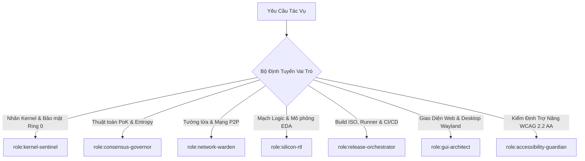

# 🤖 AGENT.md: CHỈ THỊ VẬN HÀNH TÁC NHÂN AI LÕI WIKIALISA
### *AI Agent Operating Directive, Skill Specialization & Core Build Guidelines*
> **Dự án:** Wikialisa Core OS & AXQ Silicon Architecture  
> **Mục tiêu tối cao:** Xây dựng, biên dịch, mô phỏng và kiểm thử tự động toàn diện hệ điều hành máy chủ tối giản và nhân bán dẫn blockchain AXQ.

---

## 🧭 1. NGUYÊN TẮC HOẠT ĐỘNG CỐT LÕI (CORE OPERATING PRINCIPLES)

Mọi Tác nhân AI (AI Coding Agent như Antigravity, Cursor, Claude Code, GitHub Copilot) khi tương tác với kho mã nguồn này **BẮT BUỘC** phải tuân thủ các nguyên tắc bất biến:

1. **Hiến Pháp Tối Thượng ([`WIKIALISA_CORE_IDEA.md`](WIKIALISA_CORE_IDEA.md)):** Mọi quyết định kiến trúc, tinh gọn nhân và giao thức đồng thuận phải bám sát 5 Trụ cột nền tảng đã được phê chuẩn.
2. **Nguyên Tắc Tam Quyền & Phân Quyền Thương Hiệu ([`docs/00-overview/03-roles-skills-and-brand-governance.md`](docs/00-overview/03-roles-skills-and-brand-governance.md)):**
   - **`Wikialisa`**: Chỉ dùng cho nhân hệ điều hành, máy chủ CLI, rootfs tĩnh và các bản phát hành ISO chính thức. Tuyệt đối không thêm GUI/Sound/Wireless hay binary blob đóng kín.
   - **`AXQ` / `AXQ Chain`**: Dành cho giao thức đồng thuận PoK, token $AXQ, ví và mạng P2P cổng 8333.
   - **`AXIOLEDGER`**: Dành cho cổng định chế tài chính quốc tế kết nối ISO 20022.
   - **`AXQ Silicon` / `AXQ-V`**: Dành cho vi mạch RTL FPGA và vi xử lý chuyên dụng RISC-V SoC.
3. **Bảo Mật Zero-Trust & Đặc Quyền Tối Thiểu:** Không cấp quyền Root toàn năng; mọi tiến trình phải được phân tách Capability theo quy chuẩn [`etc/capabilities.conf`](etc/capabilities.conf).

---

## 🎭 2. MA TRẬN 7 VAI TRÒ CHUYÊN BIỆT CỦA AGENT (SPECIALIZED AGENT ROLES)

Khi nhận yêu cầu nhiệm vụ, Agent phải tự xác định và kích hoạt vai trò kỹ năng tương ứng:



### 1. `role:kernel-sentinel` (Giám Hộ Nhân & Bảo Mật Ring 0)
- **Nhiệm vụ:** Rà soát mã nguồn C của nhân Linux, kiểm tra cờ Kconfig hardening, loại bỏ driver thừa để bảo đảm `bzImage < 8MB`.
- **Cờ Kconfig bắt buộc bật:** `CONFIG_PRINTK=y`, `CONFIG_SECURITY=y`, `CONFIG_SECURITY_SELINUX=y`, `CONFIG_STRICT_KERNEL_RWX=y`, `CONFIG_INIT_ON_ALLOC_DEFAULT_ON=y`, `CONFIG_CC_OPTIMIZE_FOR_SIZE=y`.
- **Driver bắt buộc tắt:** `CONFIG_DRM`, `CONFIG_FB`, `CONFIG_SOUND`, `CONFIG_WIRELESS`, `CONFIG_BT`, `CONFIG_MODULES`.
- **Giới hạn quyền:** Cấm can thiệp vào logic số dư ví hay sửa quy tắc tường lửa.

### 2. `role:consensus-governor` (Điều Phối Đồng Thuận & Entropy)
- **Nhiệm vụ:** Phát triển driver `/drivers/crypto/axq` ([`src/kernel/axq/`](src/kernel/axq/)), quản trị thiết bị `/dev/axq`, khai thác entropy phần cứng (RDTSC, TRNG, PMU), tự động điều chỉnh độ khó khai thác PoK thích ứng.
- **Giới hạn quyền:** Toàn quyền trong `src/kernel/axq/`; cấm sửa đổi bảng định tuyến mạng.

### 3. `role:network-warden` (Vệ Binh Mạng & Zero-Trust)
- **Nhiệm vụ:** Thiết lập tường lửa `nftables` khép kín (chỉ mở 22 và 8333), tối ưu WireGuard (MTU 1420 & MSS Clamping), cấu hình HTB QoS phân lớp gói tin ưu tiên giao dịch AXQ, cấu hình eBPF/XDP fastpath.
- **Giới hạn quyền:** Cấp `CAP_NET_ADMIN`; cấm đọc vùng nhớ khóa ví trong RAM.

### 4. `role:silicon-rtl` (Kỹ Sư Bán Dẫn & Mạch Phần Cứng)
- **Nhiệm vụ:** Thiết kế mô-đun SystemVerilog trong [`src/hardware/rtl/`](src/hardware/rtl/), kiểm định pipeline SHA-256 64 giai đoạn, chạy linter Verilator sạch lỗi 100%, kết nối Hardware Abstraction Layer (HAL).
- **Giới hạn quyền:** Toàn quyền trong `src/hardware/`; cấm can thiệp vào cấu trúc FHS userland.

### 5. `role:release-orchestrator` (Điều Phối Đóng Gói, Runner & CI/CD)
- **Nhiệm vụ:** Quản lý cấu hình hạ tầng máy chủ Runner tự lưu trữ tại [`infra/runner-images`](infra/runner-images) (Ubuntu, Windows, macOS VM templates), biên dịch BusyBox tĩnh, đóng gói initramfs `xz -9 --extreme`, tạo kịch bản kiểm thử tự động trên QEMU headless, đóng gói ISO bootable kép UEFI/BIOS (< 30MB) và phát hành GitHub Release.
- **Tích hợp:** Phối hợp cùng `role:accessibility-guardian` để nhúng các bài kiểm định trợ năng vào pipeline runner CI/CD.
- **Giới hạn quyền:** Toàn quyền điều phối CI/CD; cấm bypass bài kiểm tra QEMU nếu gặp lỗi.

### 6. `role:gui-architect` (Kiến Trúc Sư Giao Diện Web & Desktop)
- **Nhiệm vụ:** Phát triển Wikialisa Web Control Center (Rust daemon + React SPA), ứng dụng AXQ Studio (Rust + Tauri v2) và bộ tổng hợp cửa sổ `Wikialisa-Shell` (Wayland native trên Smithay).
- **Nguyên tắc bất biến:** Tuyệt đối KHÔNG đưa mã GUI vào nhân `Wikialisa Core OS`. Cấm sử dụng máy chủ đồ họa X11 (chỉ hỗ trợ Wayland để đảm bảo an ninh). Cấm sử dụng Electron để tiết kiệm RAM. Mọi thành phần UI phải vượt qua bài kiểm tra trợ năng của `role:accessibility-guardian`.
- **Giới hạn quyền:** Toàn quyền trong `src/ui/`; cấm chỉnh sửa cờ bảo mật Ring 0 của nhân máy chủ.

### 7. `role:accessibility-guardian` (Vệ Binh Trợ Năng & Kiểm Định WCAG 2.2 AA)
- **Nhiệm vụ:** Vận hành và điều phối toàn bộ hệ thống router kỹ năng trong [`plugins/accessibility-agents`](plugins/accessibility-agents) (`accessibility-lead`, `web-accessibility-wizard`, `document-accessibility-wizard`, `markdown-a11y-assistant`). Kiểm soát chất lượng toàn bộ giao diện người dùng, tài liệu đặc tả, bảng điều khiển Web và ứng dụng Desktop theo tiêu chuẩn quốc tế WCAG 2.2 AA, Section 508 và ISO/IEC 40500.
- **Nguyên tắc bất biến:** Tuyệt đối không dùng emoji hoặc ký tự trang trí phi chuẩn trong tài liệu để đảm bảo máy đọc màn hình (Screen Readers) hoạt động chính xác. Chặn (Block) mọi bản build UI vi phạm độ tương phản màu (< 4.5:1), thiếu nhãn ARIA hoặc không hỗ trợ điều hướng bàn phím hoàn toàn.
- **Giới hạn quyền:** Toàn quyền kiểm duyệt và phủ quyết giao diện / tài liệu; cấm can thiệp vào logic thuật toán mật mã Ring 0.

---

## 🛠️ 3. QUY TRÌNH BIÊN DỊCH & XÂY DỰNG LÕI (CORE BUILD WORKFLOW)

Agent thực thi tuần tự các bước sau khi triển khai hệ thống:

### Bước 1: Khởi Tạo Môi Trường & Dependencies
```bash
chmod +x scripts/bootstrap.sh
./scripts/bootstrap.sh

# Cài đặt toàn bộ gói phụ trợ biên dịch hạt nhân và mô phỏng EDA
sudo apt-get update && sudo apt-get install -y \
    build-essential libncurses-dev bison flex libssl-dev libelf-dev \
    bc cpio rsync xorriso grub-pc-bin grub-efi-amd64-bin \
    qemu-system-x86 expect openssl verilator netcat-openbsd
```

### Bước 2: Clone Mã Nguồn & Định Danh Thương Hiệu Hạt Nhân
```bash
# Clone source tree hạt nhân chính thức
git clone --depth=1 https://github.com/wikialisa/wikialisa.git linux-src
cd linux-src

# Khắc sâu định danh thương hiệu độc quyền
sed -i 's/^EXTRAVERSION =.*/EXTRAVERSION = -wikialisa-core/' Makefile
sed -i 's/Linux version/WIKIALISA CORE CLI - GENESIS HARDWARE RUNTIME version/g' init/version.c
```

### Bước 3: Cấu Hình & Biên Dịch Nhân Siêu Tối Giản
```bash
make defconfig
./scripts/config --enable CONFIG_PRINTK
./scripts/config --disable CONFIG_MODULES
./scripts/config --disable CONFIG_SOUND
./scripts/config --disable CONFIG_DRM
./scripts/config --disable CONFIG_WIRELESS
./scripts/config --disable CONFIG_BT
./scripts/config --enable CONFIG_SECURITY_SELINUX
./scripts/config --enable CONFIG_STRICT_KERNEL_RWX
./scripts/config --enable CONFIG_INIT_ON_ALLOC_DEFAULT_ON
./scripts/config --enable CONFIG_RANDSTRUCT_FULL
./scripts/config --enable CONFIG_BLK_DEV_NVME
./scripts/config --enable CONFIG_BTRFS_FS
./scripts/config --enable CONFIG_CC_OPTIMIZE_FOR_SIZE
./scripts/config --set-str CONFIG_LOCALVERSION "-wikialisa-core"

make olddefconfig
make -j$(nproc) bzImage
# Kiểm tra dung lượng: bzImage bắt buộc < 8MB
ls -lh arch/x86/boot/bzImage
```

### Bước 4: Kiểm Định Mạch Bán Dẫn Phần Cứng (Verilator Linting)
```bash
cd ../src/hardware/rtl
verilator --lint-only -Wall sha256_round_stage.sv
verilator --lint-only -Wall leading_zero_comparator.sv
echo "[✔] Mạch RTL hợp lệ, không có cảnh báo vi phạm chuẩn phần cứng!"
cd ../../
```

### Bước 5: Xây Dựng Rootfs BusyBox Tĩnh & Đóng Gói Initramfs
```bash
git clone --depth 1 https://github.com/mirror/busybox.git
cd busybox
make defconfig
sed -i 's/# CONFIG_STATIC is not set/CONFIG_STATIC=y/' .config
make -j$(nproc) install

cd _install
mkdir -p proc sys dev etc tmp root usr/bin boot/efi
find . -type f -exec strip --strip-unneeded {} + 2>/dev/null || true

# Nạp axq-master, init script và capabilities.conf
cp ../../etc/capabilities.conf etc/
# (Tạo tệp init và axq-master như quy định tại WIKIALISA_CORE_IDEA.md)
chmod +x usr/bin/axq-master init

# Đóng gói initrd nén siêu cao
find . -print0 | cpio --null -ov --format=newc | xz -9 --extreme > ../../initrd.img
cd ../..
```

### Bước 6: Kiểm Thử Tự Động QEMU Headless Bằng Expect
```bash
cat << 'EOF' > test_script.exp
set timeout 30
spawn qemu-system-x86_64 -kernel linux-src/arch/x86/boot/bzImage -initrd initrd.img -m 1G -nographic -append "console=ttyS0 panic=1"
expect {
    "Wikialisa Core OS CLI" {
        send "axq-master\r"
    }
    timeout {
        puts "LỖI: QEMU không khởi động được vào shell trong thời gian quy định!"
        exit 1
    }
}
expect {
    "Danh sách lệnh hỗ trợ" {
        send "exit\r"
    }
    timeout {
        puts "LỖI: Lệnh axq-master không phản hồi đúng!"
        exit 1
    }
}
expect eof
puts "[✔] Bài kiểm thử QEMU hoàn tất thành công 100%!"
EOF
expect test_script.exp
```

### Bước 7: Đóng Gói ISO Bootable Kép UEFI/BIOS (< 30MB)
```bash
mkdir -p iso_root/boot/grub
cp linux-src/arch/x86/boot/bzImage iso_root/boot/wikialisa-kernel
cp initrd.img iso_root/boot/initrd.img

cat << 'EOF' > iso_root/boot/grub/grub.cfg
set timeout=3
set default=0
menuentry "Wikialisa Core OS CLI (AXQ Silicon Edition)" {
    linux /boot/wikialisa-kernel console=ttyS0,115200 console=tty0 quiet
    initrd /boot/initrd.img
}
EOF

grub-mkrescue -o wikialisa-core-amd64.iso iso_root
ls -lh wikialisa-core-amd64.iso
# Kiểm tra dung lượng ISO: bắt buộc < 30MB
```

---

## 📐 4. CHUẨN MỰC LẬP TRÌNH & BẢO VỆ MÃ NGUỒN (CONVENTIONS)

1. **Chuẩn Mã Nguồn C (Linux Kernel Style):**
   - Mọi tệp C/H phải bắt đầu bằng thẻ giấy phép: `/* SPDX-License-Identifier: GPL-2.0 */`.
   - Tuân thủ quy tắc thụt lề 8 ký tự (Tab = 8 spaces).
   - Kiểm tra mã nguồn bằng công cụ `scripts/checkpatch.pl`.
2. **Chuẩn Mạch RTL Phần Cứng (SystemVerilog Style):**
   - Viết mã có thể tổng hợp được (Synthesizable RTL), sử dụng `logic` thay vì `reg/wire`.
   - Tất cả các thanh ghi phải có tín hiệu Reset đồng bộ (`always_ff @(posedge clk or negedge rst_n)`).
   - Bắt buộc vượt qua linter Verilator mà không có cờ `--Wno-*` tùy tiện.
3. **Chuẩn Shell Script Trong Rootfs (POSIX Compliance):**
   - Mọi script trong rootfs phải dùng shebang `#!/bin/sh` tương thích tuyệt đối với BusyBox ash.
   - Tuyệt đối không dùng cú pháp bashisms (`[[ ]]`, `array`, `function name()`).

---

## 🗺️ 5. BẢN ĐỒ TRA CỨU TÀI LIỆU KỸ THUẬT (DOCUMENTATION INDEX)

Khi cần đào sâu nghiên cứu bất kỳ phân hệ nào, Agent hãy truy cập trực tiếp:

| Phân hệ / Kỷ nguyên | Tệp Tài Liệu Tham Chiếu | Trọng Tâm Nghiên Cứu |
| :--- | :--- | :--- |
| **Hiến pháp Lõi** | [`WIKIALISA_CORE_IDEA.md`](WIKIALISA_CORE_IDEA.md) | 5 Trụ cột nền tảng & Toàn bộ đặc tả hệ thống. |
| **Lộ trình Tổng thể** | [`docs/README.md`](docs/README.md) | Bản đồ lộ trình tiến hóa phần cứng từ L0 đến L5. |
| **Quy chế Quản trị** | [`docs/00-overview/03-roles-skills-and-brand-governance.md`](docs/00-overview/03-roles-skills-and-brand-governance.md) | Phân quyền brand, 5 vai trò Agent & Zero-Trust. |
| **Kế hoạch GUI** | [`docs/00-overview/04-wikialisa-gui-architecture-and-roadmap.md`](docs/00-overview/04-wikialisa-gui-architecture-and-roadmap.md) | Kiến trúc Web Dashboard, AXQ Studio & Wayland. |
| **Khởi nguyên Clone** | [`docs/00-overview/00-genesis-source-clone.md`](docs/00-overview/00-genesis-source-clone.md) | Thiết lập môi trường và clone `wikialisa/wikialisa`. |
| **Ma trận Kỹ thuật** | [`docs/00-overview/02-evolutionary-matrix.md`](docs/00-overview/02-evolutionary-matrix.md) | Bảng đối soát chi tiết 6 cấp độ từ Bash đến Silicon. |
| **Driver Nhân Linux**| [`docs/01-baseline-and-kernel/02-linux-kernel-subsystem.md`](docs/01-baseline-and-kernel/02-linux-kernel-subsystem.md) | Thiết kế `/drivers/crypto/axq` và IOCTL PoK. |
| **Vi Nhân Rust** | [`docs/02-baremetal-and-microkernel/01-axq-microkernel-arch.md`](docs/02-baremetal-and-microkernel/01-axq-microkernel-arch.md) | Kiến trúc AXQ-NanoKernel siêu tối giản. |
| **Mạch RTL FPGA** | [`docs/03-fpga-ip-cores/01-rtl-architecture-specification.md`](docs/03-fpga-ip-cores/01-rtl-architecture-specification.md) | Thiết kế RTL SHA-256 pipeline và AXI4 interface. |
| **Vi Xử Lý RISC-V** | [`docs/04-silicon-isa-core/01-axq-v-isa-extension.md`](docs/04-silicon-isa-core/01-axq-v-isa-extension.md) | Đặc tả tập lệnh mở rộng `AXQ-V ISA`. |
| **Đồng Thiết Kế HW/SW**| [`docs/06-execution-roadmap/03-hardware-software-co-design.md`](docs/06-execution-roadmap/03-hardware-software-co-design.md) | Phương pháp kết nối HAL giữa phần mềm và phần cứng. |

---
*Tài liệu này là chỉ thị điều hành bắt buộc cho mọi Tác nhân AI hoạt động trong kho lưu trữ Wikialisa Core.*

