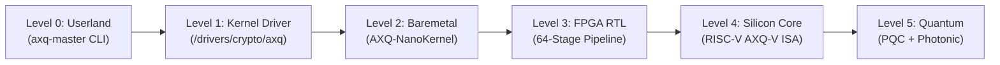

# 🏛️ WIKIALISA CORE & AXQ SILICON ARCHITECTURE
### *Next-Generation Minimalist Operating System & Hardware-Accelerated Blockchain Core*

[](https://opensource.org/licenses/GPL-2.0)
[](#)
[](docs/README.md)

---

## 📖 GIỚI THIỆU TỔNG QUAN

**Wikialisa** là dự án nghiên cứu và phát triển hệ sinh thái điện toán thế hệ mới, kết hợp chặt chẽ giữa:
1. **Hệ điều hành máy chủ dòng lệnh tối giản (Wikialisa Core CLI):** Được tùy biến và tinh gọn từ kho hạt nhân độc lập [`wikialisa/wikialisa`](https://github.com/wikialisa/wikialisa), loại bỏ toàn bộ đồ họa và subsystem không cần thiết để tối ưu hóa hiệu năng và bảo mật máy chủ.
2. **Giao thức Mạng lưới AXQ (AXIOLEDGER Protocol & AXQ Chain):** Hạ tầng đồng thuận và tài chính phi tập trung với thuật toán **Proof-of-Kernel (PoK)**, tích hợp tác nhân **AI Agent Chain** tự trị.
3. **Lộ trình Tiến hóa Phần cứng (The AXQ Silicon Core):** Đưa toàn bộ các thuật toán cốt lõi từ phần mềm người dùng (Userland Script) xuống nhân hệ điều hành (Kernel Driver), vi nhân độc lập (Bare-metal Microkernel), mạch bán dẫn FPGA (Hardware IP Core) và tiến tới **nhân vi xử lý silicon chuyên dụng (Custom RISC-V AXQ-V SoC)**.

---

## 🏁 KHỞI NGUYÊN: BẮT ĐẦU VỚI SOURCE TREE `wikialisa/wikialisa`

Hành trình xây dựng hệ thống bắt đầu bằng việc clone mã nguồn hạt nhân từ GitHub và cấu hình định danh độc quyền:

```bash
# 1. Clone source tree chính thức về thư mục cục bộ mang tên wikialisa
git clone https://github.com/wikialisa/wikialisa.git wikialisa
cd wikialisa

# 2. Khởi tạo môi trường tự động qua script bootstrap
chmod +x scripts/bootstrap.sh
./scripts/bootstrap.sh
```

> Chi tiết các bước khởi tạo thủ công và thiết lập cấu hình: xem tài liệu [docs/00-overview/00-genesis-source-clone.md](docs/00-overview/00-genesis-source-clone.md).

---

## 🗺️ MA TRẬN 5 KỶ NGUYÊN TIẾN HÓA PHẦN CỨNG



| Cấp độ | Tên thế hệ | Môi trường thực thi | Thông lượng (TPS) | Độ trễ (Latency) | Cơ chế Khóa Bí Mật |
| :--- | :--- | :--- | :--- | :--- | :--- |
| **L0** | Userland Script | Bash / OpenSSL / CLI | ~50 TPS | 20 - 50 ms | Tệp `wallet.dat` AES-256 |
| **L1** | Kernel Subsystem | Linux C Driver (`/dev/axq`) | ~2,500 TPS | 2 - 5 ms | Vùng nhớ Ring 0 Keyring |
| **L2** | Bare-metal Microkernel | Rust AXQ-NanoKernel | ~25,000 TPS | 150 µs | Hardware Enclave (SEV/SGX) |
| **L3** | FPGA Hardware IP | Xilinx UltraScale+ FPGA | ~250,000 TPS | 8 µs | BRAM mã hóa + Bitstream AES |
| **L4** | **AXQ-V Silicon Core** | **Custom RISC-V SoC** | **> 1,500,000 TPS** | **< 400 ns** | **SRAM PUF Root-of-Trust** |
| **L5** | Post-Quantum Photonic | Chip Quang tử + PQC | > 10,000,000 TPS | < 50 ns | Vân tay Silicon Kháng lượng tử |

---

## 📂 CẤU TRÚC DỰ ÁN

```text
wikialisa/
├── README.md                    # Tài liệu tổng quan dự án (Tệp này)
├── WIKIALISA_CORE_IDEA.md       # Hiến pháp & Ý tưởng thiết kế lõi Wikialisa (Hợp nhất từ DOCS & doc)
├── docs/                        # Hệ thống tài liệu kiến trúc phần cứng chuyên sâu (24 chuyên đề)
│   ├── README.md                # Bản đồ lộ trình tiến hóa phần cứng AXQ
│   ├── 00-overview/             # Khởi nguyên clone mã nguồn & Ma trận kỹ thuật
│   ├── 01-baseline-and-kernel/  # Phân tích hiện trạng, Linux Driver & Hardware PoK
│   ├── 02-baremetal-and-microkernel/ # Vi nhân Rust, Vùng nhớ Enclave, Zero-Copy XDP
│   ├── 03-fpga-ip-cores/        # Đặc tả RTL, Mật mã học phần cứng & PoK Engine
│   ├── 04-silicon-isa-core/     # Tập lệnh RISC-V AXQ-V, Vi kiến trúc AXQ-1, NPU AI Agent
│   ├── 05-post-quantum-and-future/ # Kháng lượng tử NIST PQC & Tầm nhìn Quang tử
│   └── 06-execution-roadmap/    # Lộ trình theo năm, Chuẩn EDA & Đồng thiết kế HW/SW
├── scripts/
│   └── bootstrap.sh             # Script tự động hóa kiểm tra môi trường và clone/setup
└── src/
    ├── kernel/                  # Mã nguồn Driver Linux Phase 1 (/drivers/crypto/axq)
    │   └── axq/                 # axq_main.c, axq_pok.c, axq.h, Makefile, Kconfig
    ├── hardware/                # Thiết kế mạch bán dẫn Phase 3 & 4 (SystemVerilog RTL)
    │   └── rtl/                 # axq_pok_engine.sv, sha256_round_stage.sv, TRNG
    └── hal/                     # Lớp trừu tượng phần cứng (Hardware Abstraction Layer)
        └── axq_hal.c            # Tự động nhận diện Software / Driver / FPGA / Silicon
```

---

## 🚀 HƯỚNG DẪN BẮT ĐẦU NHANH

### 1. Tra cứu Tài liệu Kiến trúc
- Bắt đầu với lộ trình tổng thể tại [docs/README.md](docs/README.md).
- Xem quy trình khởi nguyên tại [docs/00-overview/00-genesis-source-clone.md](docs/00-overview/00-genesis-source-clone.md).
- Khám phá tập lệnh vi xử lý tại [docs/04-silicon-isa-core/01-axq-v-isa-extension.md](docs/04-silicon-isa-core/01-axq-v-isa-extension.md).

### 2. Biên dịch Driver Kernel Thử nghiệm (Phase 1)
```bash
cd src/kernel/axq
make
sudo insmod axq.ko
ls -l /dev/axq
```

### 3. Mô phỏng Mạch Phần cứng PoK Engine (Phase 3)
```bash
cd src/hardware/rtl
verilator --cc axq_pok_engine.sv --exe ../testbench/tb_pok.cpp
make -C obj_dir -f Vaxq_pok_engine.mk
./obj_dir/Vaxq_pok_engine
```

---
*Phát triển bởi Đội ngũ Kỹ sư Hệ thống Wikialisa Core & AXQ Hardware Architecture Group.*

