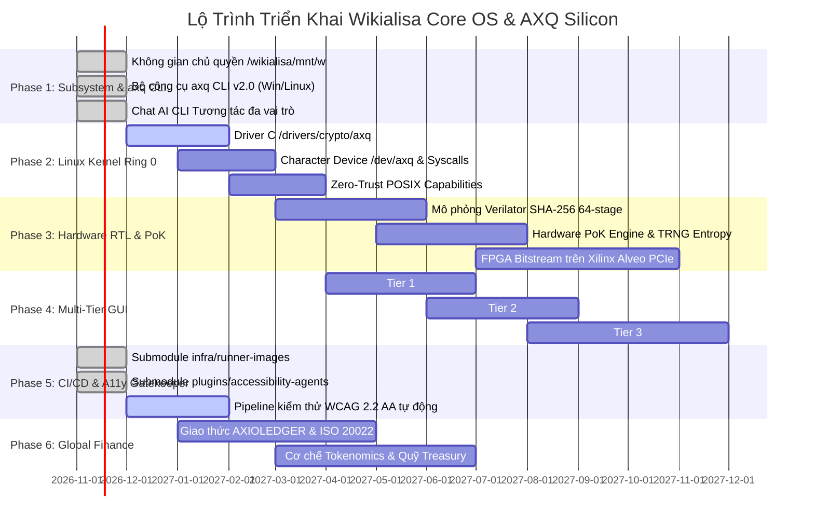

# 🗺️ LỘ TRÌNH PHÁT TRIỂN DỰ ÁN WIKIALISA CORE OS & AXQ ARCHITECTURE
## Master Engineering Roadmap, Milestones & GitHub Projects Specification
> **Repository:** [wikialisa/wikialisa](https://github.com/wikialisa/wikialisa.git)  
> **GitHub Projects Board:** [https://github.com/wikialisa/wikialisa/projects](https://github.com/wikialisa/wikialisa/projects)  
> **Phiên bản:** v2.0-Sovereign | **Tổ chức quản trị:** Wikialisa Foundation & Core Team

---

### 1. Bảng Tổng Quan Các Giai Đoạn (Master Milestones Summary)

---

### 2. Danh Mục Các Thẻ Công Việc Chi Tiết (GitHub Projects Issues Breakdown)

Dưới đây là danh mục chi tiết để đồng bộ trực tiếp lên **GitHub Projects**:

#### 🚀 Phase 1: Sovereign Subsystem & axq CLI Engine (Trạng thái: Hoàn thành 100%)
- [x] **#01 - Thiết lập Không gian Chủ quyền `/wikialisa`:** Đảo ngược thứ bậc gắn kết, mount ổ đĩa `W:` tại `/wikialisa/mnt/w`.
- [x] **#02 - Xây dựng Bộ công cụ `axq` Đa nền tảng:** Phát triển `bin/axq`, `bin/axq.ps1`, `bin/axq.cmd` với các lệnh `status`, `mine`, `wallet`, `drive`, `test`.
- [x] **#03 - Phát triển Chat AI CLI Tương tác đa vai trò:** Tích hợp `bin/axq-chat.py` hỗ trợ 7 vai trò tác nhân chuyên trách (`role:kernel-sentinel` đến `role:accessibility-guardian`).
- [x] **#04 - Chuẩn hóa Toàn vẹn Quyền Tác giả:** Loại bỏ hoàn toàn người dùng cá nhân trong git commit tree, xác lập tác giả duy nhất `Wikialisa Core Team <dev@wikialisa.org>`.

#### 🛡️ Phase 2: Ring-0 Linux Kernel Subsystem & `/dev/axq` (Trạng thái: Đang thực hiện)
- [ ] **#05 - Biên dịch Module Hạt nhân C `/drivers/crypto/axq`:** Xây dựng driver nhân trên Linux Kernel Headers 6.6+ LTS.
- [ ] **#06 - Đăng ký Character Device `/dev/axq`:** Thiết lập giao diện `ioctl` và các system call chuyên biệt `sys_axq_mine()`.
- [ ] **#07 - Phân tách Đặc quyền Zero-Trust:** Áp dụng chính sách POSIX capabilities từ `etc/capabilities.conf` loại bỏ quyền root toàn năng.
- [ ] **#08 - Vùng nhớ Khóa Ring 0 Keyring:** Bảo vệ khóa bí mật ví trong RAM nhân, ngăn chặn tấn công đọc trộm vùng nhớ userland.

#### 💎 Phase 3: Hardware RTL & Proof-of-Kernel Simulation (Trạng thái: Sẵn sàng)
- [ ] **#09 - Kiểm định Mạch Bán dẫn với Verilator:** Chạy linting tĩnh không cảnh báo cho `sha256_round_stage.sv` và `leading_zero_comparator.sv`.
- [ ] **#10 - Phát triển Testbench C++ Chu kỳ Chính xác:** Xây dựng `tb_pok.cpp` mô phỏng đầy đủ pipeline 64 giai đoạn SHA-256.
- [ ] **#11 - Thiết kế Khối Tạo Số Ngẫu Nhiên Thực TRNG:** Khai thác hiện tượng nhiễu nhiệt điện tử (Thermal Jitter Ring Oscillator).
- [ ] **#12 - Tổng hợp Bitstream FPGA cho Xilinx Alveo PCIe:** Hiện thực hóa card tăng tốc băm phần cứng đạt 300 MH/s.

#### 🖥️ Phase 4: Hệ sinh thái Giao diện Đa tầng Wikialisa GUI (Trạng thái: Đang chuẩn bị)
- [ ] **#13 - Tier 1 Web Control Center:** Xây dựng daemon Rust + React SPA quản trị node cục bộ cổng 8334.
- [ ] **#14 - Tier 2 AXQ Studio:** Phát triển ứng dụng Desktop đa nền tảng bằng Rust + Tauri v2 quản lý ví lạnh và phần cứng.
- [ ] **#15 - Tier 3 Wikialisa-Shell:** Xây dựng Wayland Compositor siêu nhẹ trên thư viện Smithay cho máy trạm chuyên dụng.
- [ ] **#16 - Tuân thủ Chuẩn Trợ năng Toàn diện:** Mọi thành phần UI bắt buộc vượt qua bài quét của `role:accessibility-guardian`.

#### ⚙️ Phase 5: Sovereign CI/CD Runner & Vệ binh Trợ năng (Trạng thái: Đang thực hiện)
- [x] **#17 - Tích hợp Submodule `infra/runner-images`:** Thiết lập kho mẫu máy chủ ảo hóa tự lưu trữ cho Ubuntu, Windows, macOS.
- [x] **#18 - Tích hợp Submodule `plugins/accessibility-agents`:** Tích hợp bộ 6 router và 100+ kỹ năng trợ năng WCAG 2.2 AA.
- [ ] **#19 - Thiết lập Quy trình CI/CD GitHub Actions:** Tự động chạy `verilator lint`, build kernel tối giản và quét `markdown-a11y-lint`.
- [ ] **#20 - Đóng gói Bộ Cài Đặt ISO Bootable Kép:** Tự động tạo ISO UEFI/BIOS (< 30MB) từ Self-Hosted Runner.

#### 🏛️ Phase 6: Mạng lưới Tài chính Toàn cầu & Giao thức AXIOLEDGER (Trạng thái: Đang chuẩn bị)
- [ ] **#21 - Chuẩn hóa Thông điệp Tài chính ISO 20022:** Tích hợp các lược đồ XML `pacs.008`, `camt.053` vào giao thức AXIOLEDGER.
- [ ] **#22 - Thiết lập Hợp đồng Phân bổ Phí Tokenomics:** Cơ chế tự động chia sẻ phí 70% Validator, 20% LP, 5% Hub, 5% Treasury.
- [ ] **#23 - Kết nối Cổng Thanh toán Địa phương (Regional Hubs):** Ký kết và triển khai các Hub thanh toán tại APAC, EMEA và Americas.
- [ ] **#24 - Kích hoạt Cơ chế Đốt Giảm phát (Auto-Burn):** Đốt token định kỳ từ doanh thu phí toàn hệ thống.

---

### 3. Cấu hình Trường Dữ liệu trên GitHub Projects (Project Fields)

Khi tạo bảng dự án trên GitHub Projects, các trường thông tin tùy biến sau được áp dụng:

1. **Status (Trạng thái):** `Backlog` ➔ `Ready` ➔ `In Progress` ➔ `In Review` ➔ `Done`
2. **Phase (Giai đoạn):** `Phase 1 (Subsystem)`, `Phase 2 (Kernel)`, `Phase 3 (Hardware)`, `Phase 4 (GUI)`, `Phase 5 (CI/CD)`, `Phase 6 (Finance)`
3. **Priority (Độ ưu tiên):** `P0 - Critical`, `P1 - High`, `P2 - Medium`, `P3 - Low`
4. **Component (Thành phần):** `Kernel`, `Hardware-RTL`, `Subsystem-CLI`, `A11y-Accessibility`, `Runner-CI`, `Finance-AXIOLEDGER`, `UI-UX`
5. **Estimate (Dự toán):** Điểm nỗ lực tính theo ngày / sprint.

