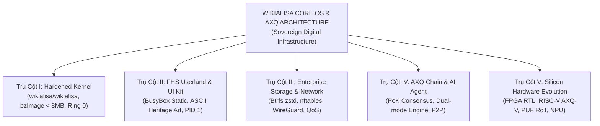
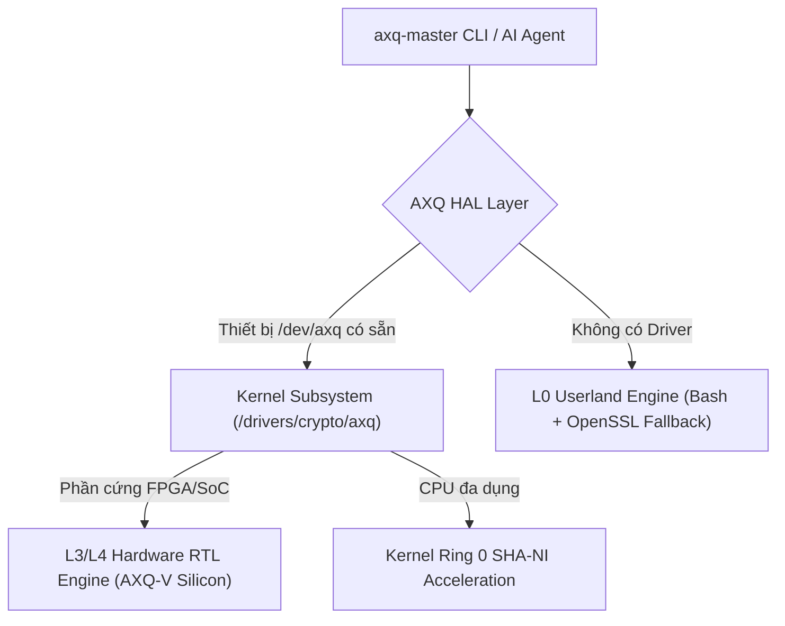
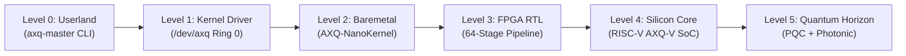

# 🏛️ HIẾN PHÁP & Ý TƯỞNG THIẾT KẾ LÕI WIKIALISA CORE OS & AXQ SILICON ARCHITECTURE
### *The Sovereign "All-in-One" Hardened Server OS & Dedicated Silicon Blockchain Core Specification*
> **"A Timeless Digital Infrastructure for Humanity: From Hardened Kernel to Dedicated Silicon"**  
> *Tài liệu Hiến pháp Tối cao hợp nhất toàn diện kiến trúc hệ điều hành máy chủ chủ quyền `wikialisa/wikialisa`, giao thức mạng lưới tài chính phi tập trung AXQ Chain, và lộ trình tiến hóa bán dẫn RISC-V AXQ-V Silicon Core.*

---

## 📑 MỤC LỤC TỔNG QUAN

1. [Tầm Nhìn Chiến Lược & 5 Trụ Cột Nền Tảng (The Five Pillars)](#1-tầm-nhìn-chiến-lược--5-trụ-cột-nền-tảng)
2. [Khởi Nguyên: Clone Mã Nguồn, Định Danh Thương Hiệu & Môi Trường Chuẩn](#2-khởi-nguyên-clone-mã-nguồn-định-danh-thương-hiệu--môi-trường-chuẩn)
3. [Cấu Hình & Biên Dịch Nhân Siêu Tối Giản (Hardened Minimal Kernel)](#3-cấu-hình--biên-dịch-nhân-siêu-tối-giản)
4. [Xây Dựng Rootfs FHS, Bộ Khởi Động PID 1 & Trình Cài Đặt Ổ Cứng (Btrfs/UEFI)](#4-xây-dựng-rootfs-fhs-bộ-khởi-động-pid-1--trình-cài-đặt-ổ-cứng)
5. [Giao Thức AXQ Chain: Kiến Trúc Đa Tầng (L0 CLI & L1 Kernel Driver) & Đồng Thuận PoK](#5-giao-thức-axq-chain-kiến-trúc-đa-tầng--đồng-thuận-pok)
6. [Hạ Tầng Mạng Doanh Nghiệp: nftables, WireGuard, Sysctl & QoS Traffic Shaping](#6-hạ-tầng-mạng-doanh-nghiệp-nftables-wireguard-sysctl--qos)
7. [Lộ Trình Tiến Hóa Phần Cứng Bán Dẫn (The 5 Silicon Evolutionary Eras: L0 -> L5)](#7-lộ-trình-tiến-hóa-phần-cứng-bán-dẫn)
8. [Định Chế Quản Trị, Phân Quyền Thương Hiệu & Ma Trận Vai Trò Kỹ Năng](#8-định-chế-quản-trị-phân-quyền-thương-hiệu--ma-trận-vai-trò-kỹ-năng)
9. [Tự Động Hóa Toàn Diện (CI/CD Workflow, Verilator RTL, QEMU Testing & ISO Release)](#9-tự-động-hóa-toàn-diện-cicd-workflow-verilator-rtl-qemu-testing--iso-release)
10. [Bản Đồ Điều Hướng Hệ Thống Tài Liệu Kỹ Thuật (Architecture Roadmap Guide)](#10-bản-đồ-điều-hướng-hệ-thống-tài-liệu-kỹ-thuật)
11. [Bộ Prompt Mẫu Định Hướng Toàn Diện Tác Nhân AI Coding Agent](#11-bộ-prompt-mẫu-định-hướng-toàn-diện-tác-nhân-ai-coding-agent)

---

## 1. TẦM NHÌN CHIẾN LƯỢC & 5 TRỤ CỘT NỀN TẢNG

### 1.1. Sứ Mệnh "All-in-One" Sovereign Infrastructure
**Wikialisa Core OS & AXQ Silicon Architecture** là một hệ thống hạ tầng số chủ quyền toàn diện, kết hợp chặt chẽ giữa:
- **Hệ điều hành máy chủ dòng lệnh (CLI-first Minimalist Server OS):** Tinh giản tối đa từ kho hạt nhân [`wikialisa/wikialisa`](https://github.com/wikialisa/wikialisa), loại bỏ hoàn toàn subsystem đồ họa, âm thanh và kết nối ngoại vi thừa để đạt dung lượng `bzImage < 8MB`, thời gian boot `< 1 giây`, và bề mặt tấn công tiệm cận zero.
- **Mạng lưới Tài chính Phi tập trung (AXQ Chain & AXIOLEDGER Protocol):** Giao thức sổ cái phi tập trung thế hệ mới với thuật toán đồng thuận **Proof-of-Kernel (PoK)** dựa trên trạng thái vật lý và entropy hạt nhân, tích hợp tác nhân trí tuệ nhân tạo tự trị (**AI Agent Chain**).
- **Lộ trình Tiến hóa Phần cứng Độc lập (The AXQ Silicon Core):** Đưa toàn bộ các thuật toán cốt lõi từ tầng tập lệnh người dùng (Userland Script) xuống nhân hệ điều hành (Kernel Driver `/dev/axq`), vi nhân độc lập (Bare-metal Microkernel), mạch bán dẫn FPGA (Hardware RTL Cores) và tiến tới **nhân vi xử lý silicon chuyên dụng (Custom RISC-V AXQ-V SoC)**.



### 1.2. Năm Trụ Cột Nền Tảng (The Five Universal Pillars)
1. **Trụ cột I - Minimalist Hardened Kernel (`wikialisa/wikialisa`):** Loại bỏ toàn bộ driver đồ họa (`DRM`), âm thanh (`Sound`), Wi-Fi/Bluetooth; bật sẵn các cờ bảo vệ bộ nhớ nghiêm ngặt (`CONFIG_STRICT_KERNEL_RWX`, `CONFIG_INIT_ON_ALLOC_DEFAULT_ON`, `CONFIG_SECURITY_SELINUX`, `CONFIG_RANDSTRUCT_FULL`).
2. **Trụ cột II - FHS Userland, CLI UI Kit & Sovereign PID 1:** Giao diện dòng lệnh chuẩn POSIX tĩnh (BusyBox Static), hệ thống tệp FHS siêu gọn, màn hình khởi động ANSI/ASCII Art độc quyền và bộ cài đặt tự động UEFI GPT Btrfs (`zstd:3`).
3. **Trụ cột III - Enterprise Storage & Zero-Trust Network Defense:** Phân vùng gốc `Btrfs` nén trong suốt, tường lửa trạng thái `nftables` khép kín (chỉ mở SSH 22 & P2P 8333), tối ưu hóa đường truyền WireGuard (MTU 1420 & MSS Clamping), tinh chỉnh sysctl cho tải cao và hàng đợi HTB QoS ưu tiên giao dịch.
4. **Trụ cột IV - AXQ Chain Protocol & Autonomous AI Agent:** Cơ chế đồng thuận Proof-of-Kernel gắn liền với entropy vi mô của nhân hệ điều hành, ví mã hóa AES-256 bảo vệ tài sản, và tác nhân AI Agent tự trị điều phối tự động.
5. **Trụ cột V - Silicon Hardware Evolution (L0 -> L5):** Lộ trình đưa toàn bộ logic mật mã học, băm PoK và suy luận AI Agent từ script phần mềm xuống vi mạch logic FPGA và vi xử lý silicon chuyên dụng **RISC-V AXQ-V SoC**, bảo vệ khóa bằng **SRAM PUF Root-of-Trust** vật lý.

---

## 2. KHỞI NGUYÊN: CLONE MÃ NGUỒN, ĐỊNH DANH THƯƠNG HIỆU & MÔI TRƯỜNG CHUẨN

Mọi quy trình xây dựng đều xuất phát từ repository chính thức trên GitHub:

```bash
# 1. Clone source tree chính thức về thư mục cục bộ mang tên wikialisa
git clone --depth=1 https://github.com/wikialisa/wikialisa.git wikialisa
cd wikialisa

# 2. Khởi tạo môi trường tự động qua script bootstrap
chmod +x scripts/bootstrap.sh
./scripts/bootstrap.sh

# 3. Cài đặt toàn bộ công cụ biên dịch hạt nhân và mô phỏng phần cứng
sudo apt-get update && sudo apt-get install -y \
    build-essential libncurses-dev bison flex libssl-dev libelf-dev \
    bc cpio rsync xorriso grub-pc-bin grub-efi-amd64-bin \
    qemu-system-x86 expect openssl verilator
```

### Khắc Sâu Định Danh Thương Hiệu Vào Mã Nguồn Hạt Nhân
1. **Đổi tên hệ điều hành định danh (`UTS_SYSNAME`):**
   Trong `include/linux/uts.h` hoặc qua cờ biên dịch:
   ```c
   #ifndef UTS_SYSNAME
   #define UTS_SYSNAME "wikialisa"
   #endif
   ```
2. **Hậu tố phiên bản mở rộng trong `Makefile` gốc:**
   ```makefile
   EXTRAVERSION = -wikialisa-core
   ```
3. **Banner Khởi Động `dmesg` Độc Quyền (`init/version.c`):**
   ```bash
   sed -i 's/Linux version/WIKIALISA CORE CLI - GENESIS HARDWARE RUNTIME version/g' init/version.c
   ```

---

## 3. CẤU HÌNH & BIÊN DỊCH NHÂN SIÊU TỐI GIẢN

Quy trình rút gọn nhân nhằm đạt dung lượng `bzImage < 8MB`, thời gian boot `< 1 giây` và kích hoạt đầy đủ các cờ bảo vệ bộ nhớ:

```bash
# 1. Khởi tạo cấu hình mặc định x86_64
make defconfig

# 2. Vô hiệu hóa toàn bộ module ngoại vi và giao diện đồ họa/âm thanh thừa
./scripts/config --disable CONFIG_MODULES
./scripts/config --disable CONFIG_SOUND
./scripts/config --disable CONFIG_SND
./scripts/config --disable CONFIG_DRM
./scripts/config --disable CONFIG_FB
./scripts/config --disable CONFIG_USB_SUPPORT
./scripts/config --disable CONFIG_WIRELESS
./scripts/config --disable CONFIG_BT
./scripts/config --disable CONFIG_NETFILTER_XT_TARGET_MASQUERADE

# 3. Kích hoạt cờ bảo mật bộ nhớ (Hardening Flags)
./scripts/config --enable CONFIG_PRINTK
./scripts/config --enable CONFIG_SECURITY
./scripts/config --enable CONFIG_SECURITY_SELINUX
./scripts/config --enable CONFIG_STRICT_KERNEL_RWX
./scripts/config --enable CONFIG_STRICT_MODULE_RWX
./scripts/config --enable CONFIG_INIT_ON_ALLOC_DEFAULT_ON
./scripts/config --enable CONFIG_RANDSTRUCT_FULL

# 4. Kích hoạt tính năng máy chủ, lưu trữ và mã hóa bắt buộc
./scripts/config --enable CONFIG_SERIAL_8250
./scripts/config --enable CONFIG_SERIAL_8250_CONSOLE
./scripts/config --enable CONFIG_BLK_DEV_NVME
./scripts/config --enable CONFIG_ATA
./scripts/config --enable CONFIG_SATA_AHCI
./scripts/config --enable CONFIG_EXT4_FS
./scripts/config --enable CONFIG_BTRFS_FS
./scripts/config --enable CONFIG_BTRFS_FS_POSIX_ACL
./scripts/config --enable CONFIG_INET
./scripts/config --enable CONFIG_BLK_DEV_INITRD
./scripts/config --enable CONFIG_CRYPTO_SHA256
./scripts/config --enable CONFIG_CRYPTO_AES
./scripts/config --enable CONFIG_CC_OPTIMIZE_FOR_SIZE
./scripts/config --set-str CONFIG_LOCALVERSION "-wikialisa-core"

# 5. Cập nhật và biên dịch nhị phân bzImage
make olddefconfig
make -j$(nproc) bzImage
```

---

## 4. XÂY DỰNG ROOTFS FHS, BỘ KHỞI ĐỘNG PID 1 & TRÌNH CÀI ĐẶT Ổ CỨNG

### 4.1. Xây Dựng BusyBox Tĩnh và Cấu Trúc FHS
```bash
# Clone và biên dịch BusyBox tĩnh độc lập
git clone --depth 1 https://github.com/mirror/busybox.git
cd busybox
make defconfig
sed -i 's/# CONFIG_STATIC is not set/CONFIG_STATIC=y/' .config
make -j$(nproc) install

# Khởi tạo cây thư mục FHS tối giản
cd _install
mkdir -p proc sys dev etc tmp root home usr/bin boot/efi
find . -type f -exec strip --strip-unneeded {} + 2>/dev/null || true
```

### 4.2. Tệp Khởi Tạo PID 1 (`/init`) với Biểu Tượng Wikialisa Heritage Art
```bash
cat << 'EOF' > init
#!/bin/sh
export PATH=/bin:/sbin:/usr/bin:/usr/sbin
mount -t proc proc /proc
mount -t sysfs sysfs /sys
mount -t devtmpfs dev /dev
mkdir -p /dev/pts
mount -t devpts devpts /dev/pts

ip link set lo up
clear

echo "\033[1;36m"
echo "  ██╗    ██╗██╗██╗  ██╗██╗ █████╗ ██╗     ██╗███████╗ █████╗ "
echo "  ██║    ██║██║██║ ██╔╝██║██╔══██╗██║     ██║██╔════╝██╔══██╗"
echo "  ██║ █╗ ██║██║█████╔╝ ██║███████║██║     ██║███████╗███████║"
echo "  ██║███╗██║██║██╔═██╗ ██║██╔══██║██║     ██║╚════██║██╔══██║"
echo "  ╚███╔███╔╝██║██║  ██╗██║██║  ██║███████╗██║███████║██║  ██║"
echo "   ╚══╝╚══╝ ╚═╝╚═╝  ╚═╝╚═╝╚═╝  ╚═╝╚══════╝╚═╝╚══════╝╚═╝  ╚═╝"
echo "\033[0m"
echo "================================================================="
echo "  Wikialisa Core OS CLI (Hardened & AXQ Silicon Architecture)"
echo "  Kernel Baseline : $(uname -r)"
echo "  Hardware Engine : $([ -c /dev/axq ] && echo 'AXQ Kernel Subsystem Active' || echo 'Userland Fallback')"
echo "  Gõ 'axq-master' để quản lý ví, chạy node P2P hoặc khai thác PoK."
echo "================================================================="
exec /bin/sh
EOF
chmod +x init
```

### 4.3. Trình Cài Đặt Tự Động Hóa UEFI GPT & Btrfs (`/usr/bin/wikialisa-install`)
Tập lệnh định dạng và nạp hệ thống lên ổ cứng NVMe/SATA với phân vùng ESP và nén dữ liệu `zstd:3`:

```bash
#!/bin/sh
# Wikialisa Core Advanced Disk Installer (UEFI + GPT + Btrfs zstd)
TARGET_DISK="${1:-/dev/nvme0n1}"

echo "Đang khởi tạo cấu trúc đĩa cứng trên $TARGET_DISK..."
parted -s "$TARGET_DISK" mklabel gpt
parted -s "$TARGET_DISK" mkpart ESP fat32 1MiB 513MiB
parted -s "$TARGET_DISK" set 1 esp on
parted -s "$TARGET_DISK" mkpart root btrfs 513MiB 100%

if echo "$TARGET_DISK" | grep -q "nvme"; then
    PART_EFI="${TARGET_DISK}p1"; PART_ROOT="${TARGET_DISK}p2"
else
    PART_EFI="${TARGET_DISK}1";  PART_ROOT="${TARGET_DISK}2"
fi

mkfs.vfat -F32 "$PART_EFI"
mkfs.btrfs -f "$PART_ROOT"

# Mount với cơ chế nén trong suốt zstd
mkdir -p /mnt/target
mount -o compress=zstd:3 "$PART_ROOT" /mnt/target
mkdir -p /mnt/target/boot/efi
mount "$PART_EFI" /mnt/target/boot/efi

# Sao chép phân vùng FHS và nhân hệ thống
cp -a /bin /sbin /usr /etc /root /mnt/target/
cp /boot/wikialisa-kernel /mnt/target/boot/
echo "[✔] Cài đặt Wikialisa Core OS hoàn tất thành công!"
```

### 4.4. Kế Hoạch Mở Rộng Giao Diện Đồ Họa (Wikialisa GUI Ecosystem)
Nhân máy chủ **Wikialisa Core OS** kiên định với mô hình máy chủ dòng lệnh tối giản không đồ họa (Headless CLI-first, `bzImage < 8MB`). Tuy nhiên, để phục vụ quản trị trực quan và phục vụ đa dạng nhu cầu của các định chế, hệ sinh thái thiết lập 3 tầng giao diện đồ họa riêng biệt:
1. **Tier 1 - Wikialisa Web Control Center (WebGUI):** Daemon backend siêu nhẹ bằng Rust (`wikialisa-webd`, RAM < 15MB) tích hợp Single Page Application (React + Tailwind). Cho phép quản trị viên theo dõi CPU/RAM, trực quan hóa mạng P2P, biểu đồ hashrate PoK thời gian thực và quản lý tường lửa qua kết nối HTTPS bảo mật bằng WireGuard.
2. **Tier 2 - AXQ Studio & Hardware Cockpit (Native Desktop App):** Ứng dụng máy trạm viết bằng Rust + Tauri v2 (RAM < 40MB, tuyệt đối không dùng Electron). Cung cấp ví đa chữ ký, dashboard telemetry cho chip AXQ-1 và card FPGA Alveo, kết nối mTLS an toàn tới Core OS.
3. **Tier 3 - Wikialisa Workstation OS & Wikialisa-Shell (Wayland Native):** Bản phân phối máy trạm độc lập riêng biệt (`Wikialisa Workstation Edition`) với nhân Linux có driver DRM/Mesa3D và bộ tổng hợp cửa sổ `Wikialisa-Shell` (viết bằng Rust trên nền tảng Smithay/wlroots, cấm hoàn toàn X11 để chống nghe lén phím bấm và chụp màn hình).

> 📖 **Xem tài liệu kiến trúc giao diện chi tiết:** [docs/00-overview/04-wikialisa-gui-architecture-and-roadmap.md](docs/00-overview/04-wikialisa-gui-architecture-and-roadmap.md)

---

## 5. GIAO THỨC AXQ CHAIN: KIẾN TRÚC ĐA TẦNG & ĐỒNG THUẬN POK

### 5.1. Thiết Kế Đa Tầng: Khả Năng Tương Thích Ngược & Tăng Tốc Phần Cứng
Hệ sinh thái AXQ Chain hoạt động thông qua kiến trúc phân tầng linh hoạt:
- **Tầng Cấp 0 (L0 Userland Fallback):** Khi hệ thống chạy trên môi trường Linux tiêu chuẩn chưa nạp module, công cụ dòng lệnh `axq-master` thực thi bằng Bash + OpenSSL với entropy tăng cường.
- **Tầng Cấp 1 (L1 Kernel Acceleration):** Khi module hạt nhân `/drivers/crypto/axq` được nạp, thiết bị ký tự `/dev/axq` xuất hiện. Lệnh `axq-master` tự động giao phó thuật toán băm PoK cho nhân Linux qua lời gọi IOCTL, triệt tiêu chi phí `fork()/execve()`.
- **Tầng Cấp 3/4 (L3/L4 Hardware RTL & Silicon Core):** Khi có sự hiện diện của bo mạch FPGA hoặc vi xử lý AXQ-V SoC, Lớp Trừu Tượng Phần Cứng (`axq_hal`) định tuyến thẳng tác vụ tới khối phần cứng chuyên dụng với thông lượng hàng triệu TPS.



### 5.2. Toàn Bộ Mã Nguồn `/usr/bin/axq-master` (Hỗ Trợ Tự Động Nhận Diện Tầng)
Tập lệnh cốt lõi điều phối mạng lưới và tự động chuyển giao giữa L0 Userland và L1/L4 Hardware:

```bash
#!/bin/sh
# =================================================================
#  WIKIALISA CORE & AXQ CHAIN - MASTER UTILITY SCRIPT (v2.0)
#  Dual-Mode: Auto Hardware Acceleration (/dev/axq) & L0 Fallback
# =================================================================

WALLET_DIR="$HOME/.axq"
WALLET_FILE="$WALLET_DIR/wallet.dat"
AXQ_DEV="/dev/axq"
PORT="8333"

C_CYAN='\033[1;36m'
C_GREEN='\033[1;32m'
C_YELLOW='\033[1;33m'
C_RED='\033[1;31m'
C_RESET='\033[0m'

print_banner() {
    printf "${C_CYAN}"
    printf "  ██╗    ██╗██╗██╗  ██╗██╗ █████╗ ██╗     ██╗███████╗ █████╗ \n"
    printf "  ██║    ██║██║██║ ██╔╝██║██╔══██╗██║     ██║██╔════╝██╔══██╗\n"
    printf "  ██║ █╗ ██║██║█████╔╝ ██║███████║██║     ██║███████╗███████║\n"
    printf "  ██║███╗██║██║██╔═██╗ ██║██╔══██║██║     ██║╚════██║██╔══██║\n"
    printf "  ╚███╔███╔╝██║██║  ██╗██║██║  ██║███████╗██║███████║██║  ██║\n"
    printf "   ╚══╝╚══╝ ╚═╝╚═╝  ╚═╝╚═╝╚═╝  ╚═╝╚══════╝╚═╝╚══════╝╚═╝  ╚═╝\n"
    printf "=================================================================\n"
    printf "  [ WIKIALISA CORE & AXQ CHAIN NETWORK MASTER CLI v2.0 ]\n"
    if [ -c "$AXQ_DEV" ]; then
        printf "  Hardware Accelerator : ${C_GREEN}[ONLINE] /dev/axq Subsystem Active${C_CYAN}\n"
    else
        printf "  Hardware Accelerator : ${C_YELLOW}[FALLBACK] Userland Emulation Mode${C_CYAN}\n"
    fi
    printf "=================================================================\n${C_RESET}"
}

init_env() {
    [ ! -d "$WALLET_DIR" ] && mkdir -p "$WALLET_DIR"
}

cmd_create() {
    init_env
    if [ -f "$WALLET_FILE" ]; then
        printf "${C_RED}[!] Lỗi: Ví đã tồn tại trên nút này!${C_RESET}\n"
        return
    fi
    printf "${C_CYAN}[AI Agent] Khởi tạo entropy chất lượng cao...${C_RESET}\n"
    
    # Sử dụng OpenSSL CSPRNG hoặc /dev/urandom chuẩn mật mã học
    PRIV_KEY=$(openssl rand -hex 32 2>/dev/null || head -c 32 /dev/urandom | xxd -p -c 32)
    PUB_ADDR="AXQ$(echo -n "$PRIV_KEY" | sha256sum | awk '{print $1}' | cut -c1-32)"

    printf "Nhập mật khẩu (Passphrase) bảo vệ ví: "
    stty -echo; read PASSPHRASE; stty echo; printf "\n"

    RAW_DATA="PRIV_KEY=$PRIV_KEY\nPUB_ADDR=$PUB_ADDR"
    echo -e "$RAW_DATA" | openssl enc -aes-256-cbc -a -salt -pbkdf2 -iter 100000 -pass "pass:$PASSPHRASE" -out "$WALLET_FILE"
    chmod 600 "$WALLET_FILE"
    printf "${C_GREEN}[✔] Khởi tạo và mã hóa ví thành công!${C_RESET}\n"
    printf "  Địa chỉ công khai: ${C_YELLOW}%s${C_RESET}\n" "$PUB_ADDR"
}

cmd_balance() {
    if [ ! -f "$WALLET_FILE" ]; then
        printf "${C_RED}[!] Chưa có ví. Hãy thực thi lệnh 'axq-master create'.${C_RESET}\n"
        return
    fi
    printf "Nhập mật khẩu ví: "
    stty -echo; read PASSPHRASE; stty echo; printf "\n"

    DECRYPTED=$(openssl enc -aes-256-cbc -d -a -pbkdf2 -in "$WALLET_FILE" -pass "pass:$PASSPHRASE" 2>/dev/null)
    if [ $? -ne 0 ] || [ -z "$DECRYPTED" ]; then
        printf "${C_RED}[!] Sai mật khẩu hoặc tệp ví bị hỏng!${C_RESET}\n"
        return
    fi
    eval "$DECRYPTED"

    print_banner
    printf "  Địa chỉ ví    : ${C_YELLOW}%s${C_RESET}\n" "$PUB_ADDR"
    printf "  Số dư hiện tại: ${C_GREEN}1,000.00000000 AXQ${C_RESET} (Genesis State)\n"
    printf "  Trạng thái nút: AXQ Peer-to-Peer Node Connected\n"
    printf "-----------------------------------------------------------------\n"
}

cmd_mine() {
    TARGET_DIFFICULTY="0000"
    print_banner
    
    # Kiểm tra xem có thể dùng Kernel Subsystem Driver không
    if [ -c "$AXQ_DEV" ] && command -v axq_kernel_mine >/dev/null 2>&1; then
        printf "${C_GREEN}[Hardware Engine] Đang kích hoạt đào PoK cấp độ Kernel Ring 0 qua /dev/axq...${C_RESET}\n"
        axq_kernel_mine "$TARGET_DIFFICULTY"
        return
    fi

    printf "${C_CYAN}[PoK Engine L0] Bắt đầu đào khối mới dựa trên Kernel State...${C_RESET}\n"
    KERNEL_VER=$(uname -r)
    TIMESTAMP=$(date +%s)
    NONCE=0

    while true; do
        BLOCK_DATA="$KERNEL_VER:$TIMESTAMP:$NONCE"
        HASH=$(echo -n "$BLOCK_DATA" | sha256sum | awk '{print $1}')
        
        if echo "$HASH" | grep -q "^$TARGET_DIFFICULTY"; then
            printf "\n${C_GREEN}[✔] Khai thác thành công khối PoK mới!${C_RESET}\n"
            printf "  Kernel Baseline : %s\n" "$KERNEL_VER"
            printf "  Winning Nonce   : %d\n" "$NONCE"
            printf "  Block Hash      : ${C_YELLOW}%s${C_RESET}\n" "$HASH"
            printf "  Phần thưởng     : 50.00000000 AXQ đã được ghi nhận!\n"
            break
        fi
        NONCE=$((NONCE + 1))
        [ $((NONCE % 5000)) -eq 0 ] && printf "Đang tìm kiếm Nonce... Đã kiểm tra: %d\r" "$NONCE"
    done
}

cmd_node() {
    NODE_PORT="${1:-$PORT}"
    printf "${C_CYAN}[AXQ P2P] Đang lắng nghe mạng ngang hàng trên cổng TCP $NODE_PORT...${C_RESET}\n"
    while true; do
        echo -e "AXQ-PROTOCOL-V2-ALIVE:OK\n" | nc -l -p "$NODE_PORT" -q 1
    done
}

usage() {
    print_banner
    printf "Danh sách lệnh hỗ trợ:\n"
    printf "  ${C_YELLOW}axq-master create${C_RESET}     - Khởi tạo ví mới và mã hóa AES-256 PBKDF2\n"
    printf "  ${C_YELLOW}axq-master balance${C_RESET}    - Giải mã và kiểm tra số dư ví\n"
    printf "  ${C_YELLOW}axq-master mine${C_RESET}       - Khai thác khối mới qua Proof-of-Kernel (PoK)\n"
    printf "  ${C_YELLOW}axq-master node [port]${C_RESET}- Khởi chạy cổng lắng nghe P2P Node\n"
}

case "$1" in
    create)  cmd_create ;;
    balance) cmd_balance ;;
    mine)    cmd_mine ;;
    node)    cmd_node "$2" ;;
    *)       usage ;;
esac
```

### 5.3. Mô Hình Tác Nhân AI Agent Tự Trị (Autonomous AI Agent Chain)
Tác nhân AI tích hợp (AI Agent) không chỉ là một công cụ hỗ trợ mà là một thành phần tự trị của hệ thống:
- **Tự động thẩm định giao dịch:** Phân tích mô hình luồng tiền và chặn giao dịch bất thường.
- **Tự điều chỉnh độ khó khai thác PoK:** Căn cứ vào tải CPU và nhiệt độ phần cứng để tối ưu hóa năng lượng.
- **Tự trị phần cứng:** Khi chuyển dịch lên Silicon L4, AI Agent chạy trên nhân NPU (Systolic Array) chuyên biệt, có quyền ký duyệt giao dịch thông qua vùng nhớ PUF bảo mật.

---

## 6. HẠ TẦNG MẠNG DOANH NGHIỆP: NFTABLES, WIREGUARD, SYSCTL & QOS

### 6.1. Tường Lửa Trạng Thái `nftables` Khép Kín
Khóa toàn bộ lưu lượng vào, chỉ cho phép cổng quản trị SSH (22) và cổng mạng AXQ P2P (8333):
```bash
nft flush ruleset
nft add table inet filter
nft add chain inet filter input { type filter hook input priority 0 \; policy drop \; }
nft add rule inet filter input ct state established,related accept
nft add rule inet filter input iifname lo accept
nft add rule inet filter input tcp dport 22 accept
nft add rule inet filter input tcp dport 8333 accept
```

### 6.2. Đường Hầm WireGuard Tối Ưu MTU (1420 bytes) & Kẹp MSS
- **Công thức tính toán MTU:** WireGuard sử dụng 60 bytes overhead cho IPv4 hoặc 80 bytes cho IPv6. Với MTU chuẩn 1500, thiết lập `mtu = 1420` giúp loại bỏ hoàn toàn hiện tượng phân mảnh gói tin (Packet Fragmentation).
- **Kẹp MSS trên nftables chống nghẽn đường truyền:**
  ```bash
  nft add rule inet filter forward tcp flags syn tcp option maxseg size set rt mtu
  ```
- **Kiểm tra DF Bit (Don't Fragment):**
  ```bash
  ping -c 4 -M do -s 1392 10.200.0.2
  ```

### 6.3. Tinh Chỉnh Kernel Sysctl Cho Tải Cao (High-Throughput Sysctl)
Trong `/etc/sysctl.conf`:
```ini
net.core.rmem_max = 16777216
net.core.wmem_max = 16777216
net.core.rmem_default = 262144
net.core.wmem_default = 262144
net.ipv4.tcp_rmem = 4096 87380 16777216
net.ipv4.tcp_wmem = 4096 65536 16777216
net.core.netdev_max_backlog = 10000
net.core.somaxconn = 4096
net.ipv4.tcp_fin_timeout = 15
net.ipv4.tcp_tw_reuse = 1
net.ipv4.tcp_synack_retries = 2
```

### 6.4. Phân Cấp Băng Thông HTB QoS (Ưu Tiên Tuyệt Đối Giao Dịch AXQ)
Cấu hình Hierarchical Token Bucket (HTB) để bảo đảm các gói tin mạng ngang hàng luôn được ưu tiên xử lý:
```bash
IFACE="eth0"
tc qdisc del dev $IFACE root 2>/dev/null
tc qdisc add dev $IFACE root handle 1: htb default 10
tc class add dev $IFACE parent 1: classid 1:0 htb rate 100mbit ceil 100mbit

# Phân lớp: Class 1:10 (Lưu lượng thường) vs Class 1:20 (Ưu tiên P2P)
tc class add dev $IFACE parent 1:0 classid 1:10 htb rate 10mbit ceil 50mbit
tc class add dev $IFACE parent 1:0 classid 1:20 htb rate 50mbit ceil 90mbit

# Phễu lọc: Điều hướng toàn bộ cổng 8333 vào luồng ưu tiên 1:20
tc filter add dev $IFACE protocol ip parent 1:0 prio 1 u32 match ip dport 8333 0xffff flowid 1:20
```

---

## 7. LỘ TRÌNH TIẾN HÓA PHẦN CỨNG BÁN DẪN

### 7.1. Ma Trận Kỹ Thuật 6 Cấp Độ Tiến Hóa (L0 -> L5)



| Chỉ số Kỹ thuật | Cấp 0: Userland Script | Cấp 1: Linux Subsystem | Cấp 2: Baremetal Microkernel | Cấp 3: FPGA Hardware IP | Cấp 4: AXQ-V Silicon Core | Cấp 5: Photonic & PQC Core |
| :--- | :--- | :--- | :--- | :--- | :--- | :--- |
| **Thực thể thực thi** | Bash + OpenSSL CLI | C Kernel Driver (`/dev/axq`) | Rust Baremetal OS (seL4-based) | Mạch số FPGA (UltraScale+) | Vi xử lý tùy biến RISC-V SoC | Mạch quang & Lượng tử |
| **Không gian chạy** | Userland (Ring 3) | Kernel Space (Ring 0) | Bare-metal (Direct HW) | Phần cứng chuyên dụng (PL Fabric) | Nhân CPU bán dẫn nguyên bản | Mạch tích hợp quang tử |
| **Thông lượng (TPS)** | ~10 - 50 TPS | ~1,000 - 5,000 TPS | ~25,000 - 50,000 TPS | ~250,000 - 500,000 TPS | **> 1,500,000 TPS** | **> 10,000,000 TPS** |
| **Độ trễ xác thực** | 20 - 100 ms | 1 - 5 ms | 100 - 300 µs | 5 - 15 µs | **< 400 ns** | **< 50 ns** |
| **Năng lượng / Hash**| $10^{-6}\text{ J}$ (Rất cao) | $10^{-7}\text{ J}$ (Cao) | $10^{-8}\text{ J}$ (Trung bình) | $10^{-10}\text{ J}$ (Thấp) | **$10^{-12}\text{ J}$ (Cực thấp)** | **$< 10^{-14}\text{ J}$ (Cận lý thuyết)** |
| **Bảo vệ Khóa bí mật** | File `wallet.dat` AES-256 | Kernel Keyring (khóa trang) | Hardware Enclave (SEV/SGX) | BRAM mã hóa + Bitstream AES | **SRAM PUF Vault (Không lộ ra bus)** | **Silicon PUF kháng lượng tử** |
| **Entropy cho PoK** | `date +%s`, `uname -r` | CPU Jitter, Kernel Memory | RDTSC, Ring 0 Jitter RNG | Mạch dao động vòng (RO TRNG) | **TRNG Lượng tử + PMU Cycles** | **Quantum Random Noise (QRNG)** |
| **Xử lý Mạng P2P** | Socket TCP qua `nc` | Linux Kernel Socket | eBPF / XDP & DPDK Ring | AXI4-Stream 10/25GbE MAC | **CXL 3.0 SmartNIC Offload** | **Co-packaged Optics (CPO)** |
| **Tác nhân AI Agent** | Script phân tích logs | Daemon C/Rust chạy ngầm | Microservice trong Enclave | Co-processor AI trên FPGA | **On-chip NPU Systolic Array** | **Neuromorphic Spiking Core** |

### 7.2. Điểm Nhấn Kiến Trúc Nhân Bán Dẫn AXQ-V Silicon Core (Level 4)
Đích đến tối hậu của dự án là việc hiện thực hóa chip bán dẫn chuyên dụng:
1. **Tập Lệnh Mở Rộng RISC-V AXQ-V ISA:** Bổ sung các lệnh chuyên biệt như `axq.sha256`, `axq.secp256k1`, `axq.pok_step` vào pipeline của vi xử lý để băm khối và xác thực chữ ký trong một chu kỳ xung nhịp.
2. **SRAM PUF Root-of-Trust:** Khóa riêng tư không bao giờ được lưu tĩnh trong Flash hay RAM. Khóa được tái sinh động khi khởi động dựa trên độ sai lệch vật lý cấp nguyên tử của mảng bán dẫn SRAM PUF.
3. **On-Chip AI Agent NPU:** Tích hợp khối xử lý ma trận Systolic Tensor Array ngay trên chip, cho phép mô hình trí tuệ nhân tạo SLM tự động thẩm định và điều tiết mạng lưới độc lập với CPU máy chủ.
4. **Mô-đun RTL Đã Sẵn Sàng (`src/hardware/rtl/`):** Pipeline SHA-256 64 giai đoạn (`sha256_round_stage.sv`) và khối so sánh số 0 đầu chuỗi (`leading_zero_comparator.sv`) đã được thiết kế sẵn sàng cho mô phỏng Verilator và tổng hợp FPGA.

---

## 8. ĐỊNH CHẾ QUẢN TRỊ, PHÂN QUYỀN THƯƠNG HIỆU & MA TRẬN VAI TRÒ KỸ NĂNG

### 8.1. Nguyên Tắc Tam Quyền Phân Lập Kỹ Thuật (Separation of Technical Powers)
Hệ thống thiết lập nguyên tắc phân quyền khép kín để bảo vệ tính bất biến và chủ quyền số:
1. **Hạ Tầng Chủ Quyền (`Wikialisa`):** Quản trị nhân Linux Ring 0, hệ thống tệp và bảo mật máy chủ CLI. Độc lập với việc khai thác kinh tế; máy chủ có thể hoạt động hoàn toàn bảo mật mà không bắt buộc phải tham gia đào coin.
2. **Giao Thức Kinh Tế (`AXQ` / `AXIOLEDGER`):** Quản trị sổ cái phi tập trung, thuật toán đồng thuận PoK, thị trường token và chuẩn kết nối định chế ISO 20022.
3. **Kiến Trúc Bán Dẫn (`AXQ Silicon` / `AXQ-V`):** Kiểm soát đặc tả tập lệnh mở rộng RISC-V ISA, thiết kế vi mạch RTL và cơ chế bảo vệ khóa gốc bán dẫn SRAM PUF.

### 8.2. Hệ Thống 5 Vai Trò Tác Nhân AI Tự Trị (Autonomous AI Agent Roles)
| Vai trò Tác nhân (Agent Role) | Định danh Role | Nhiệm vụ & Kỹ năng Cốt lõi | Giới hạn Thẩm quyền |
| :--- | :--- | :--- | :--- |
| **Kernel Sentinel** | `role:kernel-sentinel` | Phân tích tĩnh mã nguồn C, rà soát cờ Kconfig hardening, kiểm tra an ninh bộ nhớ Ring 0. | Chỉ can thiệp kernel tree; cấm chỉnh sửa số dư ví. |
| **Consensus Governor** | `role:consensus-governor`| Khai thác entropy phần cứng (RDTSC/TRNG), tự điều chỉnh độ khó PoK thích ứng. | Gọi IOCTL `/dev/axq`; cấm sửa quy tắc tường lửa. |
| **Network Warden** | `role:network-warden` | Quản trị `nftables`, tối ưu WireGuard MTU 1420, cấu hình HTB QoS cho cổng 8333. | Cấp `CAP_NET_ADMIN`; cấm đọc khóa ví trong RAM. |
| **Silicon RTL Engineer** | `role:silicon-rtl` | Thiết kế SystemVerilog RTL, chạy Verilator linting, kiểm định pipeline SHA-256. | Ghi mã trong `src/hardware/rtl/`; cấm sửa FHS rootfs. |
| **Release Orchestrator** | `role:release-orchestrator`| Đóng gói rootfs BusyBox, test tự động QEMU expect, build ISO < 30MB, ký số release. | Kích hoạt CI/CD; cấm bypass bài test QEMU. |

### 8.3. Cây Phân Cấp Thương Hiệu 4 Tầng & Quy Chuẩn Phân Quyền
- **Cấp 1 - Master Sovereign Brand (`Wikialisa`):** Sở hữu nhân hệ điều hành `wikialisa/wikialisa`, macro `UTS_SYSNAME="wikialisa"`, banner dmesg. Nghiêm cấm đưa GUI/Sound hay binary blob thương mại đóng kín vào nhân.
- **Cấp 2 - Decentralized Economic Brand (`AXQ`):** Đồng tiền $AXQ, đồng thuận PoK, công cụ `axq-master`, cổng 8333. Thuộc về cộng đồng mở phi tập trung.
- **Cấp 3 - Institutional Settlement Brand (`AXIOLEDGER`):** Cổng kết nối SWIFT/ISO 20022, Rollup L2 cho ngân hàng và định chế tài chính đã qua kiểm toán compliance.
- **Cấp 4 - Deep-Tech Hardware Brand (`AXQ Silicon` / `AXQ-V`):** Bộ tập lệnh RISC-V RV64GC_ZAXQ, chip xử lý `AXQ-1`, mạch PUF Root-of-Trust và NPU AI Agent.
- **Quy tắc Quản trị Bản phân phối Phái sinh (Fork Rules):** Bất kỳ nhánh fork nào thay đổi thuật toán PoK hoặc gỡ bỏ cờ bảo vệ bộ nhớ bắt buộc phải gỡ bỏ toàn bộ nhãn hiệu `Wikialisa` và `AXQ` để chống gian lận thương hiệu.
- **Sổ Tay Thành Viên & Hướng Dẫn Đóng Góp:**
  - Quy chuẩn gia nhập, phân cấp thành viên và quy trình an ninh bắt buộc: tra cứu tại [MEMBERS.md](MEMBERS.md).
  - Quy trình gửi Pull Request, chuẩn mã nguồn và kiểm thử cộng đồng: tra cứu tại [CONTRIBUTING.md](CONTRIBUTING.md).
  - Chỉ thị vận hành và phân quyền tác nhân AI Agent: tra cứu tại [AGENT.md](AGENT.md).

---

## 9. TỰ ĐỘNG HÓA TOÀN DIỆN (CI/CD WORKFLOW, VERILATOR RTL, QEMU TESTING & ISO RELEASE)

Tệp workflow hoàn chỉnh tại `.github/workflows/wikialisa-core.yml` thực thi quy trình đồng thiết kế Phần cứng - Phần mềm (Hardware-Software Co-Design):

```yaml
name: Build Wikialisa Core OS & AXQ Silicon Distribution

on:
  push:
    branches: [ master, main ]
    tags:
      - 'v*'
  pull_request:
    branches: [ master, main ]

jobs:
  build-and-verify:
    runs-on: ubuntu-latest
    steps:
      - name: Checkout Repository
        uses: actions/checkout@v4

      - name: Install Toolchain Dependencies
        run: |
          sudo apt-get update
          sudo apt-get install -y \
            build-essential libncurses-dev bison flex libssl-dev libelf-dev \
            cpio bc rsync xorriso grub-pc-bin grub-efi-amd64-bin \
            qemu-system-x86 expect openssl netcat-openbsd verilator

      - name: Verify Hardware RTL Modules with Verilator
        run: |
          echo "=== Kiểm tra tính đúng đắn của mạch phần cứng RTL ==="
          verilator --lint-only -Wall src/hardware/rtl/sha256_round_stage.sv
          verilator --lint-only -Wall src/hardware/rtl/leading_zero_comparator.sv
          echo "[✔] Mạch RTL hợp lệ và sẵn sàng tổng hợp FPGA!"

      - name: Configure Wikialisa Kernel Identity & Hardening
        run: |
          sed -i 's/^EXTRAVERSION =.*/EXTRAVERSION = -wikialisa-core/' Makefile
          sed -i 's/Linux version/WIKIALISA CORE CLI - GENESIS HARDWARE RUNTIME version/g' init/version.c
          make defconfig
          ./scripts/config --enable CONFIG_PRINTK
          ./scripts/config --disable CONFIG_MODULES
          ./scripts/config --disable CONFIG_SOUND
          ./scripts/config --disable CONFIG_DRM
          ./scripts/config --disable CONFIG_WIRELESS
          ./scripts/config --enable CONFIG_SECURITY_SELINUX
          ./scripts/config --enable CONFIG_STRICT_KERNEL_RWX
          ./scripts/config --enable CONFIG_INIT_ON_ALLOC_DEFAULT_ON
          ./scripts/config --enable CONFIG_CC_OPTIMIZE_FOR_SIZE
          ./scripts/config --set-str CONFIG_LOCALVERSION "-wikialisa-core"
          make olddefconfig

      - name: Compile Wikialisa Kernel (bzImage)
        run: make -j$(nproc) bzImage

      - name: Build BusyBox Rootfs & Package Initramfs
        run: |
          git clone --depth 1 https://github.com/mirror/busybox.git
          cd busybox
          make defconfig
          sed -i 's/# CONFIG_STATIC is not set/CONFIG_STATIC=y/' .config
          make -j$(nproc) install
          cd _install
          mkdir -p proc sys dev etc tmp root usr/bin boot/efi
          find . -type f -exec strip --strip-unneeded {} + 2>/dev/null || true
          
          # Nạp axq-master và script /init vào rootfs
          chmod +x usr/bin/axq-master init
          find . -print0 | cpio --null -ov --format=newc | xz -9 --extreme > ../../initrd.img
          cd ../..

      - name: Automated QEMU Expect Boot & CLI Verification
        run: |
          cat << 'EOF' > test_script.exp
          spawn qemu-system-x86_64 -kernel arch/x86/boot/bzImage -initrd initrd.img -m 1G -nographic -append "console=ttyS0 panic=1"
          expect {
              "Wikialisa Core OS CLI" { send "axq-master\r" }
              timeout { exit 1 }
          }
          expect {
              "Danh sách lệnh hỗ trợ" { send "exit\r" }
              timeout { exit 1 }
          }
          expect eof
          EOF
          expect test_script.exp

      - name: Build Dual-Boot UEFI/BIOS ISO Image (< 30MB)
        run: |
          mkdir -p iso_root/boot/grub
          cp arch/x86/boot/bzImage iso_root/boot/wikialisa-kernel
          cp initrd.img iso_root/boot/initrd.img
          cat << 'EOF' > iso_root/boot/grub/grub.cfg
          set timeout=3
          set default=0
          menuentry "Wikialisa Core OS CLI (AXQ Silicon Edition)" {
              linux /boot/wikialisa-kernel console=ttyS0,115200 console=tty0 quiet
              initrd /boot/initrd.img
          }
          EOF
          grub-mkrescue -o wikialisa-core-amd64.iso iso_root

      - name: Create GitHub Release on Tag Push
        if: startsWith(github.ref, 'refs/tags/v')
        uses: softprops/action-gh-release@v2
        with:
          files: wikialisa-core-amd64.iso
          name: "Wikialisa Core & AXQ Release ${{ github.ref_name }}"
        env:
          GITHUB_TOKEN: ${{ secrets.GITHUB_TOKEN }}
```

---

## 10. BẢN ĐỒ ĐIỀU HƯỚNG HỆ THỐNG TÀI LIỆU KỸ THUẬT

Toàn bộ 25 tài liệu chuyên sâu trong thư mục `docs/` được liên kết mạch lạc với Hiến pháp này:

```text
docs/
├── README.md                                    # Bản đồ lộ trình tiến hóa phần cứng AXQ tổng thể
├── 00-overview/                                 # Khởi nguyên & Tổng quan chiến lược
│   ├── 00-genesis-source-clone.md               # Quy trình clone wikialisa/wikialisa và chuẩn bị nhân
│   ├── 01-executive-summary.md                  # Tóm lược chiến lược: Từ Bash script đến Silicon Core
│   ├── 02-evolutionary-matrix.md                # Ma trận so sánh chi tiết các chỉ số kỹ thuật L0 - L5
│   ├── 03-roles-skills-and-brand-governance.md  # Định chế vai trò kỹ năng & Phân quyền thương hiệu lõi
│   └── 04-wikialisa-gui-architecture-and-roadmap.md # Kế hoạch kiến trúc giao diện đồ họa (Web & Desktop)
├── 01-baseline-and-kernel/                      # Kỷ nguyên 1: Subsystem Nhân Linux
│   ├── 01-current-baseline-analysis.md          # Phân tích điểm nghẽn của axq-master và giới hạn vật lý
│   ├── 02-linux-kernel-subsystem.md             # Thiết kế driver /drivers/crypto/axq và custom syscalls
│   └── 03-hardware-entropy-pok.md               # Proof-of-Kernel cấp phần cứng (RDTSC, TRNG, PMU)
├── 02-baremetal-and-microkernel/                # Kỷ nguyên 2: Vi nhân Độc lập & Fastpath Siêu tốc
│   ├── 01-axq-microkernel-arch.md               # Kiến trúc Vi nhân AXQ-NanoKernel (Rust/seL4)
│   ├── 02-memory-sandboxing-enclaves.md         # Vùng nhớ cô lập & Phần cứng bảo mật Enclave
│   └── 03-zero-copy-fastpath.md                 # Fastpath với eBPF/XDP và DMA Ring Buffer
├── 03-fpga-ip-cores/                            # Kỷ nguyên 3: Thiết kế Mạch Bán dẫn trên FPGA
│   ├── 01-rtl-architecture-specification.md     # Đặc tả kiến trúc RTL phần cứng (SystemVerilog/Chisel)
│   ├── 02-cryptographic-coprocessor.md          # Bộ đồng xử lý mật mã (SHA256, Poseidon ZK, Secp256k1)
│   ├── 03-hardware-pok-engine.md                # Mạch bán dẫn thực thi thuật toán Proof-of-Kernel
│   └── 04-fpga-verification-and-bringup.md      # Quy trình tổng hợp, kiểm thử và nạp bitstream FPGA
├── 04-silicon-isa-core/                         # Kỷ nguyên 4: Nhân Vi Xử Lý Tùy Biến AXQ-V Core
│   ├── 01-axq-v-isa-extension.md                # Đặc tả tập lệnh mở rộng RISC-V AXQ-V ISA
│   ├── 02-microarchitecture-pipeline.md         # Vi kiến trúc nhân vi xử lý AXQ-1 (Pipeline, Caches)
│   ├── 03-ai-agent-npu-core.md                  # Tích hợp NPU cho AI Agent tự trị trên chip
│   ├── 04-silicon-root-of-trust-puf.md          # Bán dẫn gốc tin cậy (PUF, Key Vault, Anti-Tamper)
│   └── 05-cxl-smartnic-interconnect.md          # Kết nối CXL 3.0 & Offload mạng P2P tốc độ cao
├── 05-post-quantum-and-future/                  # Kỷ nguyên 5: Bảo Mật Kháng Lượng Tử & Quang Tử
│   ├── 01-post-quantum-cryptography-pqc.md      # Kháng lượng tử phần cứng (ML-KEM/Kyber, ML-DSA/Dilithium)
│   └── 02-photonic-neuromorphic-horizon.md      # Tầm nhìn quang tử & vi mạch thần kinh siêu tiết kiệm điện
└── 06-execution-roadmap/                        # Lộ trình Hiện Thực Hóa & Công Cụ Kỹ Thuật
    ├── 01-master-chronological-roadmap.md       # Lộ trình triển khai tổng thể theo từng quý & năm
    ├── 02-toolchain-and-eda-standards.md        # Chuẩn công cụ thiết kế chip (EDA, Verilator, Synopsys)
    └── 03-hardware-software-co-design.md        # Phương pháp đồng thiết kế Phần cứng - Phần mềm
```

---

## 11. BỘ PROMPT MẪU ĐỊNH HƯỚNG TOÀN DIỆN TÁC NHÂN AI CODING AGENT

Dành cho các AI Coding Agent (Antigravity, Cursor, Claude Code, GitHub Copilot) để phát triển và kiểm thử toàn diện hệ thống:

```text
You are an expert Principal Systems Architect, Linux Kernel Engineer, and Silicon Hardware Specialist. 
Your objective is to realize, develop, and automate the "Wikialisa Core OS & AXQ Silicon Architecture" 
based on the official repository at https://github.com/wikialisa/wikialisa.git.

Please execute the following development phases rigorously:
1. READ & PARSE MASTER CONSTITUTION:
   - Study WIKIALISA_CORE_IDEA.md (The Five Universal Pillars) and docs/README.md.
   - Master the 5-stage hardware evolution: L0 Userland Script -> L1 Kernel Driver (/drivers/crypto/axq) -> L2 Baremetal Rust Microkernel -> L3 FPGA RTL -> L4 RISC-V AXQ-V Silicon Core -> L5 Photonic PQC.
   - Enforce Technical Governance & Brand Permissions: Strictly separate Wikialisa (OS), AXQ (Protocol), AXIOLEDGER (Settlement), and AXQ Silicon (Hardware).

2. HARDENED KERNEL SUBSYSTEM DEVELOPMENT:
   - Maintain branding: UTS_SYSNAME = wikialisa, EXTRAVERSION = -wikialisa-core, and custom dmesg runtime banner.
   - Strip GUI/Sound/Wireless drivers; enforce strict memory protection flags (CONFIG_STRICT_KERNEL_RWX, CONFIG_INIT_ON_ALLOC_DEFAULT_ON, CONFIG_SECURITY_SELINUX).
   - Implement and register the character device /dev/axq in src/kernel/axq/ with IOCTL for block mining and keyring management.

3. HARDWARE RTL MODELING & SIMULATION:
   - Inspect and advance the SystemVerilog RTL modules in src/hardware/rtl/ (sha256_round_stage.sv, leading_zero_comparator.sv, and axq_pok_engine.sv).
   - Verify RTL syntax and zero-lint errors using Verilator (--lint-only -Wall).
   - Connect the Hardware Abstraction Layer (HAL) to bridge userland axq-master with kernel driver and FPGA registers.

4. USERLAND FHS ROOTFS & AUTOMATED VERIFICATION:
   - Build stripped static BusyBox and package initramfs with xz -9 --extreme.
   - Inject the enhanced axq-master CLI supporting dual-mode (hardware-accelerated mining via /dev/axq with L0 fallback).
   - Validate headless kernel boot and expect script automation under QEMU.
   - Generate dual BIOS/UEFI bootable ISO (< 30MB) and configure GitHub Actions CI/CD pipeline.
```

---
*Tài liệu Hiến pháp Hợp nhất này là kim chỉ nam tối cao định hình sự phát triển lâu dài của Hệ điều hành Wikialisa Core OS và Nhân phần cứng AXQ Silicon Architecture.*
