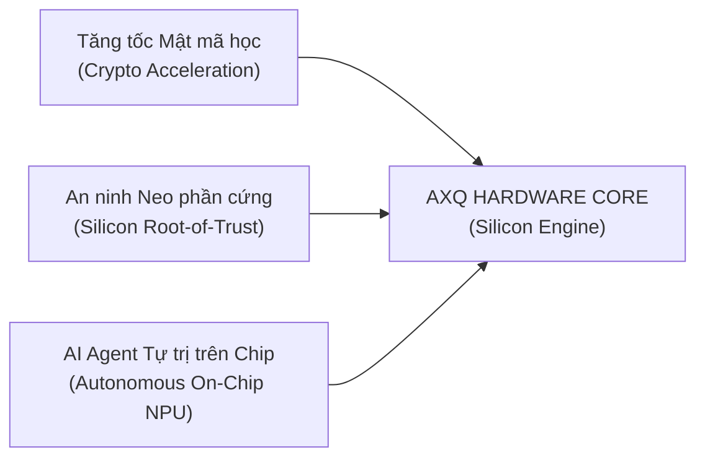

# 🎯 TÓM LƯỢC CHIẾN LƯỢC: TỪ BASH SCRIPT ĐẾN SILICON CORE
### *Executive Summary: Transforming AXQ into the Ultimate Hardware Core*

---

## 1. BỐI CẢNH VÀ ĐỘNG LỰC PHÁT TRIỂN

Trong tài liệu nền tảng [`WIKIALISA_CORE_IDEA.md`](../../WIKIALISA_CORE_IDEA.md), dự án **Wikialisa** đã đạt được một cột mốc quan trọng: xây dựng một hệ điều hành máy chủ CLI tối giản dựa trên nhân Linux độc lập (`wikialisa/wikialisa`) và tích hợp mạng lưới blockchain **AXQ Chain** cùng cơ chế đồng thuận **Proof-of-Kernel (PoK)**.

Giao thức AXQ hiện tại hoạt động thông qua tiện ích quản trị `axq-master` (`rootfs/usr/bin/axq-master`), sử dụng các công cụ dòng lệnh tiêu chuẩn:
- Thuật toán băm SHA-256 chạy qua tiện ích `sha256sum`.
- Thuật toán mã hóa ví `wallet.dat` chạy qua lệnh `openssl enc -aes-256-cbc`.
- Mạng ngang hàng P2P chạy qua lệnh lắng nghe cổng `nc -l -p $NODE_PORT`.
- Dữ liệu đồng thuận PoK dựa trên biến môi trường và chuỗi ký tự nhân (`uname -r`, `date +%s`).

### Thách thức và Giới hạn Vật lý của Tầng Phần mềm
Mặc dù kiến trúc trên hoàn thành xuất sắc vai trò nguyên mẫu (Proof of Concept - PoC), việc duy trì hệ thống ở tầng Userland vấp phải những rào cản kỹ thuật không thể vượt qua:

1. **Hiệu năng và Nghẽn cổ chai I/O (I/O & Context Switching Bottlenecks):** Mỗi lệnh gọi tiện ích nhị phân bên ngoài (`sha256sum`, `openssl`) tiêu tốn hàng ngàn chu kỳ CPU cho các hàm hệ thống `fork()`, `execve()`, và chuyển đổi ngữ cảnh người dùng / nhân (user/kernel mode switch).
2. **Nguy cơ An ninh Bộ nhớ (Memory Safety & Key Exfiltration):** Khóa riêng tư (Private Key) được giải mã tạm thời vào bộ nhớ RAM của tiến trình userland. Một lỗ hổng phần mềm ở tầng ứng dụng hoặc tấn công qua kênh kề (Side-channel / Rowhammer) có thể trích xuất khóa bí mật.
3. **Tiêu thụ Điện năng (Joule per Hash):** CPU đa dụng (x86_64 general-purpose CPU) sử dụng từ $10^{-6}$ đến $10^{-7}$ Joules cho mỗi phép toán băm, trong khi mạch logic chuyên dụng (ASIC/Hardware Core) chỉ tiêu tốn $10^{-12}$ Joules (chênh lệch một triệu lần).

---

## 2. TẦM NHÌN: NHÂN LÕI PHẦN CỨNG AXQ (THE AXQ SILICON CORE)

Chiến lược biến AXQ thành nhân lõi phần cứng tối tân nhất được xây dựng dựa trên 3 trụ cột cốt lõi:

### Trụ cột 1: Tăng tốc Mật mã học Phần cứng Tuyệt đối (Zero-Latency Cryptography)
Chuyển hóa toàn bộ thuật toán SHA-256, Keccak-256, Poseidon (hàm băm tối ưu cho Zero-Knowledge Proofs) và giải thuật đường cong Elliptic (Secp256k1, Ed25519, BLS12-381) thành các khối xử lý phần cứng chuyên dụng (Hardware Co-processor). Mỗi phép tính băm hoặc ký số được thực thi trong một chu kỳ xung nhịp (Single-cycle execution).

### Trụ cột 2: Phần cứng Gốc Tin cậy (Silicon Root-of-Trust & PUF)
Tích hợp tế bào vi mạch vật lý không thể sao chép (SRAM PUF - Physically Unclonable Function). Khóa bảo mật của mạng lưới AXQ không bao giờ lưu trữ tĩnh trong bộ nhớ mà được tái tạo động từ các đặc tính lượng tử/vật lý của chính phiến silicon. Không một kỹ thuật phần mềm hay can thiệp vật lý nào có thể trích xuất được khóa riêng tư.

### Trụ cột 3: Nhân Xử lý Thần kinh cho AI Agent (On-chip NPU for Agent Chain)
Trong `DOCS.MD`, "AI Agent Chain" đóng vai trò khởi tạo và điều phối node. Khi tiến hóa lên phần cứng, một nhân vi xử lý thần kinh (NPU - Neural Processing Unit) nhỏ gọn dạng Systolic Array được tích hợp song song với pipeline của CPU. AI Agent có thể chạy mô hình ngôn ngữ/suy luận định lượng (Quantized SLM) độc lập để tự động xác minh giao dịch, điều chỉnh độ khó khai thác và bảo vệ mạng lưới theo thời gian thực mà không phụ thuộc vào máy chủ ngoài.

---

## 3. LỢI THẾ CẠNH TRANH CỦA AXQ CORE

| Tiêu chí | Hệ thống thông thường (Bitcoin / Ethereum Node) | AXQ Hardware Core Server |
| :--- | :--- | :--- |
| **Bảo vệ Khóa bí mật** | Tệp tin trên ổ đĩa / Trình duyệt / HSM ngoài | **Trực tiếp trong Silicon PUF Vault** |
| **Đồng thuận** | PoW tiêu tốn năng lượng / PoS tập trung vốn | **Proof-of-Kernel phần cứng (Hardware Entropy)** |
| **Thời gian xác thực khối** | 12 giây - 10 phút | **< 10 micro-giây (Hardware Pipeline)** |
| **Khả năng tự trị (Autonomous)**| Cần script/bot bên ngoài điều khiển | **AI Agent tích hợp sẵn trong vi mạch** |
| **Kháng tấn công vật lý** | Rủi ro cao nếu máy chủ bị chiếm quyền vật lý | **Tự động hủy khóa khi phát hiện cạy mở chip** |

---

## 4. KẾT LUẬN VÀ BƯỚC ĐI TIẾP THEO

Việc chuyển dịch từ tầng script sang tầng bán dẫn là con đường duy nhất để đưa hệ sinh thái Wikialisa Core và đồng tiền AXQ trở thành định chế hạ tầng tài chính toàn cầu. Các tài liệu tiếp theo trong thư mục `docs/` sẽ phân rã chi tiết từng bước hiện thực hóa từ mã nguồn C kernel driver, kiến trúc vi nhân Rust, mã RTL Verilog/Chisel, đến bộ tập lệnh mở rộng RISC-V AXQ-V ISA.

