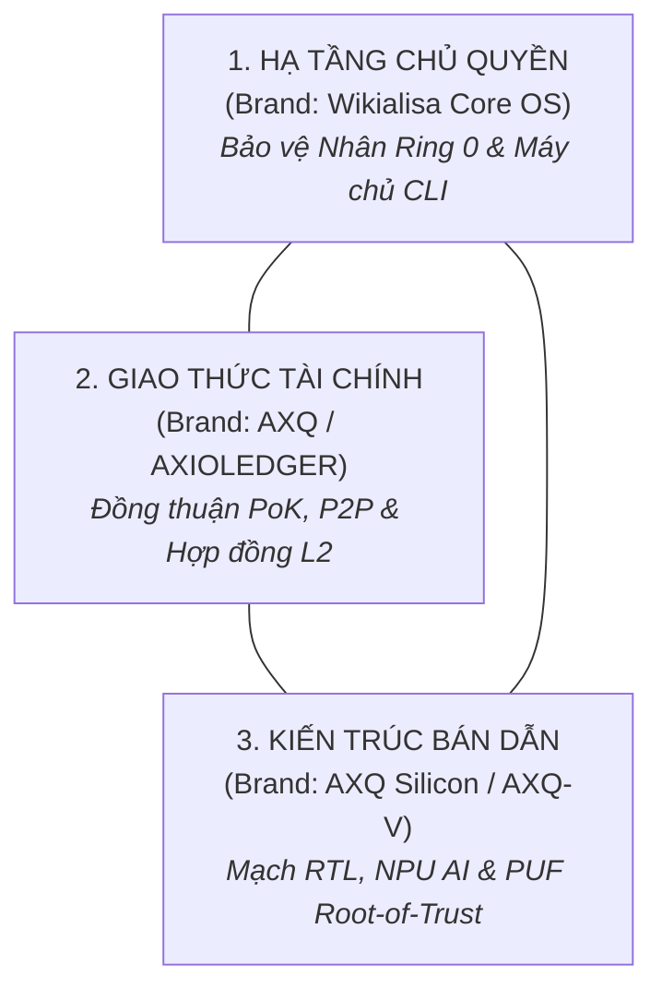
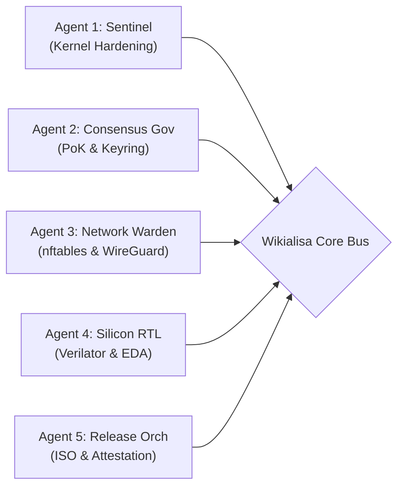

# 🛡️ MA TRẬN VAI TRÒ KỸ NĂNG & QUY CHUẨN PHÂN QUYỀN THƯƠNG HIỆU LÕI
### *Wikialisa Core OS & AXQ Silicon Architecture Governance Specification*
> **"Sovereign Trust through Separation of Powers: Strict Brand Boundaries & Autonomous Skill Specialization"**  
> *Định chế quản trị tối cao, phân tầng quyền hạn kỹ thuật và đặc tả vai trò kỹ năng chuyên biệt cho Nhân hệ điều hành, Mạng lưới AXQ và Kiến trúc Bán dẫn Silicon.*

---

## 📑 MỤC LỤC TỔNG QUAN

1. [Tầm Nhìn Định Chế & Nguyên Tắc Tam Quyền Kỹ Thuật](#1-tầm-nhìn-định-chế--nguyên-tắc-tam-quyền-kỹ-thuật)
2. [Hệ Thống Vai Trò Kỹ Năng Cho Lõi (Core Skill Roles & Capabilities)](#2-hệ-thống-vai-trò-kỹ-năng-cho-lõi)
   - 2.1. [Phân tầng Vai trò Tác nhân AI Tự trị (Autonomous AI Agent Roles)](#21-phân-tầng-vai-trò-tác-nhân-ai-tự-trị)
   - 2.2. [Phân tầng Vai trò Kỹ sư & Nhóm Chuyên môn (Human Engineering Roles)](#22-phân-tầng-vai-trò-kỹ-sư--nhóm-chuyên-môn)
   - 2.3. [Phân cấp Đặc quyền Hệ thống trong Nhân (Kernel Privilege & POSIX Capabilities)](#23-phân-cấp-đặc-quyền-hệ-thống-trong-nhân)
3. [Cơ Chế Phân Quyền Thương Hiệu Lõi (Brand Hierarchy & Governance)](#3-cơ-chế-phân-quyền-thương-hiệu-lõi)
   - 3.1. [Cây Phân Cấp Thương Hiệu 4 Tầng (The 4-Tier Brand Architecture)](#31-cây-phân-cấp-thương-hiệu-4-tầng)
   - 3.2. [Ma Trận Quyền Hạn & Tiêu Chuẩn Sử Dụng Thương Hiệu](#32-ma-trận-quyền-hạn--tiêu-chuẩn-sử-dụng-thương-hiệu)
   - 3.3. [Quy Tắc Quản Trị Bản Phân Phối Phái Sinh (Fork & Derivative Rules)](#33-quy-tắc-quản-trị-bản-phân-phối-phái-sinh)
4. [Hiện Thực Hóa Kỹ Thuật Trong Mã Nguồn Lõi](#4-hiện-thực-hóa-kỹ-thuật-trong-mã-nguồn-lõi)
   - 4.1. [Tệp Header C Định Danh Thương Hiệu (`include/wikialisa/brand.h`)](#41-tệp-header-c-định-danh-thương-hiệu)
   - 4.2. [Chính Sách Phân Quyền Hạt Nhân (`/etc/wikialisa/capabilities.conf`)](#42-chính-sách-phân-quyền-hạt-nhân)
   - 4.3. [Chữ Ký Số Định Danh Bản Phát Hành (Release Cryptographic Attestation)](#43-chữ-ký-số-định-danh-bản-phát-hành)
5. [Tóm Lược & Cam Kết Chủ Quyền Số](#5-tóm-lược--cam-kết-chủ-quyền-số)

---

## 1. TẦM NHÌN ĐỊNH CHẾ & NGUYÊN TẮC TAM QUYỀN KỸ THUẬT

Để bảo vệ tính vĩnh cửu, độ toàn vẹn an ninh và độc lập chủ quyền của hệ sinh thái **Wikialisa Core OS & AXQ Silicon Architecture**, hệ thống không thể chỉ dựa vào thiện chí cá nhân hay các quy ước mơ hồ. Dự án thiết lập một **Định chế Quản trị Kỹ thuật Khép kín (Technical Governance)** dựa trên nguyên tắc **Tam Quyền Phân Lập Kỹ Thuật (Separation of Technical Powers)**:



- **Quyền Hạ Tầng (Infrastructure Power - Brand `Wikialisa`):** Chịu trách nhiệm về nhân hệ điều hành, bảo mật bộ nhớ, quản trị thiết bị, và hệ thống tệp lưu trữ. Quyền này độc lập hoàn toàn với việc khai thác tài chính; máy chủ Wikialisa có thể hoạt động như một máy chủ bảo mật độc lập mà không bắt buộc phải tham gia đào coin.
- **Quyền Giao Thức (Protocol Power - Brand `AXQ` / `AXIOLEDGER`):** Chịu trách nhiệm về tính toàn vẹn của sổ cái phi tập trung, phân bổ token, xác thực khối qua PoK và quy chuẩn kết nối định chế tài chính quốc tế.
- **Quyền Phần Cứng (Silicon Power - Brand `AXQ Silicon` / `AXQ-V`):** Chịu trách nhiệm về đặc tả tập lệnh mở rộng RISC-V, bảo hộ sở hữu trí tuệ thiết kế vi mạch RTL, và cơ chế bảo vệ khóa vật lý trong phiến bán dẫn.

### 1.2. Tam Giác Quản Trị Vận Hành: Pháp Lý - Thiết Kế - DevOps
Để cụ thể hóa các quyền lực trên vào hoạt động thực tế hàng ngày của dự án, 3 trụ cột vận hành chuyên nghiệp được phân định rõ ràng về **Vai trò, Quyền hạn và Nghĩa vụ**:

1. **Pháp Lý & Tuân Thủ (Luật / Legal & Compliance):**
   - *Vai trò:* Định hình khung pháp lý, kiểm soát rủi ro sở hữu trí tuệ (GPL-2.0, RISC-V ISA patent), bảo đảm tuân thủ quy chuẩn tài chính quốc tế (FATF Travel Rule, ISO 20022, GDPR, Privacy by Design).
   - *Quyền hạn:* **Quyền Phủ quyết (Veto Power)** chặn phát hành vi phạm pháp lý/bản quyền; **Quyền Kiểm toán** luồng dữ liệu ví và node; **Quyền Duyệt Điều khoản** ToS, Privacy Policy và hợp đồng định chế AXIOLEDGER.
   - *Nghĩa vụ:* Cập nhật pháp luật sở tại/quốc tế; xây dựng quy chuẩn Travel Rule và báo cáo giao dịch đáng ngờ STR; tích hợp bảo mật quyền riêng tư mặc định.

2. **Thiết Kế (UI/UX & Product Design):**
   - *Vai trò:* Định hình trải nghiệm người dùng xuyên suốt từ CLI ASCII Heritage Art, Web Control Center, ứng dụng AXQ Studio (Rust/Tauri) đến máy trạm Wayland; biến các cấu trúc mật mã/phần cứng phức tạp thành giao diện dễ sử dụng.
   - *Quyền hạn:* **Quyền Định hình Trải nghiệm (UX Ownership)** luồng thao tác và Design System; **Quyền Yêu cầu Chuẩn hóa** buộc Frontend tuân thủ pixel-perfect; **Quyền Thử nghiệm A/B** tối ưu hóa tương tác.
   - *Nghĩa vụ:* Đảm bảo tính minh bạch, **tuyệt đối không dùng Dark Patterns**; thiết kế cảnh báo rủi ro sao lưu khóa riêng tư và điểm chạm eKYC tự nhiên; bàn giao Design Tokens/SVG chuẩn hóa.

3. **Hạ Tầng & Vận Hành (DevOps / Infrastructure & SRE):**
   - *Vai trò:* Xây dựng và duy trì hạ tầng máy chủ, cụm seed nodes, pipeline tự động hóa CI/CD, kiểm thử kernel và mô phỏng RTL, bảo đảm tính sẵn sàng và an ninh 24/7.
   - *Quyền hạn:* **Quyền Kiểm soát Môi trường (Access Control)** máy chủ production/staging và secrets vault; **Quyền Khóa Triển khai (Deployment Block)** chặn build nếu `bzImage >= 8MB`, Verilator có lỗi lint hoặc test QEMU hỏng; **Quyền Cấu hình Hạ tầng & Toolchain**.
   - *Nghĩa vụ:* Cam kết SLA/Uptime >= 99.99%; mã hóa Data at Rest và Data in Transit; duy trì Audit Logs phục vụ công tác thanh tra pháp lý.

#### Ma Trận Phối Hợp Trách Nhiệm RACI
| Hoạt động / Sản phẩm bàn giao cốt lõi | Luật (Legal) | Thiết kế (Design) | DevOps & SRE |
| :--- | :---: | :---: | :---: |
| **Xác thực eKYC & Tuân thủ Travel Rule (AXIOLEDGER)** | **A** (Chủ trì & Phê duyệt) | **R** (Thiết kế luồng UI/UX) | **C** (Hỗ trợ hạ tầng lưu trữ) |
| **Xây dựng Design System, Tokens & UI Kit** | **I** (Theo dõi tuân thủ) | **A / R** (Chủ trì & Thực thi) | **C** (Hỗ trợ cấu hình CDN/Assets) |
| **Quy trình CI/CD, Kernel Build & Verilator Lint** | **I** (Theo dõi bản quyền) | **I** (Theo dõi) | **A / R** (Chủ trì & Thực thi tự động) |
| **Ứng phó Sự cố Lộ Dữ liệu / Lỗ hổng Bảo mật** | **A** (Xử lý pháp lý & công bố) | **I** (Cập nhật banner cảnh báo) | **R** (Khoanh vùng & Khắc phục kỹ thuật) |
| **Kiểm định Bản quyền Giấy phép GPL-2.0 & Nhãn hiệu**| **A / R** (Thẩm định & Quyết định) | **I** (Tuân thủ Brand Guidelines) | **C** (Quét mã nguồn tự động) |
| **Thiết kế & Tích hợp Cảnh báo Sao lưu Khóa Riêng tư** | **C** (Rà soát pháp lý rủi ro) | **A / R** (Thiết kế trực quan) | **C** (Kiểm tra cơ chế xóa sạch RAM) |
| **Phát hành Bản Phân Phối ISO Kép Chính Thức** | **C** (Duyệt điều khoản đi kèm) | **C** (Duyệt banner & hình ảnh) | **A / R** (Đóng gói, Ký số & Phát hành) |

*Ghi chú: **R** (Responsible - Người thực hiện), **A** (Accountable - Người chịu trách nhiệm chính/Phê duyệt), **C** (Consulted - Người được tham vấn), **I** (Informed - Người nhận thông tin).*

---

## 2. HỆ THỐNG VAI TRÒ KỸ NĂNG CHO LÕI (CORE SKILL ROLES & CAPABILITIES)

Hệ thống phân định rạch ròi 3 tầng vai trò kỹ năng: Tác nhân AI Tự trị (Autonomous AI Agents), Đội ngũ Kỹ sư Chuyên môn (Human Engineering Teams), và Phân quyền Tiến trình Nhân (Kernel Capabilities).

### 2.1. Phân Tầng Vai Trò Tác Nhân AI Tự Trị (Autonomous AI Agent Roles)

Các tác nhân AI Coding & Operations Agent tham gia phát triển, bảo trì và tự động vận hành hệ thống được gán các vai trò kỹ năng chuyên biệt:



| Tên Vai Trò (Agent Role) | Định Danh (Role ID) | Bộ Kỹ Năng Bắt Buộc (Skill Sets) | Giới Hạn Thẩm Quyền (Permissions Boundary) |
| :--- | :--- | :--- | :--- |
| **Kernel Sentinel Agent** | `role:kernel-sentinel` | - Phân tích tĩnh C / Smatch / Sparse.<br/>- Tinh chỉnh cờ Kconfig hardening.<br/>- Kiểm soát lỗ hổng tràn bộ đệm và leo thang đặc quyền Ring 0. | - Quyền đọc toàn bộ cây mã nguồn hạt nhân.<br/>- Đề xuất bản vá bảo mật cho `/init/main.c` và `/arch/x86/`.<br/>- **Không có quyền** can thiệp vào logic số dư ví AXQ. |
| **Consensus Governor Agent** | `role:consensus-governor`| - Thu thập & phân tích entropy phần cứng (`/dev/axq`, RDTSC, PMU).<br/>- Thuật toán điều tiết độ khó khai thác PoK thích ứng.<br/>- Giám sát vùng nhớ khóa mã hóa an toàn. | - Quyền gọi IOCTL `AXQ_IOCTL_MINE_BLOCK`.<br/>- Tương tác với Hardware Keyring / PUF Vault.<br/>- **Không có quyền** sửa đổi cấu hình tường lửa hệ thống. |
| **Network Warden Agent** | `role:network-warden` | - Quản trị tường lửa `nftables` khép kín.<br/>- Tối ưu hóa MTU 1420 & MSS Clamping cho WireGuard.<br/>- Phân cấp lưu lượng HTB QoS và cấu hình XDP/eBPF fastpath. | - Quyền thực thi `CAP_NET_ADMIN`.<br/>- Cập nhật ruleset bảng lọc mạng inet.<br/>- **Không có quyền** truy cập khóa bí mật ví trong RAM. |
| **Silicon RTL Agent** | `role:silicon-rtl` | - Thiết kế phần cứng SystemVerilog / Chisel.<br/>- Chạy linter Verilator (`--lint-only -Wall`).<br/>- Kiểm định pipeline băm 64 giai đoạn & bộ mở rộng tập lệnh RISC-V AXQ-V. | - Quyền ghi trong thư mục `src/hardware/rtl/`.<br/>- Quyền tạo testbench và phân tích dạng sóng VCD.<br/>- **Không có quyền** sửa đổi cấu trúc người dùng FHS. |
| **Release Orchestrator Agent**| `role:release-orchestrator`| - Biên dịch BusyBox tĩnh và đóng gói cpio xz-9 extreme.<br/>- Kiểm thử tự động QEMU không giao diện qua Expect script.<br/>- Đóng gói ISO bootable kép UEFI/BIOS và chứng thực chữ ký số. | - Quyền kích hoạt GitHub Actions CI/CD.<br/>- Quyền tạo nhãn Git Tag (`v*`) và đóng gói ISO release.<br/>- **Không có quyền** tự ý bypass quy trình kiểm thử QEMU. |

---

### 2.2. Phân Tầng Vai Trò Kỹ Sư & Nhóm Chuyên Môn (Human Engineering Roles)

1. **Chief Systems Architect (Tổng Kiến Trúc Sư Hệ Thống):**
   - Thẩm quyền cao nhất về tính toàn vẹn của Hiến pháp [`WIKIALISA_CORE_IDEA.md`](../../WIKIALISA_CORE_IDEA.md).
   - Quyền phê duyệt hợp nhất (Merge Approval) vào nhánh `main` của repository chính thức.
   - Nắm giữ khóa Root GPG để ký phát hành bản phân phối ISO định kỳ.
2. **Kernel & Security Engineer (Kỹ Sư Nhân & Bảo Mật):**
   - Chịu trách nhiệm trực tiếp về source tree `wikialisa/wikialisa`, module `/drivers/crypto/axq`, và các bản vá cờ bảo vệ bộ nhớ.
   - Kiểm tra và đảm bảo không để lọt bất kỳ driver dư thừa nào (Sound, GUI, Wireless) làm tăng dung lượng bzImage quá 8MB.
3. **Hardware & Silicon Architect (Kiến Trúc Sư Phần Cứng & Bán Dẫn):**
   - Chịu trách nhiệm về kiến trúc SystemVerilog RTL trong `src/hardware/rtl/`, bộ tập lệnh mở rộng `AXQ-V ISA`, và lộ trình đúc chip (Tape-out) qua các đối tác foundry.
   - Tối ưu hóa mức tiêu thụ năng lượng đạt mục tiêu cận lý thuyết ($10^{-12}\text{ J/Hash}$).
4. **Decentralized Network & Protocol Lead (Trưởng Nhóm Mạng & Giao Thức AXQ):**
   - Quản trị giao thức mạng ngang hàng P2P cổng 8333, thuật toán Proof-of-Kernel thích ứng, và cầu nối định chế AXIOLEDGER ISO 20022.

---

### 2.3. Phân Cấp Đặc Quyền Hệ Thống Trong Nhân (Kernel Privilege & POSIX Capabilities)

Hệ điều hành Wikialisa Core OS **từ chối mô hình Superuser "toàn năng vô điều kiện" (All-powerful Root)** truyền thống của UNIX. Thay vào đó, hệ thống áp dụng cơ chế phân quyền dựa trên POSIX Capabilities và Sandboxing:

```text
+-------------------------------------------------------------------------+
| RING 0: WIKIALISA HARDENED KERNEL SUBSYSTEM                             |
| - CONFIG_STRICT_KERNEL_RWX: Không có vùng nhớ nào vừa Ghi vừa Thực thi  |
| - CONFIG_INIT_ON_ALLOC_DEFAULT_ON: Khởi tạo zero hóa bộ nhớ tuyệt đối   |
| - Module Chữ Ký Số: Chỉ nạp driver được ký bởi Wikialisa Core Authority|
+-------------------------------------------------------------------------+
                                    ▲
                                    │ Syscalls / Device IOCTL
+-------------------------------------------------------------------------+
| RING 3: CHIA TÁCH ĐẶC QUYỀN TIẾN TRÌNH (CAPABILITY SLICING)            |
|                                                                         |
|  [axq_network_daemon]  --> Chỉ cấp CAP_NET_BIND_SERVICE, CAP_NET_RAW   |
|                            (Bị cô lập, cấm đọc disk /dev/nvme*)         |
|                                                                         |
|  [axq_mining_engine]   --> Chỉ cấp quyền đọc /dev/axq và CAP_SYS_NICE  |
|                            (Bị cấm hoàn toàn socket kết nối ra ngoài)   |
|                                                                         |
|  [axq_wallet_manager]  --> Chạy trong Enclave / Khóa RAM mlock()       |
|                            (Tự hủy vùng nhớ giải mã ngay sau khi ký)    |
+-------------------------------------------------------------------------+
```

---

## 3. CƠ CHẾ PHÂN QUYỀN THƯƠNG HIỆU LÕI (BRAND HIERARCHY & GOVERNANCE)

### 3.1. Cây Phân Cấp Thương Hiệu 4 Tầng (The 4-Tier Brand Architecture)

Để đảm bảo danh tiếng và sự tin cậy tuyệt đối của người dùng và các định chế tài chính, các thương hiệu trong hệ sinh thái được phân định ranh giới sở hữu và thẩm quyền như sau:

```
🏛️ WIKIALISA (Master Sovereign Infrastructure Brand)
 ├── 🌐 AXQ / AXQ CHAIN (Decentralized Protocol & Network Brand)
 ├── 🏦 AXIOLEDGER (Institutional Financial Settlement Gateway Brand)
 └── ⚡ AXQ SILICON / AXQ-V (Deep-Tech Hardware & Semiconductor Brand)
```

1. **Thương Hiệu Cấp 1: `Wikialisa` (`wikialisa/wikialisa`)**
   - **Bản chất:** Thương hiệu Hạ tầng Số Chủ quyền & Quốc gia Số (Sovereign Infrastructure Brand).
   - **Tài sản định danh:** Source tree Linux fork chính thống, tên hạt nhân `UTS_SYSNAME="wikialisa"`, hậu tố `EXTRAVERSION = -wikialisa-core`, biểu trưng ASCII Heritage Art, bộ cài đặt đĩa cứng `wikialisa-install`.
   - **Ý nghĩa cốt lõi:** Đại diện cho tính tối giản, bảo mật tuyệt đối, không thỏa hiệp với các đám mây độc quyền hay cơ chế cửa sau (Backdoors).
2. **Thương Hiệu Cấp 2: `AXQ` / `AXQ Chain`**
   - **Bản chất:** Thương hiệu Giao thức Đồng thuận & Kinh tế Phi tập trung (Decentralized Economic Protocol).
   - **Tài sản định danh:** Đồng tiền $AXQ, thuật toán Proof-of-Kernel (PoK), công cụ dòng lệnh `axq-master`, định dạng địa chỉ `AXQ...`, cổng TCP 8333.
   - **Ý nghĩa cốt lõi:** Tự do tài chính, gắn kết công sức tính toán và tính toàn vẹn của phần cứng với giá trị kinh tế.
3. **Thương Hiệu Cấp 3: `AXIOLEDGER`**
   - **Bản chất:** Thương hiệu Cổng Thanh toán & Định chế Tài chính (Institutional Settlement Brand).
   - **Tài sản định danh:** Module kết nối chuẩn quốc tế SWIFT/ISO 20022, hạ tầng L2 Sequencer Rollup, hợp đồng thông minh tài sản thực (RWA).
   - **Ý nghĩa cốt lõi:** Cung cấp cầu nối vững chắc đưa dòng vốn của chính phủ, ngân hàng thương mại và quỹ đầu tư vào mạng lưới AXQ.
4. **Thương Hiệu Cấp 4: `AXQ Silicon` / `AXQ-V` / `AXQ-1`**
   - **Bản chất:** Thương hiệu Vi Mạch Bán Dẫn & Phần Cứng Chuyên Dụng (Hardware Semiconductor Brand).
   - **Tài sản định danh:** Chuẩn tập lệnh mở rộng `AXQ-V ISA`, chip vi xử lý `AXQ-1 SoC`, mảng NPU Tensor Systolic Array, công nghệ bảo mật `SRAM PUF Vault`.
   - **Ý nghĩa cốt lõi:** Khẳng định bước nhảy vọt công nghệ đưa toàn bộ thuật toán phần mềm thành phần cứng silicon không thể xuyên thủng.

---

### 3.2. Ma Trận Quyền Hạn & Tiêu Chuẩn Sử Dụng Thương Hiệu

| Thương Hiệu (Brand) | Cơ Quan Thẩm Quyền Quản Trị | Tiêu Chí Sử Dụng Chính Thức | Hành Vi Bị Nghiêm Cấm (Violations) |
| :--- | :--- | :--- | :--- |
| **`Wikialisa`** | Wikialisa Governance Committee | Chỉ sử dụng cho nhân Linux chuẩn rút gọn, rootfs FHS chính thống, và các bản phát hành ISO được ký số. | - Bổ sung GUI/X11/Wayland rồi gắn nhãn Wikialisa Core.<br/>- Đưa telemetry/theo dõi người dùng vào mã nguồn.<br/>- Chèn mã độc, backdoors hoặc tắt cờ bảo vệ bộ nhớ. |
| **`AXQ`** | AXQ Decentralized Community & DAO | Sử dụng cho các node, ví, mining pool tuân thủ đồng thuận Proof-of-Kernel chính thức. | - Tạo token giả mạo trên các chuỗi khác mà không có cầu nối xác thực.<br/>- Tuyên truyền sai lệch về tỷ lệ phát hành hoặc lạm phát. |
| **`AXIOLEDGER`** | Institutional Compliance Alliance | Dành cho các định chế tài chính, ngân hàng đối tác đã hoàn tất quy trình KYC/AML và kết nối ISO 20022. | - Sử dụng cho các dịch vụ rửa tiền hoặc hoạt động tài chính bất hợp pháp.<br/>- Tự xưng là cổng thanh toán định chế khi chưa đạt audit. |
| **`AXQ Silicon`** | Wikialisa Hardware Alliance | Áp dụng cho các bo mạch FPGA, chip ASIC, IP Core đã vượt qua bộ kiểm thử Verilator và đạt chuẩn vật lý. | - Gắn mác AXQ-V lên vi mạch chưa qua kiểm định an toàn PUF.<br/>- Độc quyền hóa tập lệnh mở rộng RISC-V thành đóng kín. |

---

### 3.3. Quy Tắc Quản Trị Bản Phân Phối Phái Sinh (Fork & Derivative Rules)

Hệ sinh thái Wikialisa tôn trọng tuyệt đối tinh thần mã nguồn mở theo giấy phép **GNU General Public License v2.0 (GPL-2.0)**. Tuy nhiên, để bảo vệ người dùng khỏi các rủi ro lừa đảo hoặc suy giảm an ninh:

1. **Quy Tắc Buộc Đổi Tên (Mandatory Rebranding):**
   - Bất kỳ cá nhân hoặc tổ chức nào fork mã nguồn `wikialisa/wikialisa` và thực hiện một trong các thay đổi sau **BẮT BUỘC PHẢI THAY ĐỔI TOÀN BỘ ĐỊNH DANH THƯƠNG HIỆU** (không được chứa từ "Wikialisa" hay "AXQ"):
     - Thay đổi thuật toán đồng thuận PoK hoặc sửa đổi bảng chia thưởng khối.
     - Vô hiệu hóa các cờ bảo vệ bộ nhớ nghiêm ngặt (`CONFIG_STRICT_KERNEL_RWX`, `CONFIG_SECURITY_SELINUX`).
     - Tích hợp thêm các subsystem đồ họa hoặc driver thương mại đóng kín (Proprietary Binary Blobs).
2. **Quy Tắc Bản Phân Phối Tương Thích (Certified Compatible Distro):**
   - Chỉ các bản phân phối duy trì 100% mã nguồn sạch, vượt qua bài kiểm tra tự động `test_script.exp` trên QEMU, và được ký số bởi Ủy ban Quản trị mới được phép sử dụng danh xưng:
     > *"Wikialisa Core Certified Distribution"*

---

## 4. HIỆN THỰC HÓA KỸ THUẬT TRONG MÃ NGUỒN LÕI

Để các quy tắc phân quyền thương hiệu và vai trò kỹ năng không chỉ nằm trên giấy, chúng được đúc kết thành các định nghĩa phần mềm trong cây mã nguồn:

### 4.1. Tệp Header C Định Danh Thương Hiệu (`include/wikialisa/brand.h`)
Được tạo trong cây mã nguồn hạt nhân để đảm bảo mọi module đều tuân thủ định danh duy nhất:

```c
#ifndef _WIKIALISA_BRAND_H
#define _WIKIALISA_BRAND_H

/* =====================================================================
 * WIKIALISA CORE OS & AXQ SILICON ARCHITECTURE - BRAND SPECIFICATION
 * ===================================================================== */

#define WIKIALISA_SOVEREIGN_NAME        "Wikialisa Core OS"
#define WIKIALISA_SYSNAME_ID            "wikialisa"
#define WIKIALISA_KERNEL_EXTRAVERSION   "-wikialisa-core"
#define WIKIALISA_RUNTIME_BANNER        "WIKIALISA CORE CLI - GENESIS HARDWARE RUNTIME"

#define AXQ_CHAIN_NETWORK_NAME          "AXQ Chain Protocol"
#define AXQ_CHAIN_COIN_SYMBOL           "AXQ"
#define AXQ_DEFAULT_P2P_PORT            8333
#define AXQ_PROTOCOL_VERSION            20002

#define AXIOLEDGER_GATEWAY_NAME         "AXIOLEDGER Institutional Settlement"
#define AXIOLEDGER_COMPLIANCE_STD       "ISO-20022-UNIFI"

#define AXQ_SILICON_CORE_NAME           "AXQ-V RISC-V Silicon Processor"
#define AXQ_SILICON_ISA_EXT             "rv64gc_zaxq"
#define AXQ_SILICON_ROT_TYPE            "SRAM-PUF-HARDWARE-ROOT-OF-TRUST"

#endif /* _WIKIALISA_BRAND_H */
```

### 4.2. Chính Sách Phân Quyền Hạt Nhân (`/etc/wikialisa/capabilities.conf`)
Định nghĩa quyền hạn tối thiểu cho từng vai trò tiến trình khi hệ thống khởi động:

```ini
# =====================================================================
# WIKIALISA CORE ZERO-TRUST CAPABILITY ASSIGNMENT POLICY
# =====================================================================

[role.sentinel]
description = "Kernel Security Auditor and Integrity Checker"
capabilities = CAP_SYS_PTRACE, CAP_DAC_READ_SEARCH
allowed_devices = /dev/kmsg, /dev/mem
restricted_network = true

[role.consensus]
description = "Proof-of-Kernel Miner and Key Manager"
capabilities = CAP_SYS_NICE, CAP_IPC_LOCK
allowed_devices = /dev/axq, /dev/urandom
restricted_network = false
allowed_ports = 8333

[role.network]
description = "Network Warden and Firewall Operator"
capabilities = CAP_NET_ADMIN, CAP_NET_BIND_SERVICE, CAP_NET_RAW
allowed_devices = /dev/net/tun
allowed_ports = 22, 8333
restricted_filesystem = true
```

### 4.3. Chữ Ký Số Định Danh Bản Phát Hành (Release Cryptographic Attestation)
Mỗi bản dựng ISO chính thức phải đi kèm chữ ký số PGP/GPG tách rời (`.asc`) và chuỗi mã băm SHA-256 đối soát:

```bash
# Lệnh tạo băm xác thực tính toàn vẹn thương hiệu
sha256sum wikialisa-core-amd64.iso > wikialisa-core-amd64.iso.sha256

# Ký số nhãn hiệu chính thức của Ủy ban Quản trị Wikialisa
gpg --armor --detach-sign --output wikialisa-core-amd64.iso.asc wikialisa-core-amd64.iso

# Xác minh tính xác thực nguồn gốc bản phân phối
gpg --verify wikialisa-core-amd64.iso.asc wikialisa-core-amd64.iso
```

---

## 5. TÓM LƯỢC & CAM KẾT CHỦ QUYỀN SỐ

Hiến chương Phân quyền Thương hiệu và Vai trò Kỹ năng này xác lập nền móng vững chắc cho dự án:
1. **Minh bạch tuyệt đối:** Người dùng, nhà phát triển và định chế tài chính luôn biết chính xác giới hạn thẩm quyền của từng phân hệ.
2. **Bảo vệ thương hiệu trước sự biến tướng:** Ngăn chặn triệt để tình trạng các bản fork kém chất lượng làm suy yếu tiêu chuẩn an ninh hạt nhân tối giản.
3. **Phát huy sức mạnh Tác nhân AI:** Trao quyền tự trị tối đa cho các AI Agent chuyên biệt trong khuôn khổ ranh giới an toàn nghiêm ngặt.
4. **Trường tồn cùng thời gian:** Đưa Wikialisa trở thành một chuẩn mực hạ tầng số toàn cầu, bền vững từ tầng nhân Linux đến vi mạch bán dẫn Silicon độc lập.

---
*Văn bản được phê chuẩn bởi Hội đồng Kiến trúc Hệ thống Wikialisa Core & AXQ Hardware Governance Board.*

