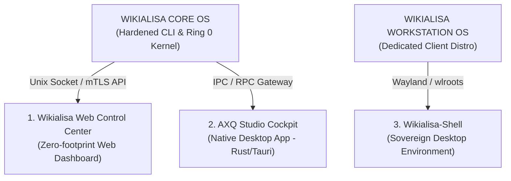
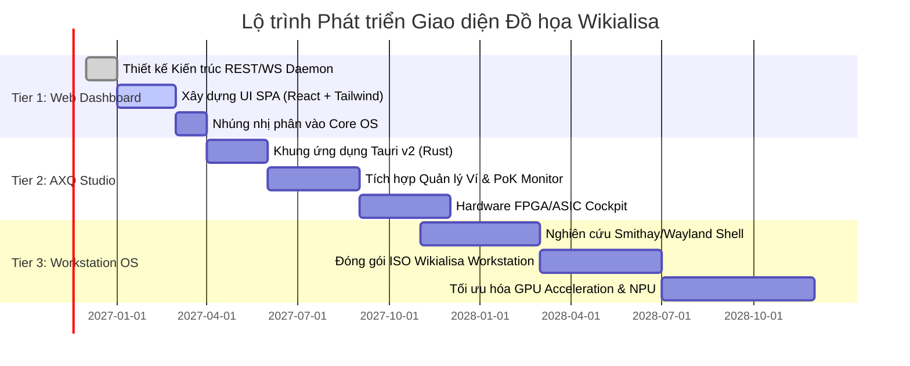

# 🖥️ KIẾN TRÚC & KẾ HOẠCH PHÁT TRIỂN WIKIALISA GUI
### *Wikialisa Sovereign GUI Architecture, Web Control Center & Desktop Workstation Roadmap*
> **"Visualizing Sovereign Infrastructure: From Headless Core to Modern Wayland & Web Cockpit"**  
> *Đặc tả chiến lược, kiến trúc kỹ thuật và lộ trình triển khai giao diện đồ họa cho hệ sinh thái Wikialisa, phân định rõ ràng giữa Nhân máy chủ CLI và Môi trường Máy trạm Trực quan.*

---

## 📑 MỤC LỤC TỔNG QUAN

1. [Tầm Nhìn & Triết Lý Thiết Kế Giao Diện (Design Philosophy)](#1-tầm-nhìn--triết-lý-thiết-kế-giao-diện)
2. [Tam Giác Sản Phẩm Giao Diện Wikialisa (The 3 GUI Tiers)](#2-tam-giác-sản-phẩm-giao-diện-wikialisa)
   - 2.1. [Tier 1: Wikialisa Web Control Center (Lightweight WebGUI)](#21-tier-1-wikialisa-web-control-center-lightweight-webgui)
   - 2.2. [Tier 2: AXQ Studio & Hardware Cockpit (Native Client App)](#22-tier-2-axq-studio--hardware-cockpit-native-client-app)
   - 2.3. [Tier 3: Wikialisa Workstation OS & Wikialisa-Shell (Wayland Native)](#23-tier-3-wikialisa-workstation-os--wikialisa-shell-wayland-native)
3. [Nguyên Tắc An Ninh & Bảo Toàn Nhân Server Lõi](#3-nguyên-tắc-an-ninh--bảo-toàn-nhân-server-lõi)
4. [Hệ Thống Thiết Kế Trực Quan (Design System & Theme)](#4-hệ-thống-thiết-kế-trực-quan-design-system--theme)
5. [Lộ Trình Triển Khai Kỹ Thuật (Chronological GUI Roadmap)](#5-lộ-trình-triển-khai-kỹ-thuật-chronological-gui-roadmap)
6. [Tổ Chức Mã Nguồn & Công Nghệ Thực Thi](#6-tổ-chức-mã-nguồn--công-nghệ-thực-thi)

---

## 1. TẦM NHÌN & TRIẾT LÝ THIẾT KẾ GIAO DIỆN

Hệ điều hành cốt lõi **Wikialisa Core OS** kiên định với sứ mệnh máy chủ dòng lệnh tối giản (CLI-first, `bzImage < 8MB`, không chứa driver đồ họa X11/DRM). Tuy nhiên, để mở rộng quy mô tiếp cận đến các nhà quản trị hệ thống, nhà phân tích tài chính và người dùng cuối, hệ sinh thái cần một hệ thống **Giao diện Người dùng Trực quan (GUI)** đẳng cấp:



### Triết lý 4 Không (The 4 Non-Negotiables):
1. **Không phá vỡ nhân máy chủ:** GUI không bao giờ được nhúng trực tiếp vào kernel của bản `Wikialisa Core OS`. Nhân máy chủ vẫn giữ nguyên tắc không đồ họa để duy trì tính bảo mật tối đa.
2. **Không sử dụng X11:** Loại bỏ hoàn toàn máy chủ đồ họa X11 do các lỗ hổng kiến trúc cố hữu (cho phép các tiến trình đọc trộm phím gõ và chụp màn hình lẫn nhau). Mọi giao diện máy trạm đều dùng **Wayland-native**.
3. **Không tiêu tốn tài nguyên quá mức (Anti-Bloatware):** Nghiêm cấm sử dụng các khung cồng kềnh như Electron ngốn gigabyte RAM. Các ứng dụng máy trạm bắt buộc viết bằng **Rust + Tauri / Slint** hoặc **C++ / Qt6**.
4. **Bảo mật Neo Phần cứng:** Mọi thao tác ký giao dịch, xem số dư hoặc cấu hình phần cứng nhạy cảm đều phải kết nối qua kênh mã hóa an toàn tới `/dev/axq` hoặc Secure Enclave.

---

## 2. TAM GIÁC SẢN PHẨM GIAO DIỆN WIKIALISA (THE 3 GUI TIERS)

### 2.1. Tier 1: Wikialisa Web Control Center (Lightweight WebGUI)
- **Đối tượng phục vụ:** Quản trị viên máy chủ từ xa, kỹ sư DevOps, người vận hành node mạng.
- **Hình thức triển khai:** Dịch vụ daemon siêu nhẹ chạy ở tầng Userland trên cổng HTTPS (mặc định cổng 9443), hỗ trợ truy cập an toàn qua đường hầm **WireGuard**.
- **Công nghệ cốt lõi:**
  - Backend: Viết bằng **Rust (Axum / Actix-web)** hoặc C, tiêu thụ `< 15MB RAM`.
  - Frontend: Giao diện đơn trang tĩnh (SPA) viết bằng **React + Vite + TailwindCSS**, nén nhúng trực tiếp vào nhị phân backend bằng `include_dir`.
- **Tính năng trọng tâm:**
  - **Telemetry Dashboard:** Đo lường tải CPU, nhiệt độ phần cứng, dung lượng đĩa Btrfs và mức độ nén `zstd`.
  - **Mạng Lưới P2P & Firewall:** Trực quan hóa bản đồ topology các node kết nối, quản lý quy tắc `nftables` bằng 1 cú nhấp chuột.
  - **PoK Real-time Monitor:** Đồ thị tốc độ băm PoK thời gian thực, số chu kỳ CPU (RDTSC), và lịch sử tìm thấy khối mới.
  - **Web Terminal:** Shell dòng lệnh an toàn nhúng trên trình duyệt thông qua WebSocket xterm.js.

---

### 2.2. Tier 2: AXQ Studio & Hardware Cockpit (Native Client App)
- **Đối tượng phục vụ:** Nhà giao dịch, nhà đầu tư, nhà phát triển phần mềm và kỹ sư kiểm thử phần cứng.
- **Hình thức triển khai:** Ứng dụng Desktop chạy độc lập trên Windows, macOS và Linux.
- **Công nghệ cốt lõi:**
  - Khung ứng dụng: **Rust + Tauri v2** (sử dụng Webview bản địa của hệ điều hành, file thực thi `< 10MB`, RAM `< 40MB`).
  - Giao tiếp bảo mật: Kết nối tới node Wikialisa từ xa qua gRPC / WebSocket có chứng thực mTLS hoặc Unix Domain Socket cục bộ.
- **Tính năng trọng tâm:**
  - **Ví Mật Mã Đa Chữ Ký (Multi-Sig Vault):** Quản lý khóa riêng AES-256 PBKDF2, hỗ trợ khôi phục khóa và ký giao dịch ngoại tuyến (Cold Storage).
  - **Hardware ASIC/FPGA Telemetry:** Đo lường thông lượng qua bus PCIe của card FPGA Alveo, tần số xung nhịp nhân AXQ-1 và trạng thái buồng khóa SRAM PUF.
  - **AI Agent Orchestrator:** Bảng điều khiển tác nhân AI tự trị, cho phép người dùng giao nhiệm vụ cho Agent (ví dụ: tự động điều chỉnh độ khó khai thác, tự động tái cân bằng danh mục staking).

---

### 2.3. Tier 3: Wikialisa Workstation OS & Wikialisa-Shell (Wayland Native)
- **Đối tượng phục vụ:** Kỹ sư hệ thống muốn một trạm làm việc độc lập hoàn toàn, kháng kiểm duyệt và bảo mật tuyệt đối từ hạt nhân đến màn hình hiển thị.
- **Hình thức triển khai:** Một bản phân phối độc lập riêng biệt: **`Wikialisa Workstation Edition`** (đi kèm nhân Linux có hỗ trợ DRM/KMS/GPU drivers và hệ thống Wayland).
- **Công nghệ cốt lõi:**
  - Bộ tổng hợp hiển thị (Compositor): **`Wikialisa-Shell`** viết bằng **Rust (dựa trên Smithay / wlroots)**.
  - Kiến trúc phân chia quyền hạn: Mỗi cửa sổ ứng dụng chạy trong một container cgroups/seccomp riêng biệt.
  - Bộ tiện ích thanh trạng thái (Bar & Panel): Hiển thị block height của mạng AXQ, tốc độ băm cục bộ và mức độ an toàn của kết nối mạng ngang hàng.

---

## 3. NGUYÊN TẮC AN NINH & BẢO TOÀN NHÂN SERVER LÕI

Để đảm bảo quy chế quản trị thương hiệu và an ninh hạt nhân không bị xâm phạm:

```
+-------------------------------------------------------------------+
| PHÂN ĐỊNH RANH GIỚI BẢN PHÂN PHỐI (DISTRIBUTION BOUNDARIES)       |
+-------------------------------------------------------------------+
|  [Wikialisa Core OS]       --> Máy chủ CLI thuần túy (Headless)   |
|                                Kích thước bzImage < 8MB           |
|                                Tuyệt đối KHÔNG driver đồ họa DRM  |
+-------------------------------------------------------------------+
|  [Wikialisa Workstation]   --> Bản phân phối Trạm làm việc đồ họa |
|                                Bật cờ DRM, Mesa3D, GPU Drivers    |
|                                Sử dụng giao diện Wayland-native   |
+-------------------------------------------------------------------+
```

1. **Cô Lập Giao Diện Khỏi Vùng Nhớ Khóa Bí Mật:**
   - GUI không bao giờ được phép trực tiếp nắm giữ khóa riêng tư trong bộ nhớ của trình kết xuất đồ họa (Renderer Process).
   - Mọi thao tác ký đều phải thông qua IPC gửi yêu cầu tới tiến trình `axq-walletd` được bảo vệ bằng cờ `mlock()` và Hardware Enclave.
2. **Giao Thức Truyền Tin Được Mã Hóa Xác Thực:**
   - Mọi kết nối giữa Web Dashboard / AXQ Studio và máy chủ Core OS đều bắt buộc sử dụng **TLS 1.3** hoặc mã hóa kênh đôi **WireGuard**.

---

## 4. HỆ THỐNG THIẾT KẾ TRỰC QUAN (DESIGN SYSTEM & THEME)

Hệ thống giao diện Wikialisa theo đuổi ngôn ngữ thiết kế **Sovereign Cyberpunk & Heritage Modernism**:

```text
BẢNG MÀU CHỦ ĐẠO (CORE PALETTE):
- Background Deep Void : #07090e (Đen sâu vũ trụ, tối ưu màn hình OLED)
- Panel Surface        : #0d121d (Xanh xám đá phiến sâu)
- Cyber Cyan (Primary) : #00e5ff (Xanh ngọc công nghệ, đại diện cho Kernel & Security)
- Heritage Gold (Accent): #ffc700 (Vàng hoàng gia, đại diện cho AXQ Value & Consensus)
- Danger Matrix (Red)  : #ff2a5f (Đỏ cảnh báo tấn công bảo mật)
- Success Green        : #00ff88 (Xanh xác thực khối PoK thành công)

FONT CHỮ TIÊU CHUẨN:
- Tiêu đề & Thông số   : JetBrains Mono / Fira Code (Font đơn cách kỹ thuật)
- Giao diện & Văn bản  : Inter / Space Grotesk (Hiện đại, dễ đọc ở mọi độ phân giải)
```

---

## 5. LỘ TRÌNH TRIỂN KHAI KỸ THUẬT (CHRONOLOGICAL GUI ROADMAP)



### Các Giai Đoạn Chi Tiết:

- **Giai đoạn 1 (Q1 - Q2 2027): Wikialisa Web Control Center (WebGUI)**
  - Xây dựng daemon `wikialisa-webd` bằng Rust.
  - Tích hợp dashboard hiển thị telemetry phần cứng và nút điều khiển node AXQ.
  - Đóng gói tùy chọn vào gói phần mềm cài đặt thêm trên `Wikialisa Core OS`.
- **Giai đoạn 2 (Q3 - Q4 2027): AXQ Studio Desktop App**
  - Phát hành bản thử nghiệm AXQ Studio trên đa nền tảng (Linux, Windows, macOS).
  - Tích hợp công cụ ví mật mã an toàn và bảng giám sát card phần cứng FPGA Alveo.
- **Giai đoạn 3 (2028): Wikialisa Workstation Edition & Wayland Shell**
  - Xây dựng bản phân phối máy trạm `Wikialisa Workstation OS` với nhân Linux hỗ trợ đầy đủ GPU Mesa3D và AMD/Intel DRM.
  - Hiện thực hóa bộ tổng hợp hiển thị `Wikialisa-Shell` mượt mà, cô lập hoàn toàn các ứng dụng máy trạm.
- **Giai đoạn 4 (2029+): Giao Diện Thực Tế Ảo & Telemetry Silicon 3D**
  - Trực quan hóa cấu trúc vi mạch silicon AXQ-1 dưới dạng 3D thời gian thực, phục vụ giám sát các trạm điện toán đám mây và trung tâm dữ liệu thế hệ mới.

---

## 6. TỔ CHỨC MÃ NGUỒN & CÔNG NGHỆ THỰC THI

Cấu trúc mã nguồn cho các phân hệ GUI được thiết lập chuẩn hóa trong kho lưu trữ:

```text
wikialisa/
├── src/
│   ├── ui/
│   │   ├── web-control/         # Tier 1: Web Control Center
│   │   │   ├── backend/         # Rust Axum Web Daemon (wikialisa-webd)
│   │   │   └── frontend/        # React + Vite + Tailwind SPA
│   │   ├── desktop-studio/      # Tier 2: AXQ Studio Native App (Tauri v2 + Rust)
│   │   │   ├── src-tauri/       # Core Rust logic & IPC bindings
│   │   │   └── src/             # Giao diện người dùng Desktop
│   │   └── workstation-shell/   # Tier 3: Wikialisa-Shell Wayland Compositor (Rust/Smithay)
│   ├── kernel/                  # Giữ nguyên bản chất tối giản (Không chứa mã GUI)
│   └── hardware/                # Mạch bán dẫn RTL (Giữ nguyên tính độc lập)
```

---
*Kế hoạch này đảm bảo hệ sinh thái Wikialisa đạt được sự cân bằng hoàn hảo: Giữ trọn sự tinh gọn và bảo mật tuyệt đối cho Nhân máy chủ Core, đồng thời cung cấp trải nghiệm giao diện người dùng đỉnh cao cho máy trạm và bảng điều khiển trực quan.*
