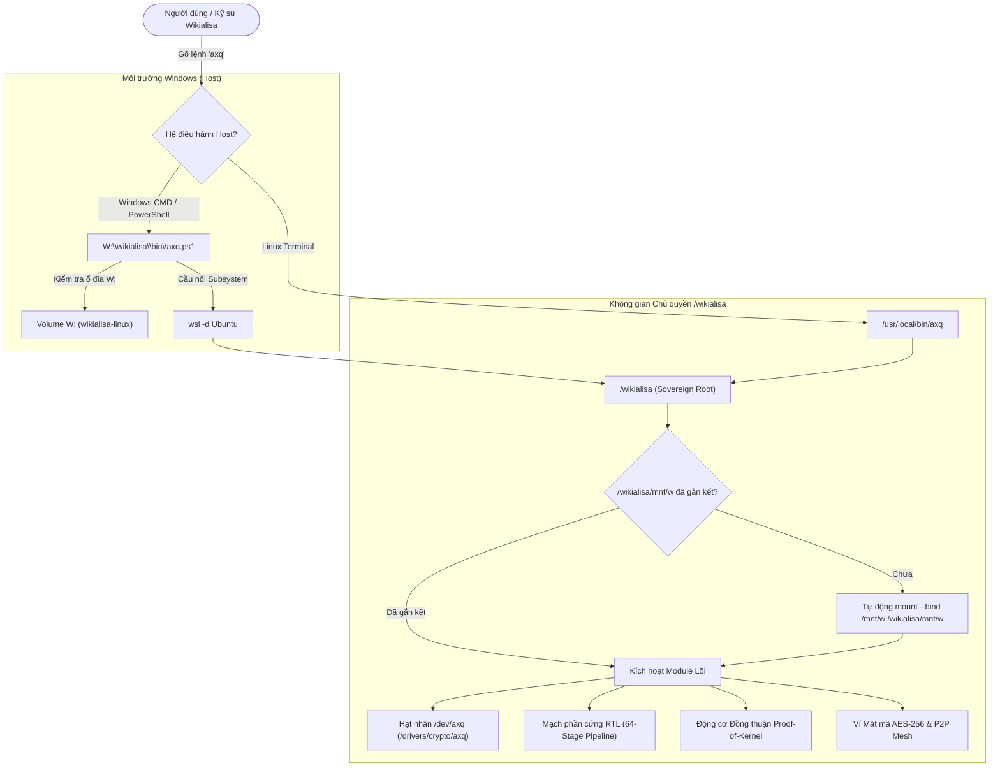

# KIẾN TRÚC KHÔNG GIAN CHỦ QUYỀN VÀ PHÂN HỆ GẮN KẾT WIKIALISA
## Sovereign Namespace & Inverted Mount Hierarchy Specification (/wikialisa/mnt/w)

---

### 1. Bối cảnh và Tầm nhìn Tái thiết kế (The Inverted Paradigm)

Trong kiến trúc ảo hóa hoặc hệ thống con truyền thống (như WSL tiêu chuẩn của Microsoft Windows), các phân vùng ổ đĩa Windows thường bị hạ cấp và đặt tại thư mục con `/mnt/c`, `/mnt/d`, `/mnt/w`. Điều này dẫn đến cấu trúc thư mục phụ thuộc:
```text
[Mô hình cũ - Bị phụ thuộc]:
/mnt/w/wikialisa  <-- Wikialisa bị giam giữ dưới cấp mount Windows
```

Nhằm thiết lập tính **Độc lập Chủ quyền Tuyệt đối (Digital Sovereignty)**, Wikialisa Core OS tái cấu trúc toàn diện không gian tên (Namespace) và hệ thống phân cấp gắn kết (Mount Hierarchy). Wikialisa không bao giờ là một thư mục con của Windows; ngược lại, **`/wikialisa` là Gốc Tối Thượng (Sovereign Root)**, và phân vùng vật lý ổ đĩa `W:` (`wikialisa-linux`) được gắn kết vào phân hệ lưu trữ tại `/wikialisa/mnt/w`:

```text
[Mô hình Chủ quyền Mới - Wikialisa Sovereign Hierarchy]:
/wikialisa/                    <-- GỐC CHỦ QUYỀN TỐI THƯỢNG (Sovereign Root)
├── .git/                      <-- Git Core Tree (Tác giả duy nhất: Wikialisa Core Team)
├── AGENT.md                   <-- Bản hiến chương Điều hành Trí tuệ Tự trị
├── CONTRIBUTING.md            <-- Quy chuẩn Đóng góp Mã nguồn Mở
├── MEMBERS.md                 <-- Quy chế Thành viên & Tam trụ Pháp lý - Thiết kế - DevOps
├── README.md                  <-- Bảng điều khiển Tổng quan
├── WIKIALISA_CORE_IDEA.md     <-- Hiến chương Lõi Hạt nhân & Bán dẫn AXQ
├── bin/                       <-- Nhị phân & Công cụ thực thi (axq, axq.cmd, axq.ps1)
├── docs/                      <-- Hồ sơ Kỹ thuật & Đặc tả 5 Kỷ nguyên
├── etc/                       <-- Cấu hình Bảo mật Zero-Trust (capabilities.conf)
├── include/                   <-- Header Hệ thống & Brand Specs (brand.h)
├── scripts/                   <-- Tập lệnh Tự động hóa & Khởi tạo Môi trường
├── src/                       <-- Mã nguồn Lõi (/drivers/crypto/axq, RTL SystemVerilog)
└── mnt/
    └── w/                     <-- ĐIỂM GẮN KẾT Ổ ĐĨA VẬT LÝ W: [wikialisa-linux]
        └── wikialisa/         <-- Bản ghi lưu trữ vĩnh cửu trên phân vùng NTFS/Ext4
```

---

### 2. Phân hệ Lệnh Chủ quyền: Tương quan `wsl` và `axq`

Trong hệ sinh thái Windows/Linux:
- Khi người dùng muốn tương tác với hệ điều hành Linux tiêu chuẩn, họ sử dụng lệnh `wsl`.
- Khi người dùng muốn tương tác với **Hệ điều hành Chủ quyền Wikialisa & Kiến trúc Bán dẫn AXQ**, họ sử dụng lệnh duy nhất: **`axq`**.

```text
+------------------------------------------------------------------------+
|                          HỆ SINH THÁI NGƯỜI DÙNG                       |
+------------------------------------+-----------------------------------+
|      Linux Phụ thuộc (Windows)     |     Wikialisa Chủ quyền (AXQ)     |
+------------------------------------+-----------------------------------+
| Lệnh điều khiển : wsl              | Lệnh điều khiển : axq             |
| Gốc phân cấp    : /mnt/w/...       | Gốc phân cấp    : /wikialisa/     |
| Ổ đĩa lưu trữ   : /mnt/c, /mnt/d   | Ổ đĩa lưu trữ   : /wikialisa/mnt/w|
| Điểm vào        : bash/zsh         | Điểm vào        : Wikialisa Shell |
| Hạt nhân        : Generic Linux    : Hạt nhân        : AXQ PoK Kernel  |
+------------------------------------+-----------------------------------+
```

---

### 3. Cơ chế Khởi tạo và Tự phục hồi Gắn kết (Self-Healing Mount Engine)

Để đảm bảo `/wikialisa` và `/wikialisa/mnt/w` luôn sẵn sàng trong mọi môi trường (Windows Host, WSL Subsystem, Isolated Container), hệ thống triển khai cơ chế 3 lớp bảo vệ tự phục hồi:

#### Lớp 1: Khởi động Hệ thống Tự động (`/etc/fstab` & `/etc/wsl.conf`)
Tệp phân vùng `/etc/fstab` được ghi cấu hình gắn kết tĩnh:
```fstab
/mnt/w /wikialisa/mnt/w none bind,defaults 0 0
```
Đồng thời, tập lệnh `/etc/bash.bashrc` kiểm tra sự tồn tại của điểm gắn kết:
```bash
mountpoint -q /wikialisa/mnt/w || sudo mount -a 2>/dev/null || true
```

#### Lớp 2: Bộ kích hoạt Chủ động trong Bộ thực thi `axq` (`/usr/local/bin/axq`)
Mỗi khi lệnh `axq` được gọi, kịch bản lõi tự động xác minh tính sẵn sàng của `/wikialisa/mnt/w`. Nếu chưa gắn kết, kịch bản lập tức thực thi bind-mount hoặc drvfs mount:
```bash
if ! mountpoint -q "$W_MOUNT" 2>/dev/null; then
    sudo mkdir -p "$W_MOUNT" 2>/dev/null || true
    if [ -d /mnt/w ]; then
        sudo mount --bind /mnt/w "$W_MOUNT" 2>/dev/null || true
    else
        sudo mount -t drvfs 'W:' "$W_MOUNT" -o uid=1000,gid=1000 2>/dev/null || true
    fi
fi
```

#### Lớp 3: Cầu nối Toàn cầu Windows Host (`axq.cmd` & `axq.ps1`)
Tại Windows:
- `axq.cmd` và `axq.ps1` được đăng ký vào thư mục `$env:LOCALAPPDATA\Microsoft\WindowsApps` và thêm `W:\wikialisa\bin` vào biến môi trường người dùng `PATH`.
- Người dùng có thể mở Command Prompt, Windows PowerShell, Terminal hoặc Run Dialog (`Win + R`) và gõ `axq` ở bất kỳ thư mục nào để kiểm soát toàn bộ hạ tầng.

---

### 4. Bảng Tra cứu Lệnh Điều hành `axq`

| Lệnh | Môi trường Thực thi | Mô tả Chi tiết Chức năng |
| :--- | :--- | :--- |
| `axq` | Windows / Linux | Khởi chạy giao diện tương tác tức thì **Wikialisa Sovereign Shell** |
| `axq status` | Windows / Linux | Kiểm tra toàn diện trạng thái ổ đĩa `W:`, Git tree, Brand specs, Driver, RTL |
| `axq drive` | Windows / Linux | Báo cáo dung lượng, tình trạng phân vùng `W:` (`wikialisa-linux`) |
| `axq mine [diff]` | Windows / Linux | Khởi động động cơ khai thác PoK (Proof-of-Kernel) với độ khó tùy chọn |
| `axq wallet [action]` | Windows / Linux | Quản lý ví mật mã AES-256 (`create` tạo ví mới, `balance` kiểm tra số dư) |
| `axq node [port]` | Windows / Linux | Khởi chạy nút mạng phân tán AXQ P2P (mặc định cổng TCP 8333) |
| `axq wsl [lệnh]` | Windows | Chuyển tiếp lệnh vào không gian chủ quyền `/wikialisa` trong hệ con Linux |
| `axq test` | Windows / Linux | Chạy toàn bộ bài kiểm tra tĩnh RTL (Verilator Lint) và an ninh Zero-Trust |
| `axq boot` | Linux / QEMU | Khởi động môi trường giả lập hạt nhân tối giản Wikialisa Core OS |
| `axq help` | Windows / Linux | Hiển thị tài liệu trợ giúp và danh mục lệnh tích hợp |

---

### 5. Sơ đồ Luồng Điều khiển Hệ sinh thái `axq`



---

### 6. Kết luận & Cam kết Chủ quyền

Việc chuyển dịch từ mô hình phụ thuộc `/mnt/w/wikialisa` sang mô hình tối thượng **`/wikialisa`** với điểm gắn kết ổ đĩa **`/wikialisa/mnt/w`** là cột mốc khẳng định sự độc lập kiến trúc của dự án. Mọi thành phần mã nguồn, tài liệu hiến chương, driver thiết bị và bản quyền sáng tạo đều thuộc quyền sở hữu tối cao của **Wikialisa Core Team**, hoàn toàn không phụ thuộc vào bất kỳ cá nhân hay nhà cung cấp phần mềm trung gian nào.
