# 🏗️ TÍCH HỢP HẠ TẦNG RUNNER-IMAGES & VỆ BINH TRỢ NĂNG ACCESSIBILITY-AGENTS
## Sovereign CI/CD Infrastructure & Automated WCAG 2.2 AA Enforcement Pipeline

---

### 1. Bối cảnh & Tầm nhìn Hợp nhất (The Strategic Synergy)

Trong tiến trình xây dựng hệ điều hành độc lập và chủ quyền **Wikialisa Core OS**, hạ tầng tự động hóa xây dựng (CI/CD) và tiêu chuẩn chất lượng tiếp cận của giao diện người dùng đóng vai trò quyết định đối với độ tin cậy của sản phẩm phát hành. 

Nhằm hiện thực hóa mục tiêu này, hai hệ thống phân hệ chiến lược đã được tích hợp trực tiếp vào lõi chính [wikialisa/wikialisa](https://github.com/wikialisa/wikialisa.git):

```text
+-----------------------------------------------------------------------------------+
|                        HỆ SINH THÁI CHỦ QUYỀN WIKIALISA CORE OS                  |
+-----------------------------------------------------------------------------------+
| 1. LÕI HỆ THỐNG     : wikialisa/wikialisa (Gốc /wikialisa, Kernel /dev/axq, RTL)  |
| 2. HẠ TẦNG RUNNER   : wikialisalang/runner-images (infra/runner-images/)         |
| 3. VỆ BINH TRỢ NĂNG : wikialisa/accessibility-agents (plugins/accessibility-agents)|
+-----------------------------------------------------------------------------------+
```

- **[`infra/runner-images`](https://github.com/wikialisalang/runner-images.git):** Cung cấp các mẫu máy chủ ảo hóa (VM templates), container builders và môi trường tự lưu trữ (Self-Hosted Sovereign Runners) trang bị đầy đủ bộ công cụ EDA (Verilator, Yosys), Kbuild nhân Linux, Rust toolchains và Node.js.
- **[`plugins/accessibility-agents`](https://github.com/wikialisa/accessibility-agents.git):** Cung cấp hệ thống 6 bộ định tuyến kỹ năng (Routers) và hơn 100 tác nhân chuyên biệt nhằm thực thi nghiêm ngặt tiêu chuẩn trợ năng quốc tế **WCAG 2.2 AA, Section 508 và ISO/IEC 40500** trên toàn bộ tài liệu và giao diện đồ họa.

Sự kết hợp giữa hai phân hệ này tạo thành **Đường ống Xây dựng & Kiểm định Trợ năng Chủ quyền (Sovereign CI/CD Build & Compliance Pipeline)**: Không một dòng mã giao diện hay tài liệu nào được phép đóng gói vào bản phát hành ISO nếu chưa vượt qua bài kiểm tra của các tác nhân trợ năng.

---

### 2. Sơ đồ Luồng Hoạt động Hợp nhất (Unified CI/CD Workflow)

```mermaid
sequenceDiagram
    autonumber
    actor Dev as Kỹ sư / Agent Wikialisa
    participant Core as Wikialisa Core (/wikialisa)
    participant Runner as infra/runner-images (Self-Hosted Runner)
    participant A11y as plugins/accessibility-agents (A11y Lead)
    participant Release as Bản phát hành ISO (bzImage + Rootfs)

    Dev->>Core: Đẩy mã nguồn mới (Kernel, RTL, UI Web/Desktop, Docs)
    Core->>Runner: Kích hoạt quy trình CI/CD trên Self-Hosted Runner
    
    rect rgb(20, 30, 45)
        Note over Runner: Giai đoạn 1: Biên dịch & Kiểm tra Kỹ thuật
        Runner->>Runner: Biên dịch hạt nhân tối giản (bzImage < 8MB)
        Runner->>Runner: Mô phỏng chu kỳ mạch RTL (Verilator Lint)
        Runner->>Runner: Kiểm tra chính sách Zero-Trust (capabilities.conf)
    end

    rect rgb(30, 45, 30)
        Note over Runner, A11y: Giai đoạn 2: Kiểm định Trợ năng Toàn diện (WCAG 2.2 AA)
        Runner->>A11y: Kích hoạt router 'accessibility-lead' & 'ci-accessibility'
        A11y->>A11y: Quét tài liệu Markdown (markdown-a11y-assistant)
        A11y->>A11y: Quét giao diện Web Control Center & AXQ Studio (Playwright + Axe-core)
        A11y->>A11y: Kiểm tra độ tương phản (contrast >= 4.5:1) và phím điều hướng
        alt Phát hiện lỗi trợ năng
            A11y-->>Runner: CHẶN PIPELINE (Block Build) & Xuất báo cáo vi phạm
            Runner-->>Dev: Báo lỗi: Yêu cầu khắc phục chuẩn WCAG 2.2 AA
        else Đạt 100% tiêu chuẩn
            A11y-->>Runner: PHÊ DUYỆT (Passed WCAG 2.2 AA Conformance)
        end
    end

    rect rgb(45, 35, 20)
        Note over Runner, Release: Giai đoạn 3: Đóng gói & Ký số Phát hành
        Runner->>Release: Đóng gói initramfs nén xz cực đại
        Runner->>Release: Tạo file ISO bootable kép UEFI/BIOS (< 30MB)
        Release-->>Dev: Xuất bản Artifact hoàn chỉnh & Sạch lỗi
    end
```



---

### 3. Phân định Cấu trúc Thư mục trong Gốc Chủ quyền `/wikialisa`

```text
/wikialisa/
├── .gitmodules                           # Đăng ký chính thức 2 phân hệ submodule
├── AGENT.md                              # Bổ sung vai trò role:accessibility-guardian
├── bin/
│   ├── axq                               # Lệnh axq hỗ trợ 'axq a11y' và 'axq runner'
│   ├── axq.ps1                           # Động cơ PowerShell tích hợp trạng thái
│   └── axq.cmd                           # Trình bao bọc CMD toàn cầu Windows
├── docs/                                 # Hồ sơ kỹ thuật chuẩn Plain-ASCII WCAG
│   └── 00-overview/
│       └── 06-runner-images-and-accessibility-agents-integration.md
├── infra/
│   └── runner-images/                    # [SUBMODULE: wikialisalang/runner-images]
│       ├── images/                       # Mẫu máy chủ Ubuntu/Linux build môi trường
│       ├── images.CI/                    # Tập lệnh Packer & cấu hình công cụ biên dịch
│       └── helpers/                      # Công cụ phụ trợ kiểm thử môi trường
└── plugins/
    └── accessibility-agents/             # [SUBMODULE: wikialisa/accessibility-agents]
        ├── AGENTS.md                     # Bản quy tắc 6 Router kỹ năng trợ năng
        ├── manifest.json                 # Danh mục 100+ Agent Skills
        ├── skills/                       # a11y-core, accessibility-lead, web-wizard...
        └── mcp-server/                   # Máy chủ MCP kết nối các công cụ quét tự động
```

---

### 4. Bảng Lệnh Điều hành Tích hợp qua CLI `axq`

| Lệnh Điều hành | Tham số | Chức năng Kỹ thuật |
| :--- | :--- | :--- |
| `axq status` | *(không)* | Hiển thị trạng thái của cả `A11y Agents` và `Runner Images` |
| `axq a11y` | `audit` | Quét và kiểm tra tính hợp lệ WCAG 2.2 AA của tài liệu và giao diện |
| `axq a11y` | `status` | Báo cáo danh mục các router trợ năng đang hoạt động và quy chuẩn tuân thủ |
| `axq runner` | `status` | Báo cáo tình trạng môi trường máy chủ runner tự lưu trữ |
| `axq test` | *(không)* | Chạy chuỗi kiểm thử kết hợp: Verilator RTL + An ninh Zero-Trust + Quét Trợ năng |

---

### 5. Trách nhiệm Tam Trụ Định chế (RACI Matrix Cập nhật)

| Hoạt động Triển khai | Luật (Legal) | Thiết kế (Design) | DevOps (Infrastructure) |
| :--- | :--- | :--- | :--- |
| **Bảo trì & Build Runner Images (`infra/runner-images`)** | **I** (Theo dõi tuân thủ) | **C** (Tham vấn tool UI) | **A / R** (Chủ trì & Triển khai) |
| **Thực thi Chuẩn WCAG 2.2 AA (`plugins/accessibility-agents`)** | **A** (Phê duyệt pháp lý) | **R** (Thực thi thiết kế) | **C** (Cấu hình runner CI/CD) |
| **Khóa Phát hành (Block Release) khi vi phạm Trợ năng** | **A** (Quyền phủ quyết) | **R** (Báo cáo lỗi UX) | **R** (Cấu hình tự động dừng build) |
| **Tối ưu hóa Môi trường Build Kernel & RTL** | **I** (Theo dõi) | **I** (Theo dõi) | **A / R** (Tối ưu hóa hạ tầng) |

---

### 6. Kết luận & Ý nghĩa Chiến lược

Việc tích hợp đồng thời **`wikialisalang/runner-images`** và **`wikialisa/accessibility-agents`** biến Wikialisa từ một dự án hạt nhân đơn lẻ thành một **Hệ sinh thái Phát triển Phần mềm & Hệ điều hành Tự chủ Hoàn chỉnh**:
1. Đảm bảo năng lực tự biên dịch độc lập không phụ thuộc vào hạ tầng đám mây bên ngoài.
2. Đảm bảo mọi sản phẩm từ máy chủ dòng lệnh CLI đến bảng điều khiển Web và giao diện Wayland đều thân thiện với mọi đối tượng người dùng, bao gồm cả người khiếm thị sử dụng máy đọc màn hình (Screen Readers).

