# CÂY SƠ ĐỒ LÕI ERGO-NODE-RUST TÁI CẤU TRÚC 10 STARTUP CÔNG NGHỆ
## HỆ THỐNG KINH TẾ eUTXO ĐA TẦNG & MA TRẬN 11 TOKEN WIKIALISA ($AXQ)

---

> **Mã tài liệu:** `WIKIALISA-CORE-TREE-ENR-09`  
> **Phiên bản:** `1.0.0-PROD`  
> **Kho nguồn tham chiếu:** [`https://github.com/wikialisa/ergo-node-rust.git`](https://github.com/wikialisa/ergo-node-rust.git) (`W:\repositories\ergo-node-rust`)  
> **Đơn vị ban hành:** Hội đồng Kỹ thuật & Nghiên cứu Wikialisa Core Team (`dev@wikialisa.org`)  
> **Không gian tên chủ quyền:** `/wikialisa/mnt/w/wikialisa`

---

## 1. TỔNG QUAN CHIẾN LƯỢC: SỰ GIAO THOA GIỮA eUTXO RUST VÀ 10 STARTUP

`ergo-node-rust` là phần mềm node chuỗi khối full-node hiệu năng cao viết bằng ngôn ngữ Rust, triển khai mô hình tính toán **Extended UTXO (eUTXO)** với ngôn ngữ hợp đồng thông minh hình thức **ErgoScript** (dựa trên giải thuật mật mã Sigma Protocols và thư viện `sigma-rust`). Khác với mô hình máy trạng thái toàn cục (Account-based) của Ethereum gặp nghẽn mạng và MEV front-running, mô hình eUTXO cho phép:
1. **Thực thi song song (Parallel Validation):** Hàng ngàn giao dịch trong cùng một khối được kiểm tra độc lập trước khi áp dụng vào cây AVL+.
2. **Xác định chi phí trước khi chạy (Deterministic Cost):** Phí giao dịch và tính hợp lệ được xác định chính xác ngay tại client, triệt tiêu rủi ro mất phí gas vô ích.
3. **Mật mã chứng minh tri thức không tiết lộ (Native Zero-Knowledge / Sigma Protocols):** Tích hợp sẵn các phép toán `proveDlog`, `proveDiffieHellmanTuple` trực tiếp trong cấu trúc hộp (Box Registers).

Việc tái thiết kế cây sơ đồ lõi của `ergo-node-rust` cho phép chúng ta biến một node xác thực đơn thuần thành **hạ tầng nền tảng cho 10 Startup Công Nghệ Web3**, đồng thời neo giữ giá trị cho **Ma trận 11 Token Hệ Sinh Thái Wikialisa**, dẫn dắt bởi Token Mẹ **$AXQ** (10.000.000.000.000 Token cố định).

---

## 2. CÂY SƠ ĐỒ KIẾN TRÚC LÕI TOÀN DIỆN (MASTER ARCHITECTURE TREE)

Biểu đồ dưới đây thể hiện sự hợp nhất từ hạ tầng máy chủ, các Crates Rust trong lõi `ergo-node-rust`, các hợp đồng giao ước (`facts/*.md`), tầng Addons mở rộng, 10 Sản phẩm Startup, và Ma trận Token tương ứng:

```mermaid
graph TD
    subgraph INFRA["TẦNG HẠ TẦNG & CHỦ QUYỀN (SOVEREIGN INFRASTRUCTURE)"]
        HOST["Máy Chủ Bare-Metal / VPS Riêng"] --> DOCKER["Docker Engine / Cgroups Sandboxing"]
        DOCKER --> VENV["Không Gian Tên: /wikialisa/mnt/w/wikialisa"]
        VENV --> NGINX["Nginx Edge Proxy / Rate Limiter (Port 80/443/9052/9054)"]
        VENV --> REDIS["Redis Cluster (Queue / Cache / Mempool Shield)"]
        VENV --> SQL["PostgreSQL / SQLite Cluster (Box & Ledger Mirrors)"]
    end

    subgraph ENR_CORE["LÕI ERGO-NODE-RUST (W:\\repositories\\ergo-node-rust)"]
        MAIN["main crate (Lifecycle, Channels & Trait Wiring)"]
        
        P2P["p2p crate<br/>- Wire Protocol & Handshake<br/>- PeerDB & Message Routing<br/>- (facts/p2p-protocol.md)"]
        CHAIN["chain crate<br/>- Header Parsing & PoW<br/>- Difficulty Adjustment<br/>- NiPoPoW & Voting (facts/voting.md)"]
        SYNC["sync crate<br/>- State Machine Sync<br/>- Section Fetching & Snapshot<br/>- (facts/sync.md)"]
        VALID["validation crate<br/>- Parallel Script Evaluation<br/>- Sigma-Rust Engine<br/>- (facts/validation.md)"]
        STATE["state crate<br/>- Authenticated AVL+ Tree<br/>- redb persistent (state.redb)<br/>- (facts/state.md)"]
        STORE["store crate<br/>- Block & Header Storage<br/>- redb quick_repair (modifiers.redb)<br/>- (facts/store.md)"]
        MEMPOOL["mempool crate<br/>- Validate-on-Entry & RBF<br/>- Family Weighting (500 levels)<br/>- (facts/mempool.md)"]
        MINING["mining crate<br/>- Autolykos v2 Assembly<br/>- EIP-27 Re-emission<br/>- (facts/mining.md)"]
        API["api crate<br/>- Axum REST (39 endpoints)<br/>- JVM Compat & /stats/p2p<br/>- (facts/api.md)"]
    end

    subgraph ADDONS["TẦNG ADDONS & MỞ RỘNG (ENR ADDONS)"]
        FASTSYNC["fastsync addon<br/>- Parallel REST Peer Bootstrapping<br/>- chainSlice Algorithm"]
        INDEXER["indexer addon (Port 9054)<br/>- SQLite / PostgreSQL Explorer Backend<br/>- Box Lifecycle & Token Register Walkers"]
    end

    subgraph STARTUPS["10 STARTUP CÔNG NGHỆ WEB3 ĐỘC LẬP"]
        ST1["Startup 1: DeFi Liquidity Booster<br/>(Liquid Staking & Restaking Suite)"]
        ST2["Startup 2: Cross-Chain Bridge & Router<br/>(NiPoPoW Relayer & Interoperability)"]
        ST3["Startup 3: AI Web3 Security & Antivirus<br/>(Mempool Firewall & Phishing Detector)"]
        ST4["Startup 4: Decentralized Social & Tips<br/>(Creator Economy & Micro-Tipping Hub)"]
        ST5["Startup 5: GameFi Automation & Bot Studio<br/>(RBF Chained Tx & Arbitrage Engine)"]
        ST6["Startup 6: RWA Tokenization Gateway<br/>(Real World Asset Legal Escrow Vault)"]
        ST7["Startup 7: Omnichain Smart Account<br/>(Passkey Wallet & Paymaster Abstraction)"]
        ST8["Startup 8: Web3 Data Indexer & Marketplace<br/>(Enterprise GraphQL & REST APIs)"]
        ST9["Startup 9: DAO Governance & Quadratic Engine<br/>(Liquid Democracy & Treasury Payouts)"]
        ST10["Startup 10: ZK Identity & Compliance Layer<br/>(SBT Credential & Sigma Privacy Guard)"]
    end

    subgraph TOKENS["MA TRẬN 11 TOKEN WIKIALISA ($AXQ)"]
        AXQ["$AXQ: Token Mẹ (10 Nghìn Tỷ - Dự Trữ & Quản Trị Tối Cao)"]
        EAXQ["$eAXQ: Stablecoin Bản Địa (Neo 1:1 VND / Thanh Khoản)"]
        SAXQ["$sAXQ: Liquid Staking & Yield-Bearing Asset"]
        MAXQ["$mAXQ: RWA Token (Bất Động Sản & Vàng Số Hóa)"]
        BAXQ["$bAXQ: Quỹ Bảo Hiểm & Đệm Thanh Khoản Sự Cố"]
        CAXQ["$cAXQ: SBT Định Danh & ZK-KYC Chứng Nhận"]
        OAXQ["$oAXQ: Phạt Slashing & Phần Thưởng Oracle Node"]
        LAXQ["$lAXQ: Điểm Thưởng Trải Nghiệm Loyalty Hệ Sinh Thái"]
        GAXQ["$gAXQ: Token Năng Lượng Gas Đốt Cháy Mạng Lưới"]
        VAXQ["$vAXQ: Quyền Biểu Quyết Hội Đồng Quản Trị DAO"]
        XAXQ["$xAXQ: Token Quản Trị Cầu Nối Xuyên Chuỗi"]
    end

    %% Mối nối hạ tầng vào Crate
    MAIN --> P2P & CHAIN & SYNC & VALID & STATE & STORE & MEMPOOL & MINING & API
    API --> ADDONS
    STORE --> STATE

    %% Ánh xạ Crate vào 10 Startup
    STATE & VALID --> ST1
    CHAIN & SYNC & P2P --> ST2
    MEMPOOL & VALID --> ST3
    INDEXER & API --> ST4
    MEMPOOL & MINING --> ST5
    STATE & VALID & CHAIN --> ST6
    VALID & API & MEMPOOL --> ST7
    INDEXER & STORE --> ST8
    CHAIN & STATE --> ST9
    VALID & STATE --> ST10

    %% Ánh xạ Startup vào Tokenomics
    ST1 --> SAXQ
    ST2 --> XAXQ
    ST3 --> BAXQ
    ST4 --> LAXQ
    ST5 --> GAXQ
    ST6 --> MAXQ & EAXQ
    ST7 --> AXQ
    ST8 --> OAXQ
    ST9 --> VAXQ
    ST10 --> CAXQ

    %% Neo giữ giá trị về Token Mẹ AXQ
    SAXQ & XAXQ & BAXQ & LAXQ & GAXQ & MAXQ & EAXQ & OAXQ & VAXQ & CAXQ -.->|Giá Trị Thặng Dư & Mua Lại / Đốt| AXQ
```



---

## 3. BẢNG CHI TIẾT ÁNH XẠ KỸ THUẬT: TỪ MÃ NGUỒN ENR ĐẾN 10 STARTUP

Dưới đây là bảng đặc tả kiến trúc kỹ thuật chi tiết chỉ rõ từng Crate, file mã nguồn trong `W:\repositories\ergo-node-rust`, giao ước trong `facts/`, cơ chế eUTXO và logic vận hành của 10 Startup:

| STT | Tên Startup & Sản Phẩm | Crate & File Rust Lõi trong `ergo-node-rust` | Giao Ước Hợp Đồng (`facts/`) | Token Chủ Đạo | Mô Tả Kỹ Thuật eUTXO & Cơ Chế Kinh Doanh |
| :--- | :--- | :--- | :--- | :--- | :--- |
| **01** | **DeFi Liquidity Booster** *(Liquid Staking Suite)* | `state/src/lib.rs`<br/>`validation/src/tx_validation.rs`<br/>`api/src/endpoints/utxo.rs` | `facts/state.md`<br/>`facts/validation.md` | **$sAXQ** | Khóa $AXQ vào Authenticated Box trong cây AVL+ (`state.redb`). Tự động đúc token phái sinh $sAXQ chứa lãi suất kép lũy kế. Khi rút vốn, hợp đồng ErgoScript kiểm tra tỷ lệ quy đổi $sAXQ / $AXQ theo công thức tăng dần theo chiều cao khối ($H$). |
| **02** | **Cross-Chain Bridge & Router** *(NiPoPoW Relayer)* | `chain/src/nipopow.rs`<br/>`sync/src/lib.rs`<br/>`p2p/src/transport.rs` | `facts/nipopow.md`<br/>`facts/p2p-protocol.md` | **$xAXQ** | Tận dụng Non-Interactive Proofs of Proof-of-Work (`ergo-nipopow`) để tạo bằng chứng ánh sáng liên chuỗi (Superblocks & Interlinks). Relayer nodes ký xác thực và phát tán modifier qua P2P, kết nối thanh khoản xuyên biên giới giữa EVM, Solana và mạng lõi Wikialisa. |
| **03** | **AI Web3 Security & Shield** *(Mempool Firewall)* | `mempool/src/lib.rs`<br/>`validation/src/lib.rs`<br/>`p2p/src/routing.rs` | `facts/mempool.md`<br/>`facts/journal-events.md` | **$bAXQ** | Triển khai cơ chế `validate-on-entry` kiểm tra giao dịch độc hại trước khi vào Pool. Tích hợp AI Agent (`accessibility-agents`) và danh sách đen `eth-phishing-detect` để tự động chặn các bẫy rút thanh khoản (drainer), tấn công rác (dust) và MEV front-run độc hại. Phí bảo hiểm thu bằng $bAXQ. |
| **04** | **Decentralized Social Hub** *(Creator Economy)* | `addons/indexer/src/lib.rs`<br/>`api/src/endpoints/boxes.rs`<br/>`state/src/box_storage.rs` | `facts/indexer.md`<br/>`facts/api.md` | **$lAXQ** | Sử dụng cấu trúc 4 thanh ghi mở rộng (R4-R9) trong hộp eUTXO để lưu trữ siêu dữ liệu bài viết (IPFS Hash, Content CID). Trình lập chỉ mục `indexer` (cổng 9054) truy vấn tức thời lịch sử hộp và cho phép người dùng Tip micro-payment siêu nhỏ không mất phí. |
| **05** | **GameFi Automation Studio** *(Arbitrage & Chained Bots)* | `mempool/src/family.rs`<br/>`mining/src/candidate_assembly.rs` | `facts/mempool.md`<br/>`facts/mining.md` | **$gAXQ** | Tận dụng cơ chế Replace-By-Fee (RBF) và Family Weighting (quản lý cây phụ thuộc con - cha lên tới 500 cấp) để đóng gói hàng ngàn giao dịch bot tự động trong game, tối ưu hóa gas $gAXQ và gom phần thưởng khối EIP-27. |
| **06** | **RWA Tokenization Gateway** *(Real World Asset Escrow)* | `validation/src/sigma.rs`<br/>`state/src/lib.rs`<br/>`chain/src/header.rs` | `facts/validation.md`<br/>`facts/chain.md` | **$mAXQ** & **$eAXQ** | Số hóa tài sản thực (bất động sản, trái phiếu, chứng chỉ vàng) thành các NFT/Token độc bản (Singleton Tokens). Thanh ghi R4 chứa băm SHA-256 của văn bản công chứng pháp lý; chi tiêu yêu cầu chữ ký đa bên (Threshold Sigma Multi-Sig 3/5 đối tác giám sát). |
| **07** | **Omnichain Smart Account** *(Passkey & AA Wallet)* | `validation/src/evaluator.rs`<br/>`api/src/endpoints/transactions.rs` | `facts/validation.md`<br/>`facts/api.md` | **$AXQ** | Triển khai trừu tượng hóa tài khoản (Account Abstraction) thông qua hợp đồng bảo vệ ErgoScript. Cho phép người dùng đăng nhập bằng sinh trắc học Passkey (WebAuthn P-256) và cơ chế Paymaster tài trợ gas miễn phí cho người dùng cuối. |
| **08** | **Web3 Data Indexer API** *(Analytics Marketplace)* | `addons/indexer/src/db.rs`<br/>`store/src/lib.rs`<br/>`api/src/endpoints/stats.rs` | `facts/indexer.md`<br/>`facts/stats.md` | **$oAXQ** | Module độc lập `ergo-indexer` đồng bộ trực tiếp với `store.redb`, lưu trữ cấu trúc giao dịch và hộp eUTXO ra SQLite/PostgreSQL. Cung cấp 19 REST endpoints và tài liệu Swagger, thu phí truy cập API chuyên sâu đối với quỹ và dApp bằng $oAXQ. |
| **09** | **DAO Quadratic Engine** *(Liquid Governance)* | `chain/src/voting.rs`<br/>`state/src/parameters.rs` | `facts/voting.md`<br/>`facts/chain.md` | **$vAXQ** | Triển khai theo dõi tham số biên kỷ nguyên (epoch-boundary parameter tracking theo chuẩn giao thức v6.0.3). Cho phép cộng đồng khóa token $vAXQ bỏ phiếu nâng cấp hệ thống (soft-fork voting) và biểu quyết phân bổ quỹ tài trợ theo giải thuật bậc hai (Quadratic Funding). |
| **10** | **ZK Identity & Privacy Layer** *(Sigma ZK-KYC & SBT)* | `validation/src/sigma_verifier.rs`<br/>`state/src/avl.rs` | `facts/validation.md`<br/>`facts/state.md` | **$cAXQ** | Khai thác tính năng bản địa của Sigma Protocols trong `sigma-rust` để xác minh thuộc tính người dùng (chứng nhận công dân, độ tuổi, AML whitelist) mà không làm lộ dữ liệu cá nhân (Zero-Knowledge Proof). Cấp chứng chỉ Soulbound Token $cAXQ không thể chuyển nhượng. |

---

## 4. CHI TIẾT 10 Ý TƯỞNG STARTUP VÀ SỰ TÍCH HỢP VÀO LÕI ENR

### 4.1. Startup 1: DeFi Liquidity Booster (Liquid Staking & Restaking Suite)
- **Kiến trúc lõi:** Tận dụng cây AVL+ xác thực bền vững trong `state/` và cơ chế đánh giá chi phí ErgoScript trong `validation/`.
- **Cơ chế eUTXO:** Khóa $AXQ vào một Hộp Staking Pool (`PoolBox`). Mỗi khi có khối mới, số dư phần thưởng khối từ thợ đào (`mining/`) được tích lũy vào `PoolBox`. Người gửi nhận lại $sAXQ.
- **Hợp đồng thông minh:**
  ```text
  // ErgoScript xác thực tỷ lệ quy đổi khi rút tiền
  val poolBox = SELF
  val outBox = OUTPUTS(0)
  val totalAxq = poolBox.value
  val totalSaxqSupply = poolBox.tokens(0)._2
  val userBurnSaxq = INPUTS(1).tokens(0)._2
  val expectedAxqReturn = (userBurnSaxq * totalAxq) / totalSaxqSupply
  sigmaProp(outBox.value >= expectedAxqReturn)
  ```

### 4.2. Startup 2: Cross-Chain Bridge & Asset Router
- **Kiến trúc lõi:** Sử dụng `chain/src/nipopow.rs` và `facts/nipopow.md`.
- **Cơ chế eUTXO:** NiPoPoW (Non-Interactive Proofs of Proof-of-Work) cho phép các hợp đồng trên mạng Ethereum hoặc Solana kiểm tra tính hợp lệ của chuỗi Wikialisa mà chỉ cần tải về vài kilobyte tiêu đề khối (Superblocks) thay vì toàn bộ blockchain hàng trăm gigabyte.
- **Dịch vụ Relayer:** Viết bằng Rust trong `p2p/`, liên tục lắng nghe sự kiện khóa token trên hợp đồng cầu nối và phát lệnh đúc $xAXQ bảo chứng tương đương.

### 4.3. Startup 3: AI-Powered Web3 Security & Phishing Detector
- **Kiến trúc lõi:** Nằm trực tiếp tại cổng gác `mempool/` (`validate-on-entry`) kết hợp với thư viện chống lừa đảo mã nguồn mở `eth-phishing-detect`.
- **Cơ chế phòng thủ:**
  - Khi một giao dịch gửi tới node qua API `/transactions`, hàm `validate_single_transaction()` trong `validation/` tiến hành giải mã mã byte ErgoScript.
  - Phân tích luồng chuyển giao tài sản: Nếu giao dịch tìm cách tiêu thụ các hộp chứa toàn bộ số dư của người dùng sang một địa chỉ chưa từng phát sinh giao dịch hoặc nằm trong danh bạ bẫy lừa đảo, `mempool` lập tức phát sự kiện `journal_event` từ chối tiếp nhận và cách ly địa chỉ IP nguồn trên tầng `p2p/`.

### 4.4. Startup 4: Decentralized Social & Creator Monetization Hub
- **Kiến trúc lõi:** Addon `addons/indexer/` (chạy trên cổng 9054) đóng vai trò là backend lưu trữ phân tán hiệu năng cao.
- **Cơ chế eUTXO:** Mỗi bài viết, bình luận hoặc tương tác của Nhà sáng tạo (Creator) là một Hộp eUTXO có giá trị tối thiểu (dust value = 0.001 $AXQ).
  - Thanh ghi `R4`: IPFS Content CID (chứa nội dung markdown/media).
  - Thanh ghi `R5`: Creator Public Key.
  - Thanh ghi `R6`: Mã định danh chủ đề / Channel ID.
  - Khi người xem bấm "Tip", một giao dịch gộp nhiều đầu ra (Multi-output transaction) chuyển $lAXQ hoặc $eAXQ thẳng vào địa chỉ Creator mà không qua trung gian.

### 4.5. Startup 5: GameFi Automated Yield & Bot Management Studio
- **Kiến trúc lõi:** Tối ưu hóa thuật toán gom giao dịch trong `mempool/src/family.rs` và `mining/src/candidate_assembly.rs`.
- **Cơ chế eUTXO:** Các tựa game Web3 yêu cầu xử lý hàng triệu hành động (đúc trang bị, lên cấp, giao dịch chợ).
  - Thay vì đợi từng khối xác nhận, GameFi Engine cho phép tạo chuỗi giao dịch chi tiêu đầu ra chưa xác nhận của nhau (Chained unconfirmed transactions) lên tới 500 cấp con-cháu.
  - Thuật toán `Family Weighting` bảo đảm rằng phí giao dịch của toàn bộ cây gia phả được cộng dồn, giúp thợ đào ưu tiên đóng gói toàn bộ chuỗi giao dịch vào khối tiếp theo mà không bị lỗi đứt gãy trạng thái.

### 4.6. Startup 6: RWA (Real World Asset) Tokenization Gateway
- **Kiến trúc lõi:** Cấu trúc Singleton Token trên `state/` và `validation/`.
- **Cơ chế eUTXO:**
  - Một tài sản ngoài đời thực (Ví dụ: Một tòa nhà trị giá 100 tỷ VND) được thẩm định và phát hành thành 100.000 token $mAXQ (mỗi token đại diện 1 triệu VND).
  - Hộp mẹ bảo chứng (`MasterAssetBox`) chứa thông tin pháp lý số hóa tại thanh ghi `R4` (Băm SHA-256 của hợp đồng công chứng) và `R5` (Khóa công khai của bên lưu ký tài sản độc lập).
  - Việc chuyển quyền sở hữu hoặc chi trả cổ tức cho người nắm giữ $mAXQ được thực thi tự động thông qua token ổn định $eAXQ (neo 1:1 VND).

### 4.7. Startup 7: Omnichain Smart Account & Passkey Wallet Wrapper
- **Kiến trúc lõi:** Tận dụng thư viện toán học Sigma trong `sigma-rust` và API endpoint `/transactions` trong `api/`.
- **Cơ chế eUTXO:**
  - Khác với Ethereum cần tiêu chuẩn ERC-4337 phức tạp, ErgoScript hỗ trợ bản địa logic chữ ký linh hoạt.
  - Hộp tài khoản thông minh (`SmartAccountBox`) được bảo vệ bởi mệnh đề kiểm tra chữ ký khóa công khai NIST P-256 (chuẩn của FaceID / TouchID / YubiKey Passkey) kết hợp điều kiện khôi phục xã hội (Social Recovery) thông qua 3 người bảo hộ đáng tin cậy sau khoảng thời gian trễ timelock (ví dụ: sau 10.000 khối nếu khóa chính không hoạt động).
  - Hỗ trợ dịch vụ Paymaster: Node tài trợ một hộp đầu vào trả phí $AXQ, cho phép người dùng giao dịch hoàn toàn miễn phí gas.

### 4.8. Startup 8: Web3 Data Indexer & Analytics API Marketplace
- **Kiến trúc lõi:** Addon `ergo-indexer` nằm trong `addons/indexer/`.
- **Cơ chế vận hành:**
  - Đọc dữ liệu trực tiếp từ `store/` và REST API của node, giải mã cây AVL+ và cập nhật cơ sở dữ liệu quan hệ (SQLite hoặc PostgreSQL) theo từng khối nguyên tử (Atomic block commit).
  - Cung cấp giao diện Swagger UI và 19 REST endpoints chuyên dụng tra cứu: Lịch sử số dư theo địa chỉ, dấu vết luân chuyển token, hộp chưa tiêu thụ (Unspent Boxes), tỷ lệ lạm phát thực tế, và biểu đồ dòng tiền cá voi.
  - Bán gói dữ liệu API doanh nghiệp (WebSocket Streaming & GraphQL) cho các quỹ đầu tư và sàn giao dịch, thu phí bằng $oAXQ.

### 4.9. Startup 9: DAO Governance & Quadratic Funding Engine
- **Kiến trúc lõi:** Tận dụng cơ chế biểu quyết tại biên epoch trong `chain/src/voting.rs` (`facts/voting.md`).
- **Cơ chế eUTXO:**
  - Bỏ phiếu bậc hai (Quadratic Voting): Chi phí để có $N$ phiếu bầu là $N^2$ token $vAXQ, giúp ngăn chặn tình trạng cá voi lấn át tiếng nói của cộng đồng.
  - Quỹ Treasury DAO được khóa trong các Hộp Ngân Sách Đa Chữ Ký có thời hạn.
  - Khi một đề xuất dự án vượt qua ngưỡng biểu quyết on-chain, hợp đồng thông minh tự động mở khóa và giải ngân số token $eAXQ tương ứng xuống ví của nhóm phát triển mà không cần bất kỳ sự can thiệp thủ công nào của ban quản trị.

### 4.10. Startup 10: Zero-Knowledge Identity & Compliance Verification Layer
- **Kiến trúc lõi:** Cấu trúc mật mã hình thức trong `validation/src/sigma_verifier.rs`.
- **Cơ chế eUTXO:**
  - Người dùng thực hiện định danh danh tính ngoài đời với đơn vị thẩm định độc lập.
  - Đơn vị thẩm định phát hành cho người dùng một Hộp Soulbound Token $cAXQ (Non-transferable Box) chứa chữ ký cam kết ZK (Zero-Knowledge Commitment).
  - Khi tương tác với các ứng dụng DeFi hoặc RWA yêu cầu tuân thủ AML/KYC, người dùng chỉ cần cung cấp bằng chứng chứng minh tri thức không tiết lộ (Sigma Proof) rằng: "Tôi sở hữu một hộp định danh hợp lệ và độ tuổi trên 18" mà không cần để lộ tên tuổi, số CCCD hay địa chỉ nhà thật trên blockchain.

---

## 5. QUY TRÌNH 5 BƯỚC ĐÓNG GÓI MÃ NGUỒN ĐỘC LẬP & SCALE TRIỆU NGƯỜI DÙNG ZERO-COST

Để hiện thực hóa 10 startup này mà không tiêu tốn hàng chục ngàn USD chi phí hạ tầng cloud (AWS/GCP), toàn bộ kiến trúc được chuẩn hóa theo quy trình đóng gói tự chủ:

```
[1. Mã Nguồn Mở Tách Rời] 
        │
        ▼
[2. Khử Phụ Thuộc & Đổi Tên Không Gian Tên]
        │
        ▼
[3. Đóng Gói Container Docker Tối Giản]
        │
        ▼
[4. Phân Phối Tải Đa Tầng: Nginx Edge + Redis Cache]
        │
        ▼
[5. Mở Rộng Cụm Đọc PostgreSQL Read-Replicas & Sharding]
```

### Bước 1: Khử phụ thuộc (Decoupling) & Cô lập Module
- Lấy mã nguồn từ các repository mã nguồn mở tiêu chuẩn:
  - Lõi chuỗi: `ergo-node-rust` (`p2p`, `state`, `mempool`, `validation`, `addons/indexer`).
  - Giao diện ví: `smart-accounts-kit` & `viem` từ MetaMask/Ethers.
  - Tường lửa lừa đảo: `eth-phishing-detect`.
- Chuyển toàn bộ cấu hình cứng (hardcoded endpoints, secret keys) sang nạp động qua biến môi trường (`.env.production` / `ergo.toml`).

### Bước 2: Tái cấu trúc không gian tên & Nhãn hiệu Wikialisa
- Thay thế toàn bộ tiền tố chuỗi, cấu trúc định danh và thông điệp P2P sang nhãn hiệu độc quyền của Wikialisa:
  - Genesis State: Định nghĩa lại bảng tham số ban đầu, số lượng token mẹ $AXQ = 10.000.000.000.000.
  - Cổng mạng mặc định: REST API = `9052`, P2P Wire = `9030`, Indexer = `9054`.

### Bước 3: Đóng gói Container hóa (Docker & Systemd Unit)
- Biên dịch nhị phân tĩnh (Static binary) với cấu hình tối ưu hóa cao nhất:
  ```bash
  RUSTFLAGS="-C target-cpu=native" cargo build --release --bin ergo-node-rust
  cargo build --release --manifest-path addons/indexer/Cargo.toml
  ```
- Sử dụng Docker scratch / alpine base image siêu nhẹ (< 50MB) giúp khởi động tức thời trong 0.8 giây.

### Bước 4: Tầng đệm siêu tốc (Nginx Edge + Redis Caching)
- Triển khai Nginx làm Edge Reverse Proxy:
  - Giới hạn tần suất gọi API (Rate limiting: 100 req/s cho người dùng thường, 500 req/s cho đối tác).
  - Bật HTTP/2 và nén Brotli / Gzip cho các endpoint trả về dữ liệu khối lớn.
- Redis Cluster đệm tầng trước:
  - Lưu kết quả của các endpoint đọc tĩnh (như `/info`, `/blocks/{id}`, `/blockchain/box/{id}`) với thời gian hết hạn TTL = 5 giây.
  - Giảm tải trực tiếp 92% truy vấn đọc xuống database `redb` và `sqlite`, cho phép một VPS 8 core 16GB RAM chịu tải trên 50.000 kết nối đồng thời.

### Bước 5: Cụm lưu trữ phân tán Master-Slave
- Phân chia vai trò lưu trữ rõ ràng:
  - `ergo-node-rust` ghi độc quyền vào cơ sở dữ liệu nhúng siêu nhanh `state.redb` và `modifiers.redb` (sử dụng tính năng `quick_repair` chống sập nguồn).
  - `ergo-indexer` đẩy dữ liệu sang cụm PostgreSQL Master-Slave.
  - Các ứng dụng dApp của 10 Startup chỉ đọc từ các Slave Replicas, triệt tiêu 100% tình trạng tắc nghẽn đọc-ghi trên node lõi.

---

## 6. LỘ TRÌNH 10 NGÀY THU LỢI NHUẬN NHANH (10-DAY MONETIZATION ROADMAP)

Không cần chờ đợi hàng năm để hoàn vốn, ma trận 10 Startup được kích hoạt theo lộ trình sinh dòng tiền ngay trong 10 ngày:

| Ngày | Mục Tiêu Triển Khai | Hành Động Kỹ Thuật Lõi | Dòng Tiền & Nguồn Thu Ngay Lập Tức |
| :---: | :--- | :--- | :--- |
| **Ngày 1** | **Khởi Chạy Indexer API Marketplace (Startup 8)** | Dựng `ergo-indexer` (cổng 9054), kết nối Nginx, mở cổng đăng ký API Key. | Bán gói dữ liệu API On-chain Pro cho các nhóm phân tích & bot trader: **$50 - $200 / key**. |
| **Ngày 2** | **Kích Hoạt Tường Lửa Phishing Shield (Startup 3)** | Đóng gói API quét mã độc giao dịch dựa trên `mempool` và `eth-phishing-detect`. | Thu phí bảo hiểm giao dịch $bAXQ từ người dùng ví và tích hợp SDK cho các sàn DEX: **$1.000 / tháng**. |
| **Ngày 3** | **Ra Mắt Bộ Công Cụ Bot GameFi & Arbitrage (Startup 5)** | Kích hoạt engine RBF và gom giao dịch ưu tiên trong `mempool`. | Thu phí thành viên VIP sử dụng bot săn chênh lệch giá (Flash Arbitrage) và đóng gói giao dịch nhanh: **0.1% lợi nhuận**. |
| **Ngày 4** | **Phát Hành Cổng Tạo Token RWA Tốc Hành (Startup 6)** | Cung cấp giao diện đúc Singleton Token chứng nhận tài sản cho doanh nghiệp SME. | Thu phí khởi tạo tài sản RWA và phí thẩm định pháp lý on-chain bằng $eAXQ: **$500 / hợp đồng**. |
| **Ngày 5** | **Mở Bể Staking Thanh Khoản $sAXQ (Startup 1)** | Kích hoạt hợp đồng `PoolBox` trên mạng lõi, cho phép người dùng gửi $AXQ nhận $sAXQ. | Thu phí hiệu suất quản lý bể thanh khoản (Performance Fee): **5% trên tổng lợi nhuận sinh ra**. |
| **Ngày 6** | **Ra Mắt Nền Tảng Micro-Tipping Cho Creator (Startup 4)** | Tích hợp widget Tip bằng $lAXQ vào các blog, trang tin tức và kênh mạng xã hội. | Trích hoa hồng thanh toán 1% trên mỗi giao dịch ủng hộ Creator xuyên biên giới. |
| **Ngày 7** | **Kích Hoạt Dịch Vụ Tài Khoản Thông Minh Passkey (Startup 7)** | Cung cấp SDK Ví Passkey bảo mật sinh trắc học cho các dApp đối tác. | Thu phí duy trì giải pháp ví nhúng White-label và phí dịch vụ Paymaster gasless: **$300 / dApp**. |
| **Ngày 8** | **Mở Cổng Xác Thực ZK-KYC Tuân Thủ Pháp Lý (Startup 10)** | Cấp chứng chỉ Soulbound Token $cAXQ cho người dùng tham gia các đợt gọi vốn. | Thu phí cấp chứng nhận danh tính ẩn danh bảo mật ZK: **$5 - $10 / lượt KYC**. |
| **Ngày 9** | **Khởi Động Nền Tảng Biểu Quyết Bậc Hai DAO (Startup 9)** | Tổ chức chiến dịch tài trợ cộng đồng đợt 1 cho các nhà phát triển hệ sinh thái. | Thu phí nộp hồ sơ đề xuất (Proposal Submission Fee) bằng $vAXQ: **$100 / hồ sơ**. |
| **Ngày 10** | **Kết Nối Cầu NiPoPoW Xuyên Chuỗi (Startup 2)** | Mở luồng swap thanh khoản tức thì giữa EVM và mạng lõi Wikialisa qua $xAXQ. | Thu phí cầu nối xuyên chuỗi (Cross-chain Bridge Fee): **0.2% trên khối lượng luân chuyển**. |

---

## 7. HƯỚNG DẪN KẾT NỐI VÀ XIN TÀI TRỢ CÁC QUỸ HỆ SINH THÁI (FOUNDATION GRANTS)

Để mở rộng quy mô mà không cần gọi vốn cổ phần (Zero Equity Dilution), 10 Startup được định vị chính xác vào các chương trình tài trợ không hoàn lại (Grants) trị giá từ **$10.000 đến $250.000**:

```
                  ┌──────────────────────────────────────────────┐
                  │    QUỸ TÀI TRỢ HỆ SINH THÁI (GRANTS)        │
                  └──────────────────────┬───────────────────────┘
             ┌───────────────────────────┼───────────────────────────┐
             ▼                           ▼                           ▼
      [ARBITRUM FOUNDATION]       [OPTIMISM RETROPGF]         [CHAINLINK BUILD]
      Target: Cross-Chain         Target: Public Goods        Target: RWA & Data
      Bridge & ZK-KYC             Security & Indexer          Oracle Integration
      Cap: $25,000 - $150,000     Cap: 10,000 - 100,000 OP    Cap: $50,000 + Support
             │                           │                           │
             ▼                           ▼                           ▼
       [POLYGON VILLAGE]          [BNB CHAIN BUILD]          [SOLANA FOUNDATION]
      Target: Passkey Smart       Target: GameFi Engine       Target: High-Throughput
      Account & DeSoc             & DeFi Staking Suite        Micro-Tipping & State
      Cap: $15,000 - $50,000      Cap: $20,000 - $100,000     Cap: $10,000 - $100,000
```

1. **Arbitrum Foundation Grants Program:**
   - *Dự án phù hợp:* **Startup 2 (Cross-Chain Bridge)** & **Startup 10 (ZK Identity Layer)**.
   - *Luận điểm hồ sơ:* "Triển khai cầu nối bảo mật không cần tin cậy dựa trên giải thuật chứng minh toán học NiPoPoW kết nối mạng Arbitrum Nitro với kiến trúc eUTXO."
2. **Optimism RetroPGF (Retroactive Public Goods Funding):**
   - *Dự án phù hợp:* **Startup 3 (AI Web3 Security)** & **Startup 8 (Web3 Indexer API)**.
   - *Luận điểm hồ sơ:* "Đóng góp công cụ giám sát mã độc mempool và bộ chỉ mục mã nguồn mở bảo vệ tài sản cho cộng đồng Superchain."
3. **Chainlink BUILD Program:**
   - *Dự án phù hợp:* **Startup 6 (RWA Tokenization)** & **Startup 1 (DeFi Staking)**.
   - *Luận điểm hồ sơ:* "Tích hợp nguồn cấp dữ liệu giá tin cậy của Chainlink vào các hộp bảo chứng tài sản thực và bể liquid staking."
4. **Polygon Village & BNB Chain Builder Grants:**
   - *Dự án phù hợp:* **Startup 7 (Smart Account Passkey)** & **Startup 5 (GameFi Automation)**.
   - *Luận điểm hồ sơ:* "Mang trải nghiệm người dùng Web2 (đăng nhập bằng vân tay/khuôn mặt) và hệ sinh thái bot tự động hóa chi phí thấp đến hàng triệu người dùng di động."

---

## 8. KẾT LUẬN & CHỈ THỊ THỰC THI HỆ THỐNG

Việc tích hợp 10 ý tưởng startup vào lõi [`ergo-node-rust`](https://github.com/wikialisa/ergo-node-rust.git) giải quyết triệt để 3 bài toán lớn của ngành công nghiệp chuỗi khối:
1. **Về công nghệ:** Đưa sức mạnh tính toán an toàn, song song và mật mã chứng minh không tiết lộ (Sigma Protocols) của mô hình eUTXO vào từng sản phẩm thực tiễn.
2. **Về tài chính:** Kiến tạo dòng tiền thặng dư tự nhiên, liên tục thu hút thanh khoản và đốt cháy nguồn cung, bảo vệ giá trị vĩnh cửu cho **Token Mẹ $AXQ**.
3. **Về chủ quyền:** Toàn bộ hệ thống chạy độc lập trên máy chủ bare-metal và không gian tên `/wikialisa/mnt/w/wikialisa`, miễn nhiễm trước các thay đổi chính sách từ các nhà cung cấp dịch vụ tập trung.

---
*Tài liệu được biên soạn và lưu trữ chính thức tại kho lưu trữ Wikialisa Core.*

