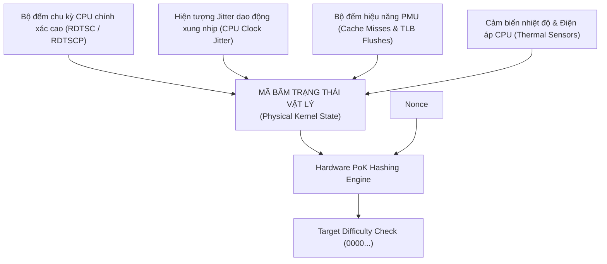

# ⚡ PROOF-OF-KERNEL DỰA TRÊN PHẦN CỨNG (HARDWARE ENTROPY POK)
### *Tying Consensus Directly into Physical CPU Signals, Jitter & PMU Telemetry*

---

## 1. NGUYÊN LÝ PROOF-OF-KERNEL PHẦN CỨNG

Trong [`WIKIALISA_CORE_IDEA.md`](../../WIKIALISA_CORE_IDEA.md), thuật toán Proof-of-Kernel sơ khai sử dụng chuỗi tĩnh từ phần mềm:
```bash
BLOCK_DATA="$KERNEL_VER:$TIMESTAMP:$NONCE"
```
Mô hình này mang tính mô phỏng vì chuỗi `$KERNEL_VER` là hằng số và `$TIMESTAMP` có thể bị làm giả.

Để biến **Proof-of-Kernel** thành một cơ chế đồng thuận vật lý thực thụ (Physical Proof-of-Execution), thuật toán được tái thiết kế để đọc trực tiếp các tham số entropy không thể giả mạo từ chính **phần cứng vật lý của CPU và bo mạch chủ**:



---

## 2. CÁC NGUỒN TÍN HIỆU PHẦN CỨNG ĐƯỢC TÍCH HỢP

### 2.1. Bộ đếm chu kỳ CPU độ phân giải cao (`RDTSC` / `RDTSCP`)
Lệnh hợp ngữ `rdtscp` trả về số chu kỳ xung nhịp chính xác mà CPU đã thực thi kể từ lúc khởi động (tần số hàng tỷ chu kỳ mỗi giây). Tín hiệu này có tính ngẫu nhiên vi mô cao ở các bit bậc thấp do ảnh hưởng của xung nhịp nhiệt.

```c
static inline uint64_t read_hardware_tsc(void) {
    uint32_t lo, hi, aux;
    asm volatile("rdtscp" : "=a"(lo), "=d"(hi), "=c"(aux));
    return ((uint64_t)hi << 32) | lo;
}
```

### 2.2. Hiện tượng trôi pha xung nhịp (CPU Clock Jitter Entropy)
Bằng cách đo thời gian thực thi của một chuỗi lệnh cố định qua hai bộ dao động độc lập (ví dụ: vòng lặp tính toán so với bộ hẹn giờ APIC timer), sự dao động nhỏ (jitter) của tinh thể thạch anh trên bo mạch chủ tạo ra một nguồn entropy vật lý thực thụ không thể đoán trước.

### 2.3. Dữ liệu từ Bộ giám sát hiệu năng (Hardware Performance Counters - PMU)
Nhân kernel đọc trực tiếp các thanh ghi MSR (Model-Specific Registers) ghi nhận:
- Số lần trượt bộ đệm cấp 1 và cấp 3 (`L1/L3 Cache Misses`).
- Số lần dự đoán sai nhánh rẽ của CPU (`Branch Mispredictions`).
- Số lần làm tươi bảng dịch địa chỉ trang (`TLB Flushes`).

Các thông số này phản ánh "hơi thở và nhịp tim" thời gian thực của toàn bộ hệ thống máy chủ, tạo thành dấu vân tay trạng thái không thể làm giả từ bất kỳ máy ảo hay phần mềm giả lập nào.

---

## 3. THUẬT TOÁN ĐỒNG THUẬN POK CẤP THẤP (C IMPLEMENTATION)

Đoạn mã C sau đây được nhúng trực tiếp vào nhân `wikialisa/wikialisa`:

```c
#include <linux/types.h>
#include <asm/msr.h>
#include <crypto/sha2.h>

struct pok_hardware_state {
    uint64_t tsc_cycles;
    uint64_t cache_misses;
    uint64_t branch_mispredicts;
    uint32_t cpu_temperature;
    uint8_t  prev_block_hash[32];
};

void capture_hardware_state(struct pok_hardware_state *state, const uint8_t *prev_hash) {
    // 1. Ghi nhận TSC
    state->tsc_cycles = read_hardware_tsc();
    
    // 2. Đọc thanh ghi PMU qua MSR (Intel IA32_PERFCTR0)
    rdmsrl_safe(0x000000C1, &state->cache_misses);
    rdmsrl_safe(0x000000C2, &state->branch_mispredicts);
    
    // 3. Sao chép băm khối trước đó
    memcpy(state->prev_block_hash, prev_hash, 32);
}

int verify_pok_block(const struct pok_hardware_state *state, uint64_t nonce, uint32_t target_zeros) {
    uint8_t buffer[sizeof(struct pok_hardware_state) + sizeof(uint64_t)];
    uint8_t hash_out[32];
    
    memcpy(buffer, state, sizeof(struct pok_hardware_state));
    memcpy(buffer + sizeof(struct pok_hardware_state), &nonce, sizeof(uint64_t));
    
    // Thực thi băm SHA-256 bằng phần cứng CPU SHA-NI
    sha256(buffer, sizeof(buffer), hash_out);
    
    // Kiểm tra số lượng bit 0 đầu tiên
    return check_difficulty(hash_out, target_zeros);
}
```

---

## 4. Ý NGHĨA KỸ THUẬT VÀ TẦM NHÌN ĐỘT PHÁ

1. **Chống Tấn công Năng lực Ảo hóa (Anti-Sybil & Anti-Virtualization):** Do PoK gắn liền với hiện tượng vật lý vi mô của CPU và PMU, một kẻ tấn công cố tình chạy hàng ngàn máy ảo trên cùng một phần cứng sẽ bị phát hiện ngay lập tức vì các máy ảo này có chung mẫu entropy PMU và bị xung đột tài nguyên cache L3.
2. **Tiền đề cho Mạch Logic Riêng (Silicon Transition):** Các phép đo entropy và thuật toán băm này chính là cấu trúc logic sẽ được đưa vào các cổng bán dẫn (Logic Gates) của chip **AXQ-V** trong Kỷ nguyên 4.

