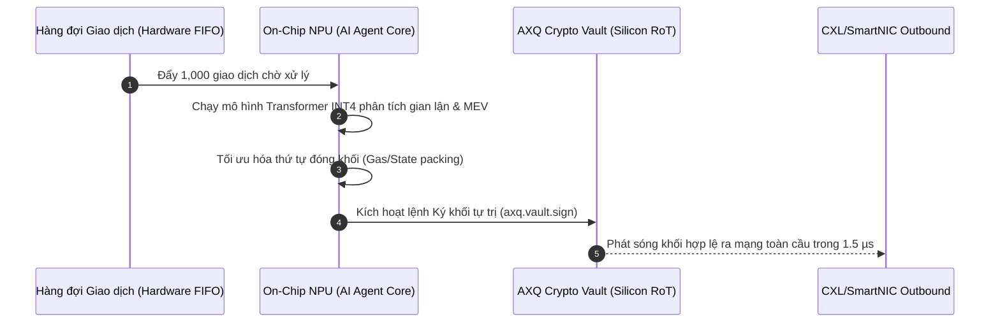

# 🧠 NHÂN VI XỬ LÝ THẦN KINH CHO AI AGENT (ON-CHIP NPU FOR AGENT CHAIN)
### *Embedded Systolic Tensor Processing Unit for Autonomous On-Silicon AI Decision Making*

---

## 1. TỪ SCRIPT AI AGENT ĐẾN SILICON NPU

Trong [`WIKIALISA_CORE_IDEA.md`](../../WIKIALISA_CORE_IDEA.md) (Mục *"Tác nhân AI Agent Chain: Khởi tạo Hash & AXQ Network"*), hệ sinh thái Wikialisa sử dụng một tác nhân AI Agent chạy bằng script phần mềm để thực hiện các công việc:
- Tự động kiểm tra tính toàn vẹn của hệ điều hành và sinh mã băm Genesis Block.
- Khởi tạo ví mạng lưới và điều hướng tham số dòng lệnh.
- Giám sát trạng thái đồng bộ khối của node mạng P2P.

Tuy nhiên, trong một hạ tầng phi tập trung quy mô lớn, một AI Agent chạy bằng script có thể bị giả mạo, can thiệp mã nguồn hoặc bị chậm trễ khi hệ thống máy chủ bị quá tải.

Giải pháp tối tân trong **Kỷ nguyên 4** là tích hợp một **Nhân Xử lý Thần kinh (NPU - Neural Processing Unit)** chuyên dụng trực tiếp lên cùng phiến silicon với nhân CPU AXQ-1. Nhân NPU này cho phép chạy các mô hình ngôn ngữ nhỏ được lượng tử hóa (Quantized Small Language Models - SLM) và mô hình học tăng cường (Reinforcement Learning Agent) ngay trên phần cứng với độ trễ sub-microsecond.

---

## 2. KIẾN TRÚC MẢNG SYSTOLIC NPU (SYSTOLIC ARRAY ARCHITECTURE)

```
                KIẾN TRÚC MẢNG SYSTOLIC NPU AXQ-AI
        Trọng số Mô hình AI (Weights từ On-chip SRAM 4MB)
                       │   │   │   │
                       ▼   ▼   ▼   ▼
              +-------------------------------+
  Đầu vào ──► | PE0,0 | PE0,1 | PE0,2 | PE0,3 |
  Dữ liệu ──► | PE1,0 | PE1,1 | PE1,2 | PE1,3 |  (16x16 Mảng MACs)
  Giao dịch──►| PE2,0 | PE2,1 | PE2,2 | PE2,3 |  - Hỗ trợ INT8, INT4, FP16
  Thời gian──►| PE3,0 | PE3,1 | PE3,2 | PE3,3 |  - Năng suất: 4 TOPS
              +-------------------------------+
                               │
                               ▼
              [ Bộ kích hoạt Phi tuyến tính: ReLU / GELU / Softmax ]
                               │
                               ▼
              [ Quyết định Tự trị của AI Agent (Silicon Decision) ]
```

### Thông số kỹ thuật của NPU:
- **Cấu trúc:** Mảng tính toán Systolic $16 \times 16$ phần tử xử lý (Processing Elements - PEs).
- **Định dạng dữ liệu:** INT8 / INT4 (cho suy luận mô hình ngôn ngữ nén) và FP16 / BF16 (cho tính toán xác suất liên tục).
- **Bộ nhớ đệm trọng số (Weight SRAM):** 4 MB BRAM tốc độ cao on-chip (băng thông 512 GB/s).
- **Hiệu năng suy luận:** **4 TOPS** (Tera-Operations Per Second) với công suất tiêu thụ dưới **1.2 Watts**.

---

## 3. CƠ CHẾ QUYẾT ĐỊNH TỰ TRỊ TRÊN CHIP (AUTONOMOUS HARDWARE AGENT)

Khối NPU được kết nối trực tiếp với thanh ghi trạng thái của nhân CPU thông qua giao tiếp nội bộ zero-copy:



### Các tác vụ được NPU xử lý hoàn toàn tự động:
1. **Phát hiện giao dịch độc hại & MEV Front-Running:** Phân tích đồ thị giao dịch trong mempool ở cấp độ vi giây để ngăn chặn các cuộc tấn công thao túng giá và bảo vệ người dùng mạng AXQ.
2. **Tự động điều chỉnh độ khó Proof-of-Kernel (Dynamic Difficulty Prediction):** Sử dụng mạng nơ-ron hồi quy thời gian thực (RNN) để dự đoán dao động hashrate toàn cầu và điều chỉnh mục tiêu số 0 của PoK một cách mượt mà, triệt tiêu hiện tượng rung giật khối.
3. **Tự hành tái cân bằng định tuyến P2P (Autonomous Mesh Routing):** Đánh giá độ tin cậy và độ trễ của các node lân cận trong mạng lưới để lựa chọn đường truyền tối ưu nhất.

---

## 4. BẢO MẬT VÀ TÍNH ĐỘC LẬP CỦA MÔ HÌNH AI

- Trọng số mô hình (Model Weights) của AI Agent được đóng gói và ký số bằng khóa gốc của Wikialisa Foundation.
- Khi khởi động chip, NPU kiểm tra chữ ký của trọng số trước khi nạp vào SRAM. Bất kỳ sự sửa đổi nào từ bên ngoài đều khiến NPU từ chối kích hoạt, đảm bảo AI Agent luôn tuân thủ nguyên tắc đồng thuận nguyên bản của mạng lưới AXQ.

