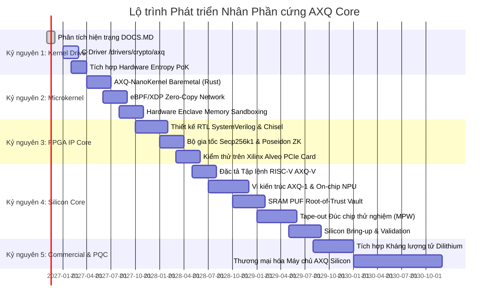

# 📅 LỘ TRÌNH THỰC THI CHI TIẾT THEO THỜI GIAN (MASTER CHRONOLOGICAL ROADMAP)
### *Giai đoạn triển khai từ Hiện trạng Phần mềm đến Thương mại hóa Silicon*

---

## 1. DÒNG THỜI GIAN TỔNG THỂ (TIMELINE OVERVIEW)

---

## 2. KẾ HOẠCH CHI TIẾT THEO TỪNG GIAI ĐOẠN

### Giai đoạn 1 (Năm 2026 - Đầu 2027): Tầng Nhân Linux (`wikialisa/wikialisa`)
- **Mục tiêu:** Di chuyển toàn bộ script `axq-master` trong `WIKIALISA_CORE_IDEA.md` vào không gian nhân.
- **Sản phẩm bàn giao:**
  - Driver `drivers/crypto/axq/` tích hợp trong repository GitHub.
  - Thiết bị ký tự `/dev/axq` và các System Call tùy biến `sys_axq_mine()`.
  - Tối ưu hóa tập lệnh x86 SHA-NI và ARMv8 Crypto Extensions.
  - Đạt thông lượng 1.25 triệu H/s trên máy chủ tiêu chuẩn.

### Giai đoạn 2 (Giữa 2027 - Cuối 2027): Vi nhân Bare-metal & Zero-Copy
- **Mục tiêu:** Tạo ra môi trường chạy độc lập không phụ thuộc vào hệ điều hành cồng kềnh.
- **Sản phẩm bàn giao:**
  - Vi nhân **AXQ-NanoKernel** viết bằng Rust (kích thước < 2MB, boot < 10ms).
  - Tích hợp công nghệ bảo vệ vùng nhớ AMD SEV-SNP / Intel SGX Enclave.
  - Đường truyền mạng siêu tốc eBPF/XDP và AF_XDP socket (độ trễ 1.2 µs).

### Giai đoạn 3 (Cuối 2027 - Giữa 2028): Mạch Bán dẫn trên FPGA
- **Mục tiêu:** Hiện thực hóa các thuật toán bằng mạch logic số trước khi đúc chip.
- **Sản phẩm bàn giao:**
  - Bộ mã nguồn RTL (SystemVerilog & Chisel) cho Hardware PoK Engine 64-stage.
  - Bộ đồng xử lý mật mã Secp256k1 và Poseidon ZK.
  - Tệp bitstream nạp chip cho dòng card **Xilinx Alveo U50 / U250 PCIe**.
  - Đạt tốc độ 300 MH/s trên một card FPGA, giải phóng 100% công suất CPU chủ.

### Giai đoạn 4 (Giữa 2028 - Cuối 2029): Đúc Chip Silicon AXQ-1 (Tape-out)
- **Mục tiêu:** Sản xuất chip vi xử lý tùy biến độc lập hoàn chỉnh.
- **Sản phẩm bàn giao:**
  - Bộ tập lệnh chuẩn hóa **RISC-V AXQ-V ISA**.
  - Nhân vi xử lý 64-bit Out-of-Order superscalar **AXQ-1**.
  - Tích hợp nhân NPU Systolic Array cho AI Agent tự trị trên chip.
  - Tích hợp tế bào SRAM PUF Root-of-Trust (chống trích xuất khóa vật lý).
  - Tham gia chương trình đúc chip thử nghiệm đa dự án (Multi-Project Wafer - MPW) tại TSMC hoặc SkyWater.

### Giai đoạn 5 (Năm 2030+): Sản xuất Hàng loạt & Kháng Lượng tử
- **Mục tiêu:** Thương mại hóa quy mô toàn cầu cho các trung tâm dữ liệu và định chế tài chính.
- **Sản phẩm bàn giao:**
  - Tích hợp chuẩn kháng lượng tử NIST ML-KEM/Kyber và ML-DSA/Dilithium.
  - Máy chủ chuyên dụng **Wikialisa AXQ Server Appliance** trang bị chip silicon AXQ-1.
  - Nghiên cứu nguyên mẫu quang tử (Silicon Photonics) cho mạng lưới 10 triệu TPS.

