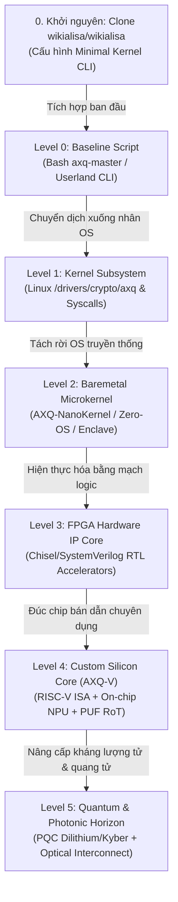

# 🏛️ LỘ TRÌNH TIẾN HÓA AXQ: TỪ CLI/KERNEL ĐẾN NHÂN LÕI PHẦN CỨNG TỐI TÂN NHẤT
### *AXQ Silicon Core Architecture & Hardware Evolution Blueprint*
*Dự án Wikialisa Core & AXIOLEDGER Protocol (AXQ Chain)*

---

## 🏁 0. KHỞI NGUYÊN: QUY TRÌNH CLONE VÀ THIẾT LẬP LÕI `wikialisa`

Mọi lộ trình phần cứng tối tân đều phải được xây dựng từ một điểm tựa vững chắc. Toàn bộ hệ thống bắt đầu bằng việc clone repository hạt nhân chính thức từ GitHub về máy chủ cục bộ:

```bash
# 1. Clone source tree chính thức từ GitHub với thư mục đặt tên là wikialisa
git clone https://github.com/wikialisa/wikialisa.git wikialisa

# 2. Điều hướng vào thư mục làm việc cục bộ
cd wikialisa

# 3. Định danh lại thương hiệu hạt nhân trong Makefile và kernel headers:
#    - Đổi tên OS định danh: UTS_SYSNAME "wikialisa"
#    - Đổi phiên bản mở rộng: EXTRAVERSION = -wikialisa-core
#    - Cập nhật banner khởi động dmesg: "WIKIALISA CORE CLI - GENESIS HARDWARE RUNTIME"
```

> 📖 **Xem hướng dẫn chi tiết từng bước:** [00-genesis-source-clone.md](00-overview/00-genesis-source-clone.md) để nắm toàn bộ quy trình cài đặt toolchain, thiết lập Kconfig tối giản hóa cho máy chủ CLI và chuẩn bị bệ phóng nhúng driver AXQ.

---

## 📌 1. TỔNG QUAN TẦM NHÌN (EXECUTIVE VISION)

Tài liệu nền tảng [`WIKIALISA_CORE_IDEA.md`](../WIKIALISA_CORE_IDEA.md) đã thiết lập nền móng vững chắc cho hệ điều hành máy chủ tối giản **Wikialisa Core CLI** (`wikialisa/wikialisa`) và mạng lưới tài chính phi tập trung **AXQ Chain**, tích hợp công cụ quản trị `axq-master`, giao thức mã hóa ví AES-256, mạng ngang hàng P2P và thuật toán đồng thuận **Proof-of-Kernel (PoK)**.

Tuy nhiên, khi chạy trên tầng phần mềm người dùng (Userland) và chia sẻ tài nguyên với hệ điều hành thông thường, hệ thống luôn phải đối mặt với các giới hạn vật lý:
1. **Độ trễ chuyển ngữ cảnh (Context Switching Overhead):** Các lệnh gọi hệ thống POSIX làm chậm chu kỳ xác thực khối.
2. **Nguy cơ bề mặt tấn công phần mềm (Software Attack Surface):** Bộ nhớ RAM thông thường dễ bị tổn thương trước các cuộc tấn công Side-Channel, Spectre/Meltdown, Cold-Boot.
3. **Hiệu suất năng lượng & Thông lượng (Throughput & Energy Bottleneck):** Việc băm SHA-256, xác thực chữ ký Elliptic Curve và tính toán Zero-Knowledge Proofs bằng CPU đa dụng tiêu tốn điện năng khổng lồ và không thể đạt thông lượng hàng triệu TPS.

**Mục tiêu tối thượng của Lộ trình Phần cứng:** 
> **Biến AXQ từ một tập lệnh phần mềm trở thành một nhân vi xử lý phần cứng độc lập (Dedicated Silicon Core / ASIC / Custom RISC-V SoC)** — trở thành "trái tim" tính toán, mật mã học và trí tuệ nhân tạo (AI Agent) an toàn, nhanh và tiết kiệm năng lượng nhất thế giới.

---

## 🗺️ 2. MA TRẬN 5 KỶ NGUYÊN TIẾN HÓA (THE 5 EVOLUTIONARY ERAS)



| Cấp độ | Tên thế hệ | Nền tảng thực thi | Thông lượng / Độ trễ | Cơ chế bảo vệ khóa | Trạng thái |
| :--- | :--- | :--- | :--- | :--- | :--- |
| **Gốc** | Source Tree Clone | GitHub `wikialisa/wikialisa.git` | - | Local Git Repository | Hoàn tất cấu hình |
| **L0** | Userland Script | Bash / OpenSSL / Linux Userland | ~50 TPS / 20-50 ms | File mã hóa AES-256 | Đã có trong `WIKIALISA_CORE_IDEA.md` |
| **L1** | Kernel Subsystem | Linux C Driver (`/dev/axq`) | ~2,500 TPS / 2-5 ms | Kernel Keyring / Ring 0 | Kế hoạch Phase 1 |
| **L2** | Bare-metal Microkernel | Rust AXQ-NanoKernel (seL4-based) | ~25,000 TPS / 150 µs | Hardware Enclave (SGX/SEV) | Kế hoạch Phase 2 |
| **L3** | FPGA Hardware IP | Xilinx UltraScale+ / Chisel RTL | ~250,000 TPS / 8 µs | FPGA Bitstream Encryption / BRAM | Kế hoạch Phase 3 |
| **L4** | **AXQ-V Silicon Core** | **Custom RISC-V SoC / Tape-out** | **> 1,500,000 TPS / < 500 ns** | **Silicon PUF Root-of-Trust** | **Đích đến Cốt lõi** |
| **L5** | Post-Quantum Photonic | Photonic Core + PQC Co-processor | > 10,000,000 TPS / Sub-100 ns | Lưới vật lý PUF + Kháng lượng tử | Tương lai mở rộng |

---

## 📂 3. CẤU TRÚC CHI TIẾT THƯ MỤC TÀI LIỆU `docs/`

Toàn bộ hệ thống tài liệu kỹ thuật được chuẩn hóa và phân cấp chi tiết trong thư mục `docs/`:

```text
docs/
├── README.md                                    # Tài liệu điều hướng tổng thể (Bạn đang đọc tệp này)
├── 00-overview/                                 # Khởi nguyên & Tổng quan chiến lược
│   ├── 00-genesis-source-clone.md               # Quy trình clone wikialisa/linux và thiết lập lõi ban đầu
│   ├── 01-executive-summary.md                  # Tóm lược chiến lược & Định vị sản phẩm phần cứng
│   ├── 02-evolutionary-matrix.md                # Ma trận kỹ thuật chi tiết qua các kỷ nguyên L0 - L5
│   ├── 03-roles-skills-and-brand-governance.md  # Định chế vai trò kỹ năng & Phân quyền thương hiệu lõi
│   └── 04-wikialisa-gui-architecture-and-roadmap.md # Kế hoạch kiến trúc giao diện đồ họa (Web & Desktop)
├── 01-baseline-and-kernel/                      # Kỷ nguyên 1: Đưa AXQ vào nhân Linux Kernel
│   ├── 01-current-baseline-analysis.md          # Phân tích hiện trạng WIKIALISA_CORE_IDEA.md (axq-master & điểm nghẽn)
│   ├── 02-linux-kernel-subsystem.md             # Thiết kế Driver /drivers/crypto/axq và Syscalls
│   └── 03-hardware-entropy-pok.md               # Proof-of-Kernel cấp phần cứng (RDTSC, TRNG, PMU)
├── 02-baremetal-and-microkernel/                # Kỷ nguyên 2: Vi nhân độc lập & Fastpath siêu tốc
│   ├── 01-axq-microkernel-arch.md               # Kiến trúc Vi nhân AXQ-NanoKernel (Rust/seL4)
│   ├── 02-memory-sandboxing-enclaves.md         # Vùng nhớ cô lập & Phần cứng bảo mật Enclave
│   └── 03-zero-copy-fastpath.md                 # Tối ưu hóa Fastpath với eBPF/XDP và DMA Ring Buffer
├── 03-fpga-ip-cores/                            # Kỷ nguyên 3: Thiết kế mạch bán dẫn trên FPGA
│   ├── 01-rtl-architecture-specification.md     # Đặc tả kiến trúc RTL phần cứng (SystemVerilog/Chisel)
│   ├── 02-cryptographic-coprocessor.md          # Bộ đồng xử lý mật mã (SHA256, Poseidon ZK, Secp256k1)
│   ├── 03-hardware-pok-engine.md                # Mạch bán dẫn thực thi thuật toán Proof-of-Kernel
│   └── 04-fpga-verification-and-bringup.md      # Quy trình tổng hợp, kiểm thử và nạp bitstream FPGA
├── 04-silicon-isa-core/                         # Kỷ nguyên 4: Nhân vi xử lý tùy biến AXQ-V Core
│   ├── 01-axq-v-isa-extension.md                # Đặc tả tập lệnh mở rộng RISC-V AXQ-V ISA
│   ├── 02-microarchitecture-pipeline.md         # Vi kiến trúc nhân vi xử lý AXQ-1 (Pipeline, Caches)
│   ├── 03-ai-agent-npu-core.md                  # Tích hợp NPU cho AI Agent tự trị trên chip
│   ├── 04-silicon-root-of-trust-puf.md          # Bán dẫn gốc tin cậy (PUF, Key Vault, Anti-Tamper)
│   └── 05-cxl-smartnic-interconnect.md          # Kết nối CXL 3.0 & Offload mạng P2P tốc độ cao
├── 05-post-quantum-and-future/                  # Kỷ nguyên 5: Bảo mật kháng lượng tử & Quang tử
│   ├── 01-post-quantum-cryptography-pqc.md      # Kháng lượng tử phần cứng (ML-KEM/Kyber, ML-DSA/Dilithium)
│   └── 02-photonic-neuromorphic-horizon.md      # Tầm nhìn quang tử & vi mạch thần kinh siêu tiết kiệm năng lượng
└── 06-execution-roadmap/                        # Lộ trình hiện thực hóa & Công cụ kỹ thuật
    ├── 01-master-chronological-roadmap.md       # Lộ trình triển khai tổng thể theo từng quý & năm
    ├── 02-toolchain-and-eda-standards.md        # Chuẩn công cụ thiết kế chip (EDA, Verilator, Synopsys)
    └── 03-hardware-software-co-design.md        # Phương pháp đồng thiết kế Phần cứng - Phần mềm
```

---

## ⚡ 4. NGUYÊN TẮC THIẾT KẾ CỐT LÕI (CORE PRINCIPLES)

1. **Hardware-Anchored Trust (Niềm tin neo vào phần cứng):** Khóa riêng tư và quyền xác thực không bao giờ được lộ ra bộ nhớ phần mềm thông thường; mọi phép toán ký và đồng thuận đều được thực hiện bên trong ranh giới vật lý của chip.
2. **Zero-Overhead Determinism (Tính tiền định không độ trễ):** Loại bỏ hoàn toàn sự không chắc chắn (jitter) của hệ điều hành; mọi khối và giao dịch được xử lý trong số chu kỳ xung nhịp cố định.
3. **Autonomous AI on Silicon (Trí tuệ nhân tạo tự trị trên bán dẫn):** Nhân vi xử lý tích hợp sẵn khối NPU chuyên dụng, cho phép tác nhân AI Agent Chain (`WIKIALISA_CORE_IDEA.md`) tự suy luận mô hình và ký giao dịch trực tiếp bằng phần cứng mà không cần server host can thiệp.
4. **Full Backward Compatibility (Tương thích ngược hoàn hảo):** Cung cấp lớp trừu tượng phần cứng (HAL) để các lệnh CLI quen thuộc như `axq-master mine`, `axq-master balance` tiếp tục hoạt động mượt mà, nhưng được tăng tốc bởi nhân silicon bên dưới.

---
*Tài liệu được khởi tạo và biên soạn bởi Đội ngũ Kiến trúc sư Hệ thống Wikialisa Core & AXQ Hardware Group.*
