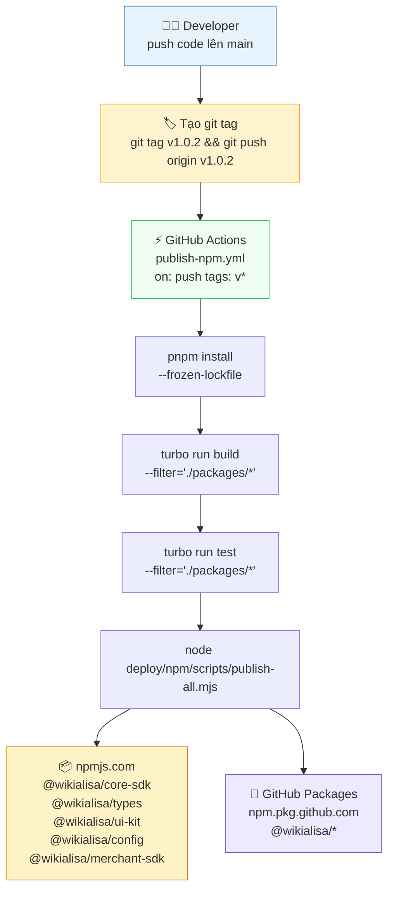
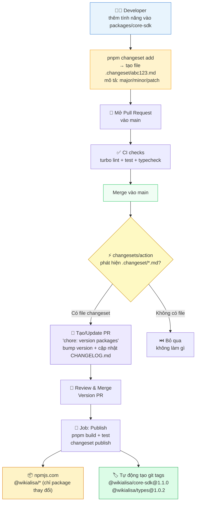
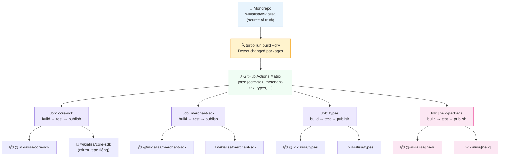

# Chiến Lược Đẩy Thư Viện Lên Tổ Chức `wikialisa`

> Ba mẫu sơ đồ CI/CD từ đơn giản → phức tạp, thiết kế để **mở rộng dễ dàng** khi monorepo lớn dần.

---

## Mẫu 1 — Tag-Triggered Publish (Hiện tại đang dùng)

> **Khi nào dùng:** Team nhỏ, release thủ công, ít packages.  
> **Mở rộng:** Thêm package mới chỉ cần khai báo vào `deploy/npm/scripts/publish-all.mjs`.



### Cấu trúc thư mục mở rộng

```
packages/
├── core-sdk/          ← đã publish
├── merchant-sdk/      ← đã publish
├── types/             ← đã publish
├── config/            ← đã publish
├── ui-kit/            ← đã publish
├── swift-adapter/     ← thêm vào publish-all.mjs khi sẵn sàng
└── [package-mới]/     ← khai báo 1 dòng là xong
```

**Thêm package mới** — chỉ cần thêm 1 dòng vào [`deploy/npm/scripts/publish-all.mjs`](../deploy/npm/scripts/publish-all.mjs):

```js
const PUBLISHABLE = [
  "packages/core-sdk",
  "packages/merchant-sdk",
  "packages/swift-adapter",   // ← thêm vào đây
  // ...
];
```

---

## Mẫu 2 — Changeset Release Flow (Khuyến nghị — Scalable)

> **Khi nào dùng:** Nhiều contributor, cần changelog tự động, version độc lập cho từng package.  
> **Mở rộng:** Mỗi package tự quản version; GitHub Actions tự tạo PR "Version Packages" và publish.



### Workflow file — `.github/workflows/changeset-release.yml`

Đã có sẵn trong repo. Secrets cần thiết:

| Secret | Nơi set | Mô tả |
|---|---|---|
| `NPM_TOKEN` | `github.com/orgs/wikialisa/settings/secrets` | npmjs.com access token |
| `GITHUB_TOKEN` | Tự động có | Tạo PR + push tags |

**Thêm package mới** — không cần config gì thêm. Package nào có `"private": false` trong `package.json` sẽ tự được publish khi có changeset.

---

## Mẫu 3 — Matrix Publish với Per-Package Repo (Độc lập hoàn toàn)

> **Khi nào dùng:** Mỗi package có vòng đời, team owner, và CI riêng. Scale lên 20+ packages.  
> **Mở rộng:** Thêm package = thêm repo riêng vào org `wikialisa`, tự động detect qua matrix.



### Workflow matrix — thêm package mới chỉ thêm 1 dòng

```yaml
# .github/workflows/publish-matrix.yml
jobs:
  publish:
    strategy:
      matrix:
        package:
          - { dir: packages/core-sdk,     name: "@wikialisa/core-sdk" }
          - { dir: packages/merchant-sdk,  name: "@wikialisa/merchant-sdk" }
          - { dir: packages/types,         name: "@wikialisa/types" }
          - { dir: packages/config,        name: "@wikialisa/config" }
          - { dir: packages/ui-kit,        name: "@wikialisa/ui-kit" }
          # ↓ Thêm package mới tại đây
          - { dir: packages/swift-adapter, name: "@wikialisa/swift-adapter" }
    steps:
      - name: Publish ${{ matrix.package.name }}
        run: npm publish ${{ matrix.package.dir }} --access public
```

---

## So sánh 3 mẫu

| Tiêu chí | Mẫu 1 (Tag) | Mẫu 2 (Changeset) | Mẫu 3 (Matrix) |
|---|:---:|:---:|:---:|
| Độ phức tạp setup | ⭐ Thấp | ⭐⭐ Trung bình | ⭐⭐⭐ Cao |
| Tự động changelog | ❌ | ✅ | ✅ (tùy cấu hình) |
| Version độc lập từng package | ❌ Cùng tag | ✅ | ✅ |
| Phù hợp khi | < 5 packages | 5–20 packages | 20+ packages |
| CI time | Nhanh | Trung bình | Song song, nhanh nhất |
| Thêm package mới | Sửa 1 file | Không cần sửa | Thêm 1 dòng matrix |
| **Trạng thái** | ✅ Đang dùng | 🔧 Đã có workflow | 📋 Kế hoạch |

---

## Lộ trình đề xuất

```
Hiện tại          → 3 tháng           → 6 tháng+
Mẫu 1 (Tag)       → Mẫu 2 (Changeset) → Mẫu 3 (Matrix)
manual release       auto changelog       per-package CI
5 packages           5–10 packages        10–20+ packages
```

> **Hành động tiếp theo:**  
> 1. Chạy `pnpm changeset add` sau mỗi PR có thay đổi package  
> 2. Set secret `NPM_TOKEN` tại `github.com/orgs/wikialisa/settings/secrets/actions`  
> 3. Workflow `changeset-release.yml` sẽ tự xử lý phần còn lại
